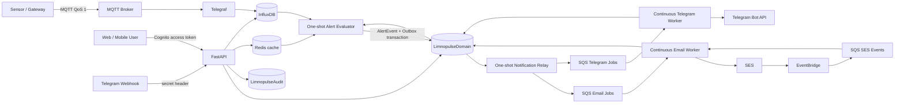

# Limnopulse Architecture

**Version:** 1.4
**Updated:** 2026-08-25

Limnopulse is the successor to the AquaFarm prototype. AquaFarm names in historical material describe the predecessor only; all active resources, topics, buckets, code, and new documentation use the Limnopulse name.

## V4 architecture baseline

- [Current-state inventory](current-state.md)
- [Platform redesign technical specification V4](superpowers/specs/2026-08-16-limnopulse-platform-redesign-tech-spec-v4.md)
- [V4 parallel execution design](superpowers/specs/2026-08-25-limnopulse-v4-parallel-execution-design.md)

## Delivery status

| Slice | Status | Delivered boundary |
|---|---|---|
| Phase 1 | Current | FastAPI, Cognito/dev authentication, tenant membership authorization, tenants, ponds, devices, DynamoDB, Redis cache-aside |
| Phase 2A | Current | authorized InfluxDB telemetry reads |
| Phase 2B/2C | Current local scaffold | MQTT, Telegraf, local registry enrichment, InfluxDB writes |
| Phase 2D | Current scaffold | OpenTofu for DynamoDB, Cognito and base cloud resources |
| Phase 3A | Current | Alert Rule configuration, optimistic updates, replacement idempotency, transactional audit, TTL |
| Phase 3B | Current | one-shot Go evaluator, 64-bucket due index, InfluxDB windows, durable Alert Events and notification outboxes |
| Phase 3C-A | Current | one-shot outbox relay, SQS email jobs, continuous SES worker/feedback, durable deliveries and attempts |
| Phase 3C-B | Current | FastAPI Telegram binding/webhook, isolated queue/worker, durable snapshots/attempts, Redis rate limit |

“Current” means implemented in this repository. “Target” is architectural direction and must not be interpreted as a deployed capability.

## System view



All shown edges are present repository responsibilities or local/cloud
scaffolds. Cloud container orchestration and webhook registration remain
environment-specific deployment work.

## Canonical names

### MQTT

```text
limnopulse/v1/devices/{device_id}/readings
limnopulse/v1/devices/{device_id}/health
```

Devices publish their identity and sensor readings. Tenant and pond ownership are resolved by trusted registry enrichment; tenant IDs, credentials, and tokens do not belong in device payloads or topic names.

### InfluxDB

| Bucket | Purpose | Status |
|---|---|---|
| `limnopulse_raw` | authorized raw water-quality readings | current |
| `limnopulse_1h` | long-retention hourly aggregates | target |
| `limnopulse_events` | lightweight operational time-series events | target |

The `water_quality` measurement uses `tenant_id`, `pond_id`, `device_id`, `source`, and `schema_version` tags. Sensor values remain fields.

### DynamoDB

```text
LimnopulseDomain
LimnopulseAudit
```

Both tables use string `PK` and `SK`, on-demand billing, encryption, point-in-time recovery in cloud infrastructure, and TTL on the numeric `expires_at` attribute. DynamoDB TTL deletion is eventual, so application logic treats expired records as expired before physical deletion.

Core `LimnopulseDomain` keys:

| Entity | PK | SK |
|---|---|---|
| Tenant | `TENANT#<tenant_id>` | `META` |
| Pond | `TENANT#<tenant_id>` | `POND#<pond_id>` |
| Device | `TENANT#<tenant_id>` | `DEVICE#<device_id>` |
| Device lookup | `DEVICE#<device_id>` | `META` |
| Membership | `USER#<cognito_sub>` | `TENANT#<tenant_id>` |
| Tenant member | `TENANT#<tenant_id>` | `MEMBER#<cognito_sub>` |
| Alert Rule | `TENANT#<tenant_id>` | `ALERT_RULE#<rule_id>` |
| Alert Rule replacement replay | `TENANT#<tenant_id>` | `IDEMPOTENCY#ALERT_RULE_REPLACE#<sha256>` |
| Alert Event | `TENANT#<tenant_id>` | `ALERT_EVENT#<event_id>` |
| Notification Outbox | `TENANT#<tenant_id>` | `NOTIFICATION_OUTBOX#<outbox_id>` |
| Notification Delivery | `NOTIFICATION_OUTBOX#<outbox_id>` | `DELIVERY#<delivery_id>` |
| Notification Attempt | `NOTIFICATION_DELIVERY#<delivery_id>` | `ATTEMPT#<attempt_id>` |
| Email suppression | `EMAIL_IDENTITY#<sha256(normalized_email)>` | `DELIVERABILITY` |
| Telegram binding | `TENANT#<tenant_id>` | `TELEGRAM_BINDING#USER#<recipient_id>` |
| Telegram binding request | `TENANT#<tenant_id>` | `TELEGRAM_BINDING_REQUEST#USER#<recipient_id>` |
| Telegram binding token | `TELEGRAM_BINDING_TOKEN#<sha256(token)>` | `META` |
| Telegram destination | `TELEGRAM_DESTINATION#<sha256(chat_id)>` | `META` |
| Telegram update dedupe | `TELEGRAM_UPDATE#<update_id>` | `META` |

Critical list paths use `Query` or known-key reads. Application code does not use DynamoDB `Scan`.

Audit keys:

```text
PK = TENANT#<tenant_id>#MONTH#YYYY-MM
SK = <UTC timestamp>#<audit event id>
```

Audit records retain actor, action, resource, before/after SHA-256 hashes, IP, user agent, creation time, and 90-day expiry. They never store JWTs, credentials, or mutation payloads.

## M1 v2 domain foundation (behind disabled rollout flags)

The M1 Site, Asset, Device, Component, Capability, IntegrationAccount, DeviceIntegration and temporal Deployment model is implemented behind disabled rollout flags; it is not deployed capability. `API_V2_ENABLED` (default `false`) mounts the M1 `/v2` route groups; `V1_POND_DEVICE_PROJECTION_ENABLED` (default `false`) makes `/v1` Pond/Device writes dual-write to v2 records with lazy provisioning, while `/v1` reads stay on the legacy `POND#`/`DEVICE#` rows; with it on, a `/v1` device create or patch without a `pond_id` returns `409`. The flags are independent; `API_V2_ENABLED` leaves `/v1` paths, dependencies and responses unchanged. Rollout and rollback follow the M1-08 runbook; rollback sets both flags to `false` and restarts without deleting data.

With `API_V2_ENABLED=true` the API mounts only these tenant-scoped groups, each guarded by tenant membership authorization:

```text
/v2/tenants/{tenant_id}/sites[/{site_id}]
/v2/tenants/{tenant_id}/assets[/{asset_id}]
/v2/tenants/{tenant_id}/devices[/{device_id}]
/v2/tenants/{tenant_id}/devices/{device_id}/components
/v2/tenants/{tenant_id}/devices/{device_id}/integrations
/v2/tenants/{tenant_id}/components/{component_id}[/capabilities]
/v2/tenants/{tenant_id}/integration-accounts
/v2/tenants/{tenant_id}/deployments[/{deployment_id}/end]
```

Telemetry/observations, health/calibration, billing, AWS IoT, notification destinations and commands are not part of M1. `/v2` validation errors never fail on non-finite JSON numbers, and integration validation errors never echo rejected input.

The four M1 repositories reuse the API's single DynamoDB client and `LimnopulseDomain`; M1 adds no table, GSI, queue, service or key attribute. M1 `LimnopulseDomain` keys:

| Entity | PK | SK |
|---|---|---|
| Site | `TENANT#<tenant_id>` | `SITE#<site_id>` |
| Asset | `TENANT#<tenant_id>` | `ASSET#<asset_id>` |
| Pond profile | `ASSET#<asset_id>` | `PROFILE#POND` |
| Device v2 | `TENANT#<tenant_id>` | `DEVICE#<device_id>` |
| Device lookup | `DEVICE#<device_id>` | `META` |
| Component mirror | `TENANT#<tenant_id>` | `COMPONENT#<component_id>` |
| Component | `COMPONENT#<component_id>` | `META` |
| Capability | `COMPONENT#<component_id>` | `CAPABILITY#<capability_id>` |
| Integration account | `TENANT#<tenant_id>` | `INTEGRATION_ACCOUNT#<integration_account_id>` |
| Device integration | `TENANT#<tenant_id>` | `DEVICE_INTEGRATION#<device_integration_id>` |
| External-id lookup | `EXTERNAL_ID#<provider_key>#<sha256(provider_key + "\0" + external_identity)>` | `META` |
| Deployment mirror | `TENANT#<tenant_id>` | `DEPLOYMENT#<deployment_id>` |
| Deployment history | `COMPONENT#<component_id>` | `DEPLOYMENT#<started_at>#<deployment_id>` |
| Current deployment | `COMPONENT#<component_id>` | `DEPLOYMENT#CURRENT` |
| Deployment marker | `COMPONENT#<component_id>` | `DEPLOYMENT#MARKER` |
| v2 idempotency receipt | `TENANT#<tenant_id>` | `IDEMPOTENCY#<scope>#<sha256(key)>` |

`<started_at>` in deployment history SKs is the canonical UTC key (`canonical_timestamp_key`, `YYYY-MM-DDTHH:MM:SS.ffffffZ` with fixed six-digit microseconds), so lexicographic order is chronological. Idempotency receipts carry the numeric `expires_at` TTL (24 hours); no other M1 record expires.

## P2 canonical telemetry (behind disabled rollout switches)

P2 introduces transport-independent metric observations, stored as InfluxDB `observation_numeric` points in the existing `INFLUXDB_BUCKET_RAW` bucket (D6), next to the unchanged legacy `water_quality` measurement. It ships dark (D16): every switch defaults off, and with all of them off the running application behaves like `main@2918532`.

| Switch | Default | Effect |
|---|---|---|
| `TELEMETRY_V2_WRITE_ENABLED` | `false` | Write `observation_numeric` points. |
| `TELEMETRY_LEGACY_DUAL_WRITE_ENABLED` | `false` | Write eligible legacy `water_quality` points from the normalizer path (D7/D8). |
| `API_V2_TELEMETRY_ENABLED` | `false` | Mount the three `/v2` telemetry routes; valid only with `API_V2_ENABLED=true` (settings validation error otherwise). |
| `V1_TELEMETRY_READ_SOURCE` | `legacy` | `legacy` or `v2` implementation behind the `/v1` `TelemetryRepository` (D10). |
| `ALERT_EVALUATOR_TELEMETRY_SOURCE` | `legacy` | Go alert evaluator `WindowReader` selection (D12). |

Composition (API lifespan): the single `InfluxDBClient` provides one query API shared by the `/v1` telemetry repository (`app.state.telemetry_repository`, now chosen by `V1_TELEMETRY_READ_SOURCE`) and the observation reader (`app.state.observation_reader`). A synchronous write API, and the one `InfluxObservationWriter` that serves both write targets (`app.state.observation_writer`), exist only when a write switch is on; otherwise `app.state.observation_writer` is `None` and no write API is created. `app.state.observation_write_service` applies the two independent write switches, v2 first and then legacy; any failure raises `TelemetryWriteError` and nothing is reported as written (D9).

With `API_V2_ENABLED=true` alone `/v2` mounts only the 13 M1 paths (D11). Adding `API_V2_TELEMETRY_ENABLED=true` mounts exactly these three read routes, each requiring tenant membership with a read role:

```text
GET /v2/tenants/{tenant_id}/metric-definitions
GET /v2/tenants/{tenant_id}/observations
GET /v2/tenants/{tenant_id}/observations/latest
```

`/v1` paths, schemas and the OpenAPI golden stay identical in every switch combination.

**D16 — ships dark.** No deployed service calls the telemetry pipeline in P2, and Telegraf keeps writing only `water_quality`. The only producer is the dev CLI `scripts/dev/ingest_reading_v2.py`, which builds the trusted `legacy_mqtt` source context from its arguments (never from the payload), uses the DynamoDB-backed M1 repositories and the configured InfluxDB, and honors the two write switches (both off is a dry run). `V1_TELEMETRY_READ_SOURCE=v2` and `ALERT_EVALUATOR_TELEMETRY_SOURCE=v2` may be enabled only where a producer writes every legacy device to `observation_numeric` and the keyed divergence check reports zero missing or different `(pond, device, metric, _time, value)` tuples over max(longest rule window, legacy read window). In production the owner flips them only through the P3 runbook's [D16 owner gate](p3-ingestion-rollout-runbook.md#d16-owner-gate): legacy devices are HTTPS only (#104).

**Rollback:** switch the flags back to their defaults and recreate the services that read them (`docker compose up -d <service>`; `docker compose restart` keeps the old environment). No data deletion; legacy `water_quality` writes and reads never depend on a P2 switch.

## V4 P3 ingestion wiring (behind a disabled rollout switch)

P3 composes the generic HTTPS ingress and the telemetry ingest worker. It ships dark (D16): `INGEST_V2_ENABLED` defaults off, and with every switch off the running application behaves like `main` before P3. Settings reject `INGEST_V2_ENABLED=true` unless `API_V2_ENABLED=true`, `TELEMETRY_V2_WRITE_ENABLED=true` and `SQS_TELEMETRY_INGRESS_QUEUE_URL` is non-empty.

Composition (API lifespan, only when `INGEST_V2_ENABLED`): one boto3 SQS client (`sqs_client_kwargs`, mirroring the DynamoDB kwargs) backs `SqsIngressQueue` as `app.state.ingress_queue_producer`; the shared DynamoDB client backs the ingest-credential repository and the integration-lifecycle repository (both with the audit table for the D23 audit items), the connector authenticator, the receipts repository and `TrustedMappingService`. The three in-process token buckets (process-global pre-auth keyed `"*"`, per-credential pre-auth, per-account), `AllowDirectIngressEntitlements` and `StructuredLogTelemetryMetrics` complete the frozen `app.state` names of `api/ingestion_dependencies.py`, which are also part of the lifespan's pre-wired guard. OpenAPI generation creates no client.

Routes (D15): `INGEST_V2_ENABLED` mounts `POST /ingest/v2/observations` (not tenant-scoped; the ingest credential is its only authority) and 5 owner/admin tenant routes: issue, list and revoke ingest credentials, and the IntegrationAccount and DeviceIntegration status transitions. `API_V2_ENABLED` alone keeps the 53 M1 tenant routes; with ingest on there are 58, and 61 with `API_V2_TELEMETRY_ENABLED` too. `/v1` and its OpenAPI golden are identical in every combination.

Worker (D7; ADR-020): `python -m limnopulse_api.workers.telemetry_ingest` runs from the API image as the `telemetry-ingest-worker` compose service in profile `ingestion` (both compose files; `docker compose --profile ingestion` starts it, and since ADR-020 every production deploy passes the profile). `build_worker(settings)` composes the DynamoDB and SQS clients (finite botocore timeouts; the SQS read timeout outlasts the long poll), a synchronous InfluxDB write API, the P2 normalizer, pipeline and write service, the P3 repositories, `IngestMessageProcessor` and `IngestWorkerLoop`; it never calls `create_app`, so no optional cache client exists. `main()` exits 78 (a configuration error) unless `TELEMETRY_V2_WRITE_ENABLED=true` and the queue URL is set, so the worker can never delete a message it did not write, and SIGTERM/SIGINT set the loop's stop for a bounded drain; it exits 0 only after that stop and 1 on a crash or a stall. The loop marks a liveness stamp every turn, a watchdog thread exits 1 when the marks stop for the stall threshold (the worst message lifetime, 111 s at the defaults), and the `healthcheck` subcommand answers from the stamp alone. In production the service restarts `unless-stopped`, its entrypoint guard parks the container on exit 78 instead of letting Docker restart it, and InfluxDB is published on host loopback (`127.0.0.1:8086`) only. In production it runs as the dedicated `telemetry_ingest` IAM user, from `TELEMETRY_INGEST_AWS_ACCESS_KEY_ID` / `TELEMETRY_INGEST_AWS_SECRET_ACCESS_KEY` and its own InfluxDB write token, and never loads the API's env file or keys.

**Rollback:** set `INGEST_V2_ENABLED=false` and recreate the API (`docker compose ... up -d api`; `docker compose restart` keeps the old environment), then stop the `ingestion` profile, in the rollback order of `docs/p3-ingestion-rollout-runbook.md` (P3-11). Queued messages are kept in the queue and the DLQ.

## Authentication and tenant authorization

The access token authenticates a user; it does not grant tenant access by itself. Every tenant route resolves an active DynamoDB membership and then enforces the required role.

```text
JWT or local dev identity
  -> active tenant membership
  -> role check
  -> tenant-scoped repository access
```

Owner and admin roles may mutate Alert Rules. Member and viewer roles may list them.

## Phase 3A: Alert Rule configuration

Alert Rule identity consists of tenant, pond, optional device, and metric. These fields cannot be patched. Mutable fields are name, operator, threshold, aggregation, window, duration, severity, channels, cooldown, and enabled state.

Supported metric values:

```text
temp_c
ph
do_mg_l
turbidity_ntu
salinity_ppt
battery_v
rssi
```

Rules support `<`, `<=`, `>`, and `>=`; `min`, `max`, `mean`, and `last`; warning/critical severity; and email/Telegram channel declarations. Channel declarations are configuration only in Phase 3A.

Windows and durations use compact values from 60 seconds through 24 hours, such as `60s`, `5m`, and `24h`. Cooldown is 60 through 86,400 seconds.

Changing semantic identity uses the replace endpoint. One DynamoDB transaction disables and versions the old rule, links both records, creates the replacement, records audit, and stores a 24-hour replay result. The same `Idempotency-Key` and payload returns that result; a different payload with the same key returns `409`.

The domain table exposes three sparse GSIs: `AlertEvaluationByDue` for 64
versioned evaluation buckets, `AlertEventsByTenantTime` for incident reads, and
`NotificationRelayByAvailableAt` for 64 versioned notification relay buckets.
Both one-shot processes discover work with paginated `Query`; they never Scan.

## Phase 3B: evaluation

The one-shot Go evaluator:

1. read active rules from `LimnopulseDomain`;
2. query bounded InfluxDB windows;
3. apply aggregation/operator thresholds;
4. use Redis only for cooldown and short deduplication;
5. atomically creates Alert Events, transitions and NotificationOutboxes;
6. exits and leaves scheduling to an external 60-second scheduler.

One AlertEvent represents one continuous episode. Opening requires `duration`;
recovery occurs on the first complete, sufficiently covered, fresh and valid
clean window. No-data or query failure never resolves an incident. Phase 3B does
not publish SQS and does not change the Phase 3A API identity or replacement
contract.

## Phase 3C-A: email delivery

The one-shot relay expands an email outbox into deterministic immutable
deliveries, publishes compact SQS jobs, and conditionally records publication.
The continuous worker uses fenced DynamoDB leases and attempt transactions,
rechecks membership/suppression, rate limits SES calls, retries typed transient
failures and reconciles SES feedback routed by EventBridge. Duplicate jobs are
safe; DynamoDB, not SQS or Redis, owns identity and state.

Opening and recovery are separate deliveries. A recovery delivery depends on a
succeeded opening delivery and is cancelled when the opening was not sent.
Hard bounce and complaint feedback create a hashed suppression record without a
plain address. The normalized address and rendered content remain durable only
on the Delivery snapshot; Attempt rows and telemetry do not duplicate them.

The worker does not consume any DLQ automatically, and the EventBridge routing
DLQ is not a worker input. Phase 3C-A exposes no public Delivery/Attempt API.

## Phase 3C-B: Telegram binding and delivery

FastAPI exposes a Cognito-exempt `POST /webhooks/telegram` whose Telegram secret
header is checked before the bounded body. A separate one-time token establishes
a durable verified binding; authenticated preference updates retain active
tenant membership and optimistic locking. The webhook never enables delivery.

The relay expands Telegram schema-v2 outboxes into immutable plain-text
Deliveries and sends compact, chat-ID-free jobs to a dedicated queue. The
Telegram worker rechecks membership, preference, binding, destination and Alert
Event state, transactionally fences each Attempt, uses Redis only for atomic
global/destination rate limiting, and calls Bot API `sendMessage` without parse
mode or link preview. Definite destination failures suppress the destination;
unconfirmed sends become terminal `unknown` without automatic resend.

Deferred Telegram outboxes are migrated through explicit-tenant paginated
`Query` with `notifications backfill-telegram`; no Scan is used. Email remains
schema v1 and keeps its prior identity, queue, SES and feedback semantics.
WhatsApp, SMS and mobile push remain later commercial/product decisions.

## Security boundaries

- InfluxDB, Redis, and DynamoDB are service-side resources; clients do not connect directly.
- Redis is cache/ephemeral coordination, never source of truth or durable queue.
- Production MQTT requires TLS/mTLS, per-device credentials, and topic ACLs.
- Tenant/pond/device target mismatches return `404` to avoid cross-tenant disclosure.
- Conditional writes and expected versions prevent silent lost updates.
- Notification jobs and SES events are at-least-once; deterministic identities,
  leases, fencing and transactions make duplicate processing safe.
- SES feedback associations trust only provider message ID plus exact
  `delivery_id`/`attempt_id` tags; provider destination arrays are discarded.
- Secrets, raw tokens, and idempotency keys are excluded from domain/audit records.
- Telegram webhook secret, binding token and Cognito token have disjoint trust
  boundaries; only the binding-token digest is stored.
- Private Telegram chat IDs and rendered text remain only on durable Delivery
  snapshots and never enter jobs, logs or metrics.
- IAM, network exposure, real remote state, and secret management require environment-specific hardening before production deployment.
