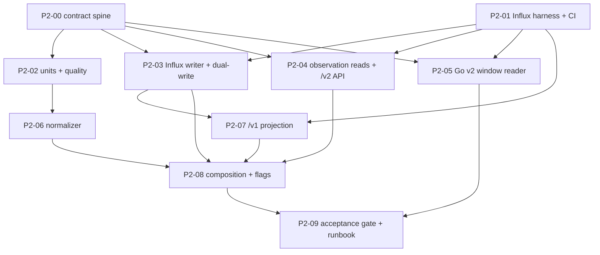

# LimnoPulse V4 Phase 2 — Canonical Telemetry and Dual Schema Implementation Plan

> **For agentic workers:** Execute one task per worktree/session. Every task is test-first: write the failing tests, audit them for usefulness, and only then implement. Steps use checkbox (`- [ ]`) syntax for tracking.

**Goal:** Introduce transport-independent metric observations, the InfluxDB `observation_numeric` schema, controlled dual writes and a `/v1` read projection with proven equivalence. Track event, receive and ingest time separately. Never let a device payload carry tenant, site, asset or deployment authority.

**Architecture:** A short serial contract spine freezes the catalog, envelope, Influx schema, line protocol and repository protocols with executable fixtures. Two Wave 0 tasks run in parallel: the spine and a real-InfluxDB integration harness. Independent vertical slices follow: units and quality, the writer, reads/API and the Go evaluator. Then come the normalizer and the `/v1` projection, one composition owner, and a release gate. Every dependency boundary is a merge to `main`.

**Tech Stack:** Python 3.12+, FastAPI, Pydantic v2, `influxdb-client` 1.50 (already locked), pytest/pytest-asyncio, uv; Go 1.26 from `go.mod` with `influxdb-client-go/v2` v2.14.0 and `google/uuid` v1.6.0 (already required); InfluxDB 2.7.11 for integration tests; GitHub Actions.

**Spec:** `docs/superpowers/specs/2026-08-16-limnopulse-platform-redesign-tech-spec-v4.md` (§§7.2, 7.3, 8, 10, 16, 19.2, 20.7, 23.2, 24 Phase 2, 25) and `docs/superpowers/specs/2026-08-25-limnopulse-v4-parallel-execution-design.md`. ADR gates: ADR-005, ADR-006, ADR-007.

**Epic:** #22 (roadmap #14). **Planning baseline:** `main@2918532` (M1 complete; `make verify-python` 2120 passed / 8 skipped, `go test -race ./...` green).

## Global Constraints

- Every worktree starts from `origin/main` only after all blocking task PRs are merged. Branch names are `agent/v4-p2-<nn>-<short-name>`. One executable issue maps to one worktree, one session and one PR.
- Preserve every `/v1` path, request, response, status code, role gate and the byte-identical `tests/contracts/openapi/v1.json` golden. The legacy `water_quality` measurement, Telegraf path and `InfluxTelemetryRepository` keep working unchanged.
- Every new behavior ships behind a default-off switch (see **Rollout switches**). With all P2 switches off, the running application is behaviorally identical to `main@2918532`.
- The client and the device never supply authoritative tenant, site, asset or deployment ownership. `tenant_id` comes from the authenticated path/membership boundary or from trusted integration context, never from a telemetry payload.
- No DynamoDB `Scan`, no new GSI, no new DynamoDB table. Deployment at event time uses the M1 `DeploymentRepository.get_deployment_at` bounded Component-history query.
- M1 protocols in `repositories/v2_contracts.py` are frozen by `tests/unit/test_v2_repository_protocols.py`. P2 adds new protocols in `repositories/telemetry_v2.py` and never edits M1 protocol signatures.
- The M1 acceptance gate forbids `redis`, `aws_iot`, `thing_name`, `certificate_arn` and `shadow_name` (case-insensitive substrings) in every `domain/*.py` and `api/v2/**` file. P2 domain/API code uses opaque `ProviderKey` strings and the `SourceType` transport classes below; it never names AWS IoT or Redis.
- Redis/Valkey is not used by P2 for correctness, deduplication or identity.
- No new runtime or dev dependency, and no lockfile change (`uv lock --check` and `go.mod` stay unchanged). `testdata/telemetry_v2/` holds the cross-language vectors.
- Test basenames are unique repository-wide: `tests/` has no `__init__.py`, so pytest imports test modules by basename. Shared test helpers live under `tests/support/` and are imported as `tests.support.<module>`.
- Integration tests that need a real InfluxDB live in `tests/influx/` (Python) or are named `TestInfluxIntegration*` (Go). They skip unless `RUN_INFLUX_INTEGRATION=1`. Default `make verify-python` and `make verify-go` never need InfluxDB.
- Sonar runs only the default (non-integration) suites. New production code must therefore reach ≥80% line coverage from unit tests alone; integration tests prove semantics, not coverage.
- Go files under `cmd/alert-evaluator` and `internal/alertevaluator` must not contain the substrings `.Scan(`, `dynamodb.ScanInput`, `service/sqs`, `service/ses`, `api.telegram.org`, `telegram-bot-api` (`tests/unit/test_phase3b_boundaries.py`, test files included). Parse Influx results with the client's own iterator or `encoding/csv` `Read`, never `bufio.Scanner`.
- Issue `#6` (presence-aware `Evaluation.Value`) stays canonical and out of P2 scope. The P2 Go reader reports values only through the existing `WindowResult` and never relies on zero meaning "no data".
- Every PR records the exact commands and observed results: the failing-test run, the passing run, `make verify-python`, `make verify-go`, `git diff --check`, `uv run --locked --extra dev python scripts/dev/export_v1_openapi.py --check`, and `make verify-influx` when the task adds integration tests.

## Entry Decisions (frozen by this plan)

Epic #22 requires the metric/unit and dual-write contracts to be frozen before decomposition. These decisions are the approved answers. Changing one requires amending this plan before the dependent task starts.

| # | Decision | Answer |
|---|---|---|
| D1 | Metric catalog | One global, versioned catalog `metric-catalog@1` with exactly the seven legacy metrics below. P2 accepts no tenant-defined metric keys. |
| D2 | Unit mapping | Versioned `unit-mapping@1` with explicit per-metric source units. An unknown unit is quarantined, never guessed. |
| D3 | Written quality states | The P2 normalizer writes only `valid`, `suspect` or `out_of_range` as the point `quality_state` tag. `uncalibrated`, `calibration_unknown` and `impossible_jump` are reserved point states for P6 (no calibration records or rate limits exist yet). `stale` and `missing` are read/evaluation states and are never written. `duplicate` and `delayed` are flags, not point states, so timeliness never changes a point's series identity or excludes a correct value from quality-gated alerts. |
| D4 | Quality determinism | Classification is a pure function of the envelope (`observed_at`, `received_at`, value, replay marker) and the pinned versions. It never reads wall-clock time, so a replay of the same envelope reproduces the same tags. |
| D5 | Canonical identity | One point per `(tenant_id, component_id, metric_key, observed_at)`. A later write with the same identity overwrites fields in place (last-writer-wins); this is the deduplication mechanism. No per-observation DynamoDB receipt is written. |
| D6 | Bucket | `observation_numeric` lives in the existing `INFLUXDB_BUCKET_RAW` bucket. No per-tenant or per-plan bucket. Retention durations remain an operational decision recorded in the runbook. |
| D7 | Legacy dual-write eligibility | Dual-write only when the observation's Component is the deterministic default Component of its Device (`default_component_id_for_legacy_device(tenant_id, device_id)`), the resolved Asset carries a `PondProfile.legacy_pond_id`, and the metric has a `legacy_field`. Native v2 probes never appear in `water_quality`. |
| D8 | Legacy series identity | Dual-written legacy points use the Telegraf series identity: measurement `water_quality`, tags `tenant_id`, `pond_id`, `device_id`, `source`, `schema_version="1"`, and time floored to the whole second (Telegraf `precision="1s"`). `source` is `mqtt` for `SourceType.LEGACY_MQTT`, otherwise the `SourceType` value. A reading written by both Telegraf and the normalizer therefore stays one legacy point. |
| D9 | Write switches | `TELEMETRY_V2_WRITE_ENABLED` and `TELEMETRY_LEGACY_DUAL_WRITE_ENABLED` are independent and default `false`. The write path writes v2 first, then legacy. Any failure raises `TelemetryWriteError` and nothing is reported as written, so the caller retries; idempotent identity makes the retry safe. |
| D10 | `/v1` projection | `V1_TELEMETRY_READ_SOURCE=legacy\|v2` (default `legacy`) swaps the implementation behind the existing `TelemetryRepository` protocol. The v2-backed projection reads only the seven legacy metrics of the Asset for the legacy pond, includes every quality state (legacy has no quality), floors time to the whole second, and returns the four `/v1` shapes byte-identically for samples whose observation times are distinct whole seconds per device. |
| D11 | `/v2` telemetry API | `API_V2_TELEMETRY_ENABLED` (default `false`, valid only together with `API_V2_ENABLED=true`) mounts exactly `GET metric-definitions`, `GET observations` and `GET observations/latest`. `API_V2_ENABLED` alone still mounts only the 13 M1 paths. |
| D12 | Alert evaluator | `ALERT_EVALUATOR_TELEMETRY_SOURCE=legacy\|v2` (default `legacy`). With `v2`, `/v1` rules (pond, optional device, legacy metric) read `observation_numeric` through a new `WindowReader`. That reader maps the pond to `asset_id_for_legacy_pond`, the metric to `metric_key`, and requires `quality_state == "valid"` (V4 §16.3 default policy). Coverage, staleness and aggregation stay in the unchanged Go `EvaluateSamples`. Alert events keep legacy metric names. |
| D13 | Trusted mapping in P2 | P2 has no public ingress. The normalizer receives a `TrustedSourceContext` (tenant, device, optional integration, source type, receive time) built by trusted code: tests, the P2 dev CLI, and later the P3 worker. External-identity-to-DeviceIntegration resolution, queues, DLQ persistence and connector health are P3. P2 returns quarantine outcomes for P3 to persist. |
| D14 | Measurement capability | P2 does not require `ProbeProfile.measurement_metric_keys` to list a metric (legacy default Components carry none). Capability-gated acceptance belongs to P3 trusted mapping and P6. |
| D15 | Out-of-range values | An out-of-range value is written (to v2 and, when eligible, to legacy) with `quality_state=out_of_range` and provenance `plausible_range`. Legacy reads still show it, as today. v2 quality-gated alert reads exclude it. This divergence from legacy alert behavior is intentional and documented in the runbook. |

## Execution Graph and Merge Gates



| Wave | Tasks allowed in parallel | Start condition |
|---:|---|---|
| 0 | P2-00, P2-01 | This plan merged and the GitHub graph accepted |
| 1 | P2-02, P2-03, P2-04, P2-05 | P2-00 and P2-01 merged and green |
| 2 | P2-06, P2-07 | P2-02 (for P2-06) and P2-03 (for P2-07) merged and green |
| 3 | P2-08 only | P2-03, P2-04, P2-06, P2-07 merged and green |
| 4 | P2-09 only | P2-05 and P2-08 merged and green |

P2-02 does not need the InfluxDB harness and may start as soon as P2-00 merges. P2-07 depends on the P2-03 writer so that its equivalence fixtures use the production write path. P2-05 depends only on the spine's vectors and the harness, so it can merge any time before P2-09.

## Locked Cross-Task Contracts

### Versions and limits

```python
TELEMETRY_SCHEMA_VERSION = 2
METRIC_CATALOG_VERSION = "metric-catalog@1"
UNIT_MAPPING_VERSION = "unit-mapping@1"
QUALITY_POLICY_VERSION = "quality-policy@1"
MAX_OBSERVATIONS_PER_BATCH = 1000
MAX_QUALITY_JSON_FIELD_BYTES = 512
MAX_QUARANTINE_EXCERPT_BYTES = 2048
SOURCE_METADATA_ALLOWLIST = frozenset({"firmware_version"})  # values ≤ 64 chars, never tagged
```

### Metric catalog `metric-catalog@1`

Metric keys match M1 `CAPABILITY_KEY_PATTERN`. `legacy_field` values are exactly the values of `domain/alerts.py::AlertMetric` and of Go `allowedMetrics`. The plausible range is inclusive.

| metric_key | canonical_unit | value_type | plausible range | legacy_field | legacy Influx field type |
|---|---|---|---|---|---|
| `water.temperature` | `degC` | float | [-5, 60] | `temp_c` | float |
| `water.ph` | `pH` | float | [0, 14] | `ph` | float |
| `water.dissolved_oxygen` | `mg/L` | float | [0, 50] | `do_mg_l` | float |
| `water.turbidity` | `NTU` | float | [0, 4000] | `turbidity_ntu` | float |
| `water.salinity` | `ppt` | float | [0, 70] | `salinity_ppt` | float |
| `device.battery_voltage` | `V` | float | [0, 60] | `battery_v` | float |
| `device.rssi` | `dBm` | integer | [-150, 0] | `rssi` | integer |

The legacy `seq` field is not a metric. It maps to `observation.sequence` (integer ≥ 0) and back to the legacy integer field `seq`.

### Unit mapping `unit-mapping@1`

Unit codes are case-sensitive. A source unit outside this table is quarantined with `unit_unsupported`. Identity conversions return the input value unchanged (bit-for-bit); non-identity conversions are compared with `math.isclose(rel_tol=1e-12, abs_tol=1e-12)`.

| metric_key | accepted source unit → canonical |
|---|---|
| `water.temperature` | `degC` → x; `degF` → (x − 32) × 5 / 9; `K` → x − 273.15 |
| `water.ph` | `pH` → x |
| `water.dissolved_oxygen` | `mg/L` → x; `ppm` → x; `ug/L` → x / 1000 |
| `water.turbidity` | `NTU` → x |
| `water.salinity` | `ppt` → x; `g/kg` → x |
| `device.battery_voltage` | `V` → x; `mV` → x / 1000 |
| `device.rssi` | `dBm` → x (must be integral after conversion, else `value_invalid`) |

Booleans, strings, NaN and ±Infinity are `value_invalid`. Percent-saturation dissolved oxygen is intentionally unsupported: converting it needs temperature and salinity.

### Quality policy `quality-policy@1`

`delay = received_at − observed_at`. The thresholds are versioned constants:

| Condition | Effect | Provenance entry |
|---|---|---|
| always | — | `schema_validation`, `unit_mapping` (first two entries, in this order) |
| canonical value < min or > max | state `out_of_range` | `plausible_range` |
| `observed_at − received_at > 300 s` | state `suspect`, flag `clock_skew_future` | `clock_skew` |
| `delay > 30 days` | state `suspect`, flag `clock_skew_past_extreme` | `clock_skew` |
| `delay > 300 s` | flag `delayed` (state unchanged) | `timeliness` |
| `TrustedSourceContext.replay` | flag `replay` (state unchanged) | `replay` |

- Precedence: `out_of_range` > `suspect` > `valid`.
- Flags are unique and sorted by value. Provenance entries are unique, in table order.
- `delivery.delayed` is true exactly when the `delayed` flag is present; `delivery.replay` is true exactly when the `replay` flag is present.
- `confidence` is always `null` in P2.

### Enumerations (`domain/telemetry_v2.py`)

```python
class MetricValueType(StrEnum): FLOAT = "float"; INTEGER = "integer"

class SourceType(StrEnum):            # transport class; provider identity stays an opaque ProviderKey
    LEGACY_MQTT = "legacy_mqtt"       # local Mosquitto/Telegraf compatibility payloads
    HTTPS = "https"
    MQTT = "mqtt"
    VENDOR_WEBHOOK = "vendor_webhook"
    VENDOR_POLL = "vendor_poll"
    EDGE = "edge"

class QualityState(StrEnum):          # V4 §10.5, all ten values
    VALID = "valid"; SUSPECT = "suspect"; STALE = "stale"; OUT_OF_RANGE = "out_of_range"
    UNCALIBRATED = "uncalibrated"; CALIBRATION_UNKNOWN = "calibration_unknown"
    DUPLICATE = "duplicate"; DELAYED = "delayed"; IMPOSSIBLE_JUMP = "impossible_jump"; MISSING = "missing"

POINT_QUALITY_STATES = frozenset({VALID, SUSPECT, OUT_OF_RANGE, IMPOSSIBLE_JUMP, UNCALIBRATED, CALIBRATION_UNKNOWN})
P2_WRITTEN_QUALITY_STATES = frozenset({VALID, SUSPECT, OUT_OF_RANGE})

class QualityFlag(StrEnum):
    DELAYED = "delayed"; CLOCK_SKEW_FUTURE = "clock_skew_future"
    CLOCK_SKEW_PAST_EXTREME = "clock_skew_past_extreme"; REPLAY = "replay"
    DUPLICATE = "duplicate"; SEQUENCE_GAP = "sequence_gap"; SEQUENCE_REGRESSION = "sequence_regression"  # reserved

class QuarantineReason(StrEnum):
    METRIC_UNKNOWN = "metric_unknown"; UNIT_UNSUPPORTED = "unit_unsupported"
    VALUE_INVALID = "value_invalid"; OBSERVED_AT_INVALID = "observed_at_invalid"
    COMPONENT_NOT_OWNED = "component_not_owned"; COMPONENT_NOT_MEASURING = "component_not_measuring"
    DEPLOYMENT_UNRESOLVED = "deployment_unresolved"
```

These values are frozen by a P2-00 test, in the same way as `test_frozen_enum_values`.

### Models (`domain/telemetry_v2.py`)

All models are frozen Pydantic v2 models with `extra="forbid"`. Every datetime must be timezone-aware and is normalized to UTC; a naive datetime is rejected. IDs use the M1 validators: `SafeId` for tenant, `DeviceId` for device, canonical prefixes `site`, `ast`, `cmp`, `prb`, `dep`, `di`, `obs`.

```text
MetricDefinition      metric_key, display_name, canonical_unit, value_type, plausible_min, plausible_max,
                      legacy_field | None
TrustedSourceContext  tenant_id, device_id, integration_id (di_) | None, integration_type: ProviderKey,
                      source_type: SourceType, connector_version (≤64) | None, received_at, replay=False
SourceObservation     component_id (cmp_), metric_key (≤64), value: StrictInt | StrictFloat, source_unit (1–16),
                      observed_at, sequence ≥ 0 | None, source_event_id (1–128 printable) | None,
                      source_metadata: dict[str, str] keys ⊆ SOURCE_METADATA_ALLOWLIST
                      — has NO tenant/site/asset/deployment/device field; extra fields are rejected
CanonicalObservation  schema_version: Literal[2], event_id (obs_), source_event_id | None,
                      source{integration_id, integration_type, source_type, connector_version, received_at},
                      resolved{tenant_id, site_id, asset_id, deployment_id, device_id, component_id, probe_id | None},
                      observation{metric_key, value: finite float, value_type, source_unit, canonical_unit,
                                  observed_at, sequence | None},
                      delivery{ingested_at, delayed, replay},
                      quality{state ∈ POINT_QUALITY_STATES, flags (sorted unique), confidence: None, provenance (non-empty)},
                      mapping{catalog_version, unit_mapping_version, quality_policy_version},
                      source_metadata
                      validators: event_id == observation_event_id(...); delivery flags mirror quality flags
QuarantinedObservation reason, tenant_id, device_id, component_id | None, metric_key | None, observed_at | None,
                      received_at, source_event_id | None, detail (≤256), source_excerpt_json (≤2048 bytes), truncated
StoredObservation     observed_at, received_at, ingested_at, metric_key, value, canonical_unit, site_id, asset_id,
                      device_id, component_id, probe_id | None, deployment_id, quality_state, quality_flags,
                      sequence | None, source_type
NormalizationResult   accepted: tuple[CanonicalObservation, ...], quarantined: tuple[QuarantinedObservation, ...]
```

### Canonical identity

```python
def observation_event_id(tenant_id: str, component_id: str, metric_key: str, observed_at: datetime) -> str:
    discriminator = (
        f"limnopulse/v4/observation/{tenant_id}/{component_id}/{metric_key}/"
        f"{format_utc_timestamp(observed_at)}"
    )
    return f"obs_{uuid5(NAMESPACE_URL, discriminator).hex}"
```

Mapping versions, quality, `received_at`, `ingested_at` and `source_event_id` are deliberately excluded from the identity. A replay under a later catalog version therefore keeps the same identity (ADR-005).

### InfluxDB `observation_numeric` schema and canonical line protocol

- Measurement: `observation_numeric`. Bucket: `INFLUXDB_BUCKET_RAW`. `_time` = `observed_at` in nanoseconds, computed as integer microseconds × 1000 from the UTC datetime (never via a float `timestamp()`).
- Tags, the closed allowlist, in sorted key order: `asset_id`, `component_id`, `deployment_id`, `device_id`, `metric_key`, `probe_id` (only when present), `quality_state`, `schema_version` (`"2"`), `site_id`, `source_type`, `tenant_id`.
- Fields, in sorted key order: `catalog_version` (string), `delay_ms` (integer, may be negative), `event_id` (string), `ingested_at_ns` (integer), `integration_id` (string, only when present), `quality_flags_json` (string, compact sorted JSON array, ≤ 512 bytes), `quality_policy_version` (string), `quality_provenance_json` (string, compact JSON array, ≤ 512 bytes), `received_at_ns` (integer), `sequence` (integer, only when present), `source_event_id` (string, only when present), `source_unit` (string), `unit_mapping_version` (string), `value` (float, always float, even for integer metrics).
- Formatting:
  - a float uses `repr(float(v))` (`25.0`, `4.82`, `1e-05`); an integer uses `<n>i`.
  - string field values escape `\` and `"`; tag keys/values and the measurement escape `,`, `=` and space per Influx line protocol.
  - one point per line, with no trailing newline in the encoder output.
- Cardinality guard (`validate_observation_tags`):
  - rejects any tag key outside the allowlist and any missing required tag;
  - IDs must match their validators;
  - `metric_key` must be in the catalog, `source_type` a `SourceType`, `quality_state` a point state, and `schema_version == "2"`;
  - event IDs, `source_event_id`, firmware, integration IDs and metadata are never tags.

### Legacy `water_quality` dual-write point

```text
water_quality,device_id=<d>,pond_id=<p>,schema_version=1,source=<mqtt|source_type>,tenant_id=<t> <fields> <floor(observed_at, 1s) in ns>
```

- `LegacyPoint` is a frozen dataclass with `tenant_id`, `pond_id`, `device_id`, `source` and `observed_at`, plus `fields: Mapping[str, float | int]` keyed by legacy field name or `seq`.
- The six float metrics are written as floats. `rssi` and `seq` are written as integers (`-67i`, `1i`), matching the Telegraf schema to avoid field-type conflicts.
- Fields are written in sorted key order.
- Eligible observations that share `(tenant, pond, device, floored second)` are grouped into one line. When grouped values conflict, the observation with the latest `observed_at` wins, then the higher `sequence`; `seq` is the winning observation's sequence.

### Repository protocols (`repositories/telemetry_v2.py`)

```python
@runtime_checkable
class ObservationWriter(Protocol):
    async def write_observations(self, observations: Sequence[CanonicalObservation]) -> None: ...

@runtime_checkable
class LegacyObservationWriter(Protocol):
    async def write_legacy_points(self, points: Sequence[LegacyPoint]) -> None: ...

@dataclass(frozen=True)
class ObservationSelector:
    kind: Literal["asset", "component", "device"]
    entity_id: str  # validated: ast_/cmp_ canonical, device via require_device_id

@runtime_checkable
class ObservationReader(Protocol):
    async def query_observations(
        self, *, tenant_id: str, selector: ObservationSelector,
        metric_keys: frozenset[str] | None, quality_states: frozenset[QualityState] | None,
        start: datetime, stop: datetime, limit: int,
    ) -> list[StoredObservation]: ...

    async def query_latest_observations(
        self, *, tenant_id: str, selector: ObservationSelector,
        metric_keys: frozenset[str] | None, lookback: timedelta,
    ) -> list[StoredObservation]: ...
```

A P2-00 test freezes the method names, parameter names/kinds and annotations, like `test_v2_repository_protocols.py`.

`core/errors.py` gains `TelemetryWriteError(LimnopulseError)` with a keyword-only `retryable: bool` attribute.

### Cross-language vectors (`testdata/telemetry_v2/contract_vectors.json`)

`scripts/dev/export_telemetry_v2_vectors.py [--check]` generates the file deterministically from the Python contract; `--check` exits 1 on drift. It contains:

- versions;
- measurement names, tag keys and field keys;
- the catalog rows;
- deterministic ID vectors: `asset_id_for_legacy_pond` and `default_component_id_for_legacy_device` for at least five inputs each, including `tnt_local_001`/`pond_local_001`/`local-device-001`;
- `observation_event_id` vectors.

It also contains named scenarios. Each scenario holds its canonical observations as JSON, the exact expected `observation_numeric` lines and the exact expected `water_quality` lines:

- `legacy_sample`: `examples/telemetry/reading.local.json` for `local-device-001` in `tnt_local_001`/`pond_local_001`. Seven v2 lines and one legacy line.
- `two_probes_same_metric`: two probe Components of one native v2 Device, both `water.dissolved_oxygen`, at the same `observed_at`. Two v2 lines and no legacy line.
- `out_of_range`: a legacy default Component with `water.dissolved_oxygen = 75.0`, state `out_of_range`. One v2 line and one legacy line.
- `delayed_replay`: flags `delayed` and `replay`.
- `relocation`: one legacy default Component, before and after a West→East move, with distinct deployment and asset IDs.
- `unit_converted`: source `degF`, canonical `degC`.

Go and Python tests seed real InfluxDB from these lines. Evaluator parity is therefore measured on bytes the production encoder emits.

### Rollout switches

| Setting / env | Default | Owner | Effect |
|---|---|---|---|
| `TELEMETRY_V2_WRITE_ENABLED` | `false` | P2-08 | Write `observation_numeric` points. |
| `TELEMETRY_LEGACY_DUAL_WRITE_ENABLED` | `false` | P2-08 | Write eligible `water_quality` points from the normalizer path. |
| `API_V2_TELEMETRY_ENABLED` | `false` | P2-08 | Mount the three `/v2` telemetry routes; requires `API_V2_ENABLED=true` (validation error otherwise). |
| `V1_TELEMETRY_READ_SOURCE` | `legacy` | P2-08 | `legacy` or `v2` implementation behind the `/v1` `TelemetryRepository`. |
| `ALERT_EVALUATOR_TELEMETRY_SOURCE` | `legacy` | P2-05 | Go `WindowReader` selection (`legacy` or `v2`); also `--telemetry-source`. |

App-state names created by P2-08: `app.state.observation_writer`, `app.state.observation_reader`, `app.state.observation_write_service`. `app.state.telemetry_repository` keeps its name and becomes the projection-selected implementation. Every new name is added to the lifespan skip-list so tests can inject fakes.

### InfluxDB integration harness contract (P2-01)

- Env: `RUN_INFLUX_INTEGRATION=1`, plus `INFLUX_INTEGRATION_URL` (default `http://127.0.0.1:8086`), `INFLUX_INTEGRATION_TOKEN` (default `local-dev-token`) and `INFLUX_INTEGRATION_ORG` (default `limnopulse`).
- Python: `tests/support/influx_harness.py` provides the fixture factory `influx_bucket` (a unique bucket per test, deleted afterwards) and `influx_clients(bucket)`, which yields a `query_api`/`write_api` pair bound to it.
- Go: integration tests create and delete their own bucket through `influxdb2.Client.BucketsAPI()` using the same env names.
- `scripts/dev/run_local_influxd.sh` runs InfluxDB 2.7.11 without Docker. It downloads `influxdb2-2.7.11_linux_amd64.tar.gz`, checks SHA-256 `8d7872013cad3524fb728ca8483d0adc30125ad1af262ab826dcf5d1801159cf` and unpacks into `${XDG_CACHE_HOME:-$HOME/.cache}/limnopulse/influxd`. It starts on a loopback port and runs idempotent setup with the default org and token. It is for local and session use only.
- CI:
  - `.github/workflows/verify.yml` gains job `influx`, running `make verify-influx` against a service container `influxdb:2.7.11-alpine` initialized with the defaults above.
  - `make verify-influx` runs `uv sync --locked --extra dev`, then `RUN_INFLUX_INTEGRATION=1 uv run --locked --no-sync python -m pytest -q tests/influx`, then `RUN_INFLUX_INTEGRATION=1 go test -race -run 'TestInfluxIntegration' ./...`.
  - The aggregate `make verify` is unchanged.

### `/v2` telemetry API (P2-04, mounted by P2-08)

```text
GET /v2/tenants/{tenant_id}/metric-definitions
GET /v2/tenants/{tenant_id}/observations
GET /v2/tenants/{tenant_id}/observations/latest
```

- **Roles and errors**: `READ_ROLES`. 403 `tenant access denied` comes before any lookup. 503 on `TelemetryQueryError`. Every request model has `extra="forbid"`.
- **`metric-definitions`** returns `{"items": [...]}` in catalog order. Each item carries `metric_key`, `display_name`, `canonical_unit`, `value_type`, `plausible_min`, `plausible_max`, `legacy_field` and `catalog_version`.
- **`observations`** query parameters:
  - exactly one of `asset_id`, `component_id` or `device_id`, otherwise 422;
  - `metric_key` (repeatable, every value in the catalog, otherwise 422);
  - `quality_state` (repeatable, point states only);
  - `start` and `stop`, both timezone-aware ISO-8601. They default to `stop = now` and `start = stop − 1 h`. `stop` must be after `start`, and the range is at most 31 days, otherwise 422;
  - `limit` from 1 to 1000, default 500.
  - The selector entity must exist in the tenant (M1 readers), otherwise 404 with no Influx call.
  - Results are ordered by `observed_at`, `component_id`, `metric_key` ascending, and the limit is applied after the global sort.
- **`observations/latest`** takes the same selector and optional `metric_key`, with a 24 h lookback. It returns one item per `(component_id, metric_key)`, ordered by `component_id`, `metric_key`.
- **Item fields**: `observed_at`, `received_at`, `ingested_at`, `metric_key`, `value`, `unit`, `site_id`, `asset_id`, `device_id`, `component_id`, `probe_id`, `deployment_id`, `quality` `{state, flags}`, `sequence`, `source_type`. `integration_id`, `source_event_id` and metadata are not exposed.

### `/v1` projection semantics (P2-07)

`V2ProjectedTelemetryRepository(query_api, org, bucket, domain_repository)` implements the existing `TelemetryRepository` protocol over `observation_numeric`:

- **Filters**: `tenant_id`, `asset_id = asset_id_for_legacy_pond(tenant_id, pond_id)` (for the tenant-wide method, the set derived from `domain_repository.list_ponds(tenant_id)`), and `metric_key` limited to the seven catalog metrics. Every quality state is included. `_time` is floored to the second. Metric keys and `sequence` map back to legacy field names and `seq`.
- **Rows** keep the legacy row keys: readings use `(_time, tenant_id, pond_id, device_id)`. Latest per pond has no device in the row key. Latest per tenant keeps the newest row per `pond_id` within 24 h, sorted by pond.
- **Summary** keeps the legacy period/interval table, the `do_mg_l`, `ph` and `temp_c` series and statistics, and wraps errors in `TelemetryQueryError`. The other methods propagate errors exactly as the legacy adapter does.
- **Equivalence**: for the same samples dual-written by P2-03, each of the four methods returns objects equal to `InfluxTelemetryRepository`'s. The four `/v1` HTTP responses are byte-identical. Samples have distinct whole-second times per device.

### Go evaluator v2 reader (P2-05)

```text
from(bucket: <b>)
  |> range(start: time(v: <Start>), stop: time(v: <End>))
  |> filter(fn: (r) => r["_measurement"] == "observation_numeric")
  |> filter(fn: (r) => r["tenant_id"] == <tenant>)
  |> filter(fn: (r) => r["asset_id"] == <assetIDForLegacyPond(tenant, pond)>)
  [|> filter(fn: (r) => r["device_id"] == <device>)]
  |> filter(fn: (r) => r["metric_key"] == <metricKeyForLegacyMetric(metric)>)
  |> filter(fn: (r) => r["quality_state"] == "valid")
  |> filter(fn: (r) => r["_field"] == "value" or r["_field"] == "sequence")
  |> pivot(rowKey: ["_time", "device_id", "component_id"], columnKey: ["_field"], valueColumn: "_value")
  |> keep(columns: ["_time", "device_id", "component_id", "value", "sequence"])
  |> sort(columns: ["_time", "device_id", "component_id"])
```

- Every literal goes through the existing `fluxString`.
- Rows become `alertevaluator.Sample{Time, DeviceID, Value, Seq}` and flow through the unchanged `EvaluateSamples`.
- `assetIDForLegacyPond` uses `uuid.NewSHA1(uuid.NameSpaceURL, []byte("limnopulse/v4/legacy-pond/"+tenant+"/"+pond))` and returns `"ast_" + hex without dashes`. It must equal the Python vectors.
- Parity means identical `WindowResult` values for the legacy reader on `water_quality` and the v2 reader on `observation_numeric`, seeded from the same scenario lines.
- Two probes of the same metric on one device are deduplicated per `(device, bucket)` by the existing rule (latest time, then higher `Seq`, then the deterministic sort order). This is documented as the `/v1`-rule semantics.

## File Ownership Map

| Task | Exclusive responsibility | Restriction |
|---|---|---|
| P2-00 | `domain/telemetry_v2.py`, `domain/metric_catalog.py`, `domain/telemetry_v2_schema.py`, `repositories/telemetry_v2.py`, `TelemetryWriteError` in `core/errors.py`, `testdata/telemetry_v2/`, `scripts/dev/export_telemetry_v2_vectors.py` | No adapters, services, routers, settings or Go code |
| P2-01 | `tests/support/influx_harness.py`, `tests/influx/test_influx_harness_smoke.py`, `scripts/dev/run_local_influxd.sh`, `Makefile` (`verify-influx` only), `.github/workflows/verify.yml` (`influx` job only), `tests/unit/test_ci_contract.py`, `docs/verification.md` | No runtime code |
| P2-02 | `domain/telemetry_units.py`, `domain/telemetry_quality.py` | Pure functions only; no I/O |
| P2-03 | `adapters/influxdb_v2_writer.py`, `services/telemetry_v2_writes.py` | No settings, `main.py` or `/v1` files |
| P2-04 | `adapters/influxdb_v2_reader.py`, `services/telemetry_v2.py`, `api/v2/routers/observations.py`, `api/v2/routers/metric_definitions.py`, `api/v2/schemas/observations.py`, `api/v2/schemas/metric_definitions.py`, `api/v2/telemetry_dependencies.py` | Routers unmounted; no edit to `api/v2/router.py`, `api/v2/dependencies.py` or `main.py` |
| P2-05 | `internal/alertevaluator/influx/{query_v2,client_v2,legacy_ids}.go` and their tests, `internal/alertevaluator/config.go`, `config_test.go`, `cmd/alert-evaluator/main.go` | No Python; no change to `EvaluateSamples` or `state_machine.go` |
| P2-06 | `services/telemetry_normalizer.py`, `domain/legacy_telemetry_mapping.py` | No Influx I/O |
| P2-07 | `adapters/influxdb_v1_projection.py` | No change to `/v1` routers, services, schemas or `adapters/influxdb.py` |
| P2-08 | `core/config.py`, `main.py`, `api/router.py`, `api/v2/router.py`, `services/telemetry_pipeline.py`, `scripts/dev/ingest_reading_v2.py`, `.env.example`, `README.md`, `docs/architecture.md` (new section only), `tests/api/test_v2_composition.py`, `tests/api/test_app_runtime.py` | Integration hotspot owner; no feature logic |
| P2-09 | `tests/contracts/test_p2_acceptance_gate.py`, `tests/influx/test_p2_acceptance_influx.py`, `docs/p2-telemetry-rollout-runbook.md`, README link | No production feature code |

Each task also owns the new test files named in its section.

---

### Task 1: P2-00 — Freeze the canonical telemetry contract spine

**Branch:** `agent/v4-p2-00-telemetry-contract-spine` · **Blocked by:** this plan merged · **Blocks:** P2-02 through P2-09

**Files:**
- Create: `src/limnopulse_api/domain/telemetry_v2.py`, `src/limnopulse_api/domain/metric_catalog.py`, `src/limnopulse_api/domain/telemetry_v2_schema.py`, `src/limnopulse_api/repositories/telemetry_v2.py`, `scripts/dev/export_telemetry_v2_vectors.py`, `testdata/telemetry_v2/contract_vectors.json`
- Modify: `src/limnopulse_api/core/errors.py` (add `TelemetryWriteError`)
- Test: `tests/unit/test_telemetry_v2_contracts.py`, `tests/unit/test_metric_catalog.py`, `tests/unit/test_telemetry_v2_schema.py`, `tests/unit/test_telemetry_v2_protocols.py`, `tests/unit/test_telemetry_v2_vectors.py`

**Interfaces:** Consumes the M1 `ids.py` validators and deterministic legacy IDs, plus `v2_common.SafeId`, `DeviceId`, `ProviderKey` and `format_utc_timestamp`. Produces every type, constant, encoder, guard, protocol and vector in **Locked Cross-Task Contracts**.

- [ ] **Step 1: Write failing contract tests.**
  - enum values frozen;
  - catalog equals the table, `{m.legacy_field} == {v.value for v in AlertMetric}`, keys match `CAPABILITY_KEY_PATTERN`;
  - models reject naive datetimes, extra fields, NaN/Infinity, booleans as values, bad ID prefixes and non-allowlisted metadata;
  - `SourceObservation` has no `tenant_id`/`site_id`/`asset_id`/`deployment_id`/`device_id` field;
  - `CanonicalObservation` rejects a mismatched `event_id` and inconsistent delivery/flag mirrors;
  - `observation_event_id` is stable and excludes versions, quality and times other than `observed_at`.
- [ ] **Step 2: Write failing schema tests.**
  - `encode_observation_line` output equals each scenario's golden lines byte-for-byte: sorted tags/fields, escaping, `repr` floats, integer suffixes, integer-nanosecond time;
  - optional `probe_id`, `integration_id`, `sequence` and `source_event_id` are omitted when absent;
  - JSON fields over 512 bytes are rejected;
  - the guard rejects unknown tag keys, missing tags, invalid IDs, unknown metrics, `stale`/`missing`/`delayed`/`duplicate` as states, and any attempt to tag an event ID or metadata;
  - `encode_legacy_line` floors time to the second, writes `rssi`/`seq` as integers and sets `source`/`schema_version` per D8.
- [ ] **Step 3: Write failing protocol and vector tests.**
  - protocol method sets, signatures and annotations are frozen;
  - `export_telemetry_v2_vectors.py --check` passes on the committed file and fails on a mutated copy (use a temp path);
  - ID vectors equal `ids.py` outputs.
- [ ] **Step 4: Run** `uv run --locked --extra dev pytest -q tests/unit/test_telemetry_v2_contracts.py tests/unit/test_metric_catalog.py tests/unit/test_telemetry_v2_schema.py tests/unit/test_telemetry_v2_protocols.py tests/unit/test_telemetry_v2_vectors.py`. **Expected:** FAIL (modules missing). Commit the tests alone: `test(p2-00): ...`.
- [ ] **Step 5: Audit the tests** (see **Execution Protocol**), fix the findings, then implement the modules, generate the vectors and make the tests pass.
- [ ] **Step 6: Run the shared gates.** `make verify-python`, `make verify-go`, `git diff --check`, `uv run --locked --extra dev python scripts/dev/export_v1_openapi.py --check`. `tests/contracts/test_m1_acceptance_gate.py` must still pass; it scans the new domain files for forbidden words.

**Acceptance criteria:**
- [ ] Every Locked Contract name, value and signature exists exactly as written, frozen by tests.
- [ ] The golden lines are byte-stable and regenerated only by the export script.
- [ ] No adapter, service, router, setting or Go file changes.
- [ ] `/v1` golden unchanged; no forbidden words in domain files.

**Rollback:** Revert the commit. Nothing consumes the spine at runtime.

---

### Task 2: P2-01 — Real-InfluxDB integration harness and CI gate

**Branch:** `agent/v4-p2-01-influx-integration-harness` · **Blocked by:** this plan merged · **Blocks:** P2-03, P2-04, P2-05, P2-07, P2-09

**Files:**
- Create: `tests/support/influx_harness.py`, `tests/influx/test_influx_harness_smoke.py`, `scripts/dev/run_local_influxd.sh`
- Modify: `Makefile` (add `verify-influx`; keep `verify` unchanged), `.github/workflows/verify.yml` (add job `influx`), `tests/unit/test_ci_contract.py`, `docs/verification.md`
- Test: `tests/unit/test_influx_harness_contract.py`

**Interfaces:** Produces the harness contract above. Consumes nothing from P2-00.

- [ ] **Step 1: Write failing tests.**
  - `test_ci_contract.py` expects the jobs `{python, go, opentofu, compose, frontend, influx}`, the exact `verify-influx` recipe via `make -n`, a SHA-pinned action set, no `secrets.`, and the service image `influxdb:2.7.11-alpine`;
  - `test_influx_harness_contract.py` asserts the env names and defaults, that the fixture skips without `RUN_INFLUX_INTEGRATION=1`, that `run_local_influxd.sh` pins version 2.7.11 and the SHA-256 and binds loopback only, and that `docs/verification.md` documents the job and the local script;
  - the smoke test writes one point into an isolated bucket, reads it back with Flux, and asserts the bucket is deleted at teardown.
- [ ] **Step 2: Run the failing tests** and commit them alone.
- [ ] **Step 3: Audit, then implement** the harness, script, Make target, CI job and docs.
- [ ] **Step 4: Prove it.** Run `scripts/dev/run_local_influxd.sh` and then `make verify-influx` locally; record the output. Push and confirm the CI `influx` job is green.
- [ ] **Step 5: Run the shared gates.**

**Acceptance criteria:**
- [ ] `make verify-influx` is green locally (no Docker needed) and in CI.
- [ ] Default suites skip `tests/influx` cleanly.
- [ ] Bucket isolation and cleanup are proven.
- [ ] No credentials are needed: the dev token exists only in the local service container.

**Rollback:** Remove the job and target. No runtime effect.

---

### Task 3: P2-02 — Unit conversion and deterministic quality classification

**Branch:** `agent/v4-p2-02-units-quality` · **Blocked by:** P2-00 · **Blocks:** P2-06

**Files:**
- Create: `src/limnopulse_api/domain/telemetry_units.py`, `src/limnopulse_api/domain/telemetry_quality.py`
- Test: `tests/unit/test_telemetry_units.py`, `tests/unit/test_telemetry_quality.py`

**Interfaces:** Produces two functions:
- `convert_to_canonical(metric: MetricDefinition, value: int | float, source_unit: str, *, unit_mapping_version: str = UNIT_MAPPING_VERSION) -> float`, which raises `UnitConversionError(reason: QuarantineReason, detail: str)`;
- `classify_quality(metric: MetricDefinition, canonical_value: float, *, observed_at: datetime, received_at: datetime, replay: bool, quality_policy_version: str = QUALITY_POLICY_VERSION) -> ObservationQuality`.

An unknown version raises `ValueError`.

- [ ] **Step 1: Write failing unit tests.**
  - every row of the unit table, with identity conversions bit-exact;
  - unknown unit → `unit_unsupported`;
  - non-integral `device.rssi` and booleans/NaN/Infinity → `value_invalid`.
- [ ] **Step 2: Write failing quality tests.**
  - inclusive range boundaries (min, max, just outside);
  - threshold boundaries at exactly 300 s, 300 s + 1 µs, 30 days and 30 days + 1 µs;
  - precedence, sorted unique flags, provenance order and content;
  - replay flag; `confidence is None`;
  - determinism: equal inputs give equal output, and no wall-clock read (monkeypatch `datetime` to fail).
- [ ] **Step 3: Run the failing tests**, commit them alone, audit, then implement.
- [ ] **Step 4: Run the shared gates.**

**Acceptance criteria:**
- [ ] Exactly the locked tables and thresholds, versioned.
- [ ] Pure and deterministic; no I/O.
- [ ] An out-of-range value is never `valid`, and its provenance includes `plausible_range`.

**Rollback:** Revert. No runtime consumer until P2-08.

---

### Task 4: P2-03 — InfluxDB v2 writer and dual-write service

**Branch:** `agent/v4-p2-03-influx-v2-writer` · **Blocked by:** P2-00, P2-01 · **Blocks:** P2-07, P2-08

**Files:**
- Create: `src/limnopulse_api/adapters/influxdb_v2_writer.py`, `src/limnopulse_api/services/telemetry_v2_writes.py`
- Test: `tests/unit/test_influxdb_v2_writer.py`, `tests/unit/test_telemetry_v2_write_service.py`, `tests/influx/test_influx_v2_writer_integration.py`

**Interfaces:**
- `InfluxObservationWriter(*, write_api, bucket, org, max_lines_per_request=5000)` implements `ObservationWriter` and `LegacyObservationWriter`. It encodes with the P2-00 encoders, writes with `WritePrecision.NS` through `anyio.to_thread.run_sync`, and chunks requests. Error mapping:
  - `ApiException` with status 429 or ≥ 500 → `TelemetryWriteError(retryable=True)`;
  - other 4xx → `TelemetryWriteError(retryable=False)`;
  - connection, timeout and protocol errors → `TelemetryWriteError(retryable=True)`.
- `ObservationWriteService(*, writer, legacy_writer, site_assets: SiteAssetReader, v2_write_enabled: bool, legacy_dual_write_enabled: bool)`:
  - `async write(observations) -> TelemetryWriteOutcome(v2_points: int, legacy_points: int)`;
  - writes v2 first, then legacy;
  - applies D7 eligibility (Asset lookups cached per call) and D8 grouping;
  - rejects batches larger than `MAX_OBSERVATIONS_PER_BATCH`.

- [ ] **Step 1: Write failing unit tests.**
  - the fake `write_api` receives exactly the golden lines for each scenario;
  - chunking;
  - every error-class mapping;
  - all four switch combinations;
  - D7 exclusions: native probe, asset without legacy pond, non-legacy metric;
  - D8 grouping and conflict tie-break;
  - a v2 failure means no legacy write is attempted;
  - a legacy failure after v2 success raises and reports nothing as written;
  - an Asset lookup failure raises retryable.
- [ ] **Step 2: Write failing integration tests** (real InfluxDB).
  - writing the same scenario twice, and in shuffled order, yields an identical stored point set;
  - a dual-written legacy point and a Telegraf-shaped line for the same reading collapse to one legacy series/time (one row in the legacy adapter's readings);
  - a stopped/unreachable URL raises `TelemetryWriteError(retryable=True)`.
- [ ] **Step 3: Run the failing tests**, commit them alone, audit, then implement.
- [ ] **Step 4: Run** `make verify-influx` (local `run_local_influxd.sh`) **and the shared gates.**

**Acceptance criteria:**
- [ ] Byte-exact lines.
- [ ] Independent switches.
- [ ] A failure is never swallowed.
- [ ] Idempotent duplicate/out-of-order writes are proven on real InfluxDB.
- [ ] Legacy series identity matches Telegraf.

**Rollback:** Both switches off (default). Never delete written points as rollback.

---

### Task 5: P2-04 — Observation reads and unmounted `/v2` telemetry API

**Branch:** `agent/v4-p2-04-observation-reads` · **Blocked by:** P2-00, P2-01 · **Blocks:** P2-08

**Files:**
- Create:
  - `src/limnopulse_api/adapters/influxdb_v2_reader.py`
  - `src/limnopulse_api/services/telemetry_v2.py`
  - `src/limnopulse_api/api/v2/telemetry_dependencies.py`
  - `src/limnopulse_api/api/v2/routers/observations.py`
  - `src/limnopulse_api/api/v2/routers/metric_definitions.py`
  - `src/limnopulse_api/api/v2/schemas/observations.py`
  - `src/limnopulse_api/api/v2/schemas/metric_definitions.py`
- Test: `tests/unit/test_influxdb_v2_reader.py`, `tests/unit/test_telemetry_v2_read_service.py`, `tests/api/test_v2_observations.py`, `tests/influx/test_influx_v2_reader_integration.py`

**Interfaces:**
- `InfluxObservationReader(*, query_api, org, bucket)` implements `ObservationReader`. Every literal is escaped with `json.dumps`. It pivots fields per point, groups, sorts and limits globally, and parses rows into `StoredObservation`.
- `ObservationReadService(*, reader, site_assets: SiteAssetReader, devices: DeviceReader, components: ComponentReader)` checks selector ownership (404 via `NotFoundError`) before any Influx call.
- `observations.router` and `metric_definitions.router` follow the M1 conventions: `V2JsonSafeRoute`, `require_tenant_role(*READ_ROLES)` and the error responses. `telemetry_dependencies.py` provides `ObservationReaderDep` from `app.state.observation_reader` (503 when missing).

- [ ] **Step 1: Write failing reader unit tests** (fake `query_api`).
  - Flux contains the measurement, tenant, selector, metric and quality filters, all escaped;
  - injection attempts are inert;
  - parsing of every field, including absent optional fields;
  - global sort and limit; latest is one item per `(component, metric)`.
- [ ] **Step 2: Write failing service and API tests** (isolated app including the unmounted routers).
  - the 403/404/422/503 matrix;
  - exactly-one-selector rule;
  - 31-day range limit; naive timestamps rejected; unknown `metric_key` rejected;
  - cross-tenant selector → 404 with zero reader calls;
  - two probes of the same metric return two series distinguished by `component_id`/`probe_id`;
  - metric-definitions equal the catalog.
- [ ] **Step 3: Write failing integration tests.** Seed the `two_probes_same_metric`, `legacy_sample` and `relocation` scenario lines into real InfluxDB, then assert the read results, ordering and latest semantics.
- [ ] **Step 4: Run the failing tests**, commit them alone, audit, then implement.
- [ ] **Step 5: Run** `make verify-influx` **and the shared gates.** The `/v1` golden and `test_v2_composition.py` stay unchanged, because nothing is mounted.

**Acceptance criteria:**
- [ ] The API contract above is exact.
- [ ] No Influx call precedes tenant and ownership checks.
- [ ] Two probes are distinguishable.
- [ ] Routers stay unmounted.

**Rollback:** Keep the routers unmounted (`API_V2_TELEMETRY_ENABLED=false`).

---

### Task 6: P2-05 — Go alert evaluator v2 window reader and source switch

**Branch:** `agent/v4-p2-05-evaluator-v2-reader` · **Blocked by:** P2-00, P2-01 · **Blocks:** P2-09

**Files:**
- Create: `internal/alertevaluator/influx/query_v2.go`, `internal/alertevaluator/influx/client_v2.go`, `internal/alertevaluator/influx/legacy_ids.go`
- Modify: `internal/alertevaluator/config.go`, `cmd/alert-evaluator/main.go`
- Test: `internal/alertevaluator/influx/query_v2_test.go`, `internal/alertevaluator/influx/legacy_ids_test.go`, `internal/alertevaluator/influx/parity_integration_test.go` (`TestInfluxIntegration*`), `internal/alertevaluator/config_test.go`, `cmd/alert-evaluator/main_test.go`

**Interfaces:**
- `V2WindowReader{Bucket string; Querier Querier}` implements `alertevaluator.WindowReader`.
- `BuildV2Query(bucket, rule, spec) (string, error)`.
- `ClientV2Querier{API api.QueryAPI}` parses the `value` and `sequence` columns.
- `AssetIDForLegacyPond(tenantID, pondID string) string` and `MetricKeyForLegacyMetric(metric string) (string, bool)`.
- `RunConfig.TelemetrySource` (`legacy` or `v2`, default `legacy`), set via `ALERT_EVALUATOR_TELEMETRY_SOURCE` or `--telemetry-source`; an invalid value is a configuration error.
- `main.go` selects the `WindowReader` by source.

- [ ] **Step 1: Write failing Go unit tests.**
  - ID and metric vectors read from `testdata/telemetry_v2/contract_vectors.json` (path relative to the repository root via `runtime.Caller`);
  - Flux fragments with escaping;
  - unknown metric and invalid window rejected;
  - row parsing for float and integer columns;
  - NaN dropped;
  - config default, env, flag and invalid value.
- [ ] **Step 2: Write failing parity integration tests** (`TestInfluxIntegrationParity*`).
  - For each scenario and aggregation (`min`, `max`, `mean`, `last`), and for both pond-wide and device-scoped rules, seed the legacy and v2 lines. Assert the legacy `WindowReader` and `V2WindowReader` return identical `WindowResult`.
  - Out-of-range points are excluded only in v2 (documented divergence).
  - Shuffled write order gives an identical result.
- [ ] **Step 3: Run the failing tests**, commit them alone, audit, then implement.
- [ ] **Step 4: Run** `make verify-go`, `make verify-influx`, `make verify-python` (boundary tests read Go code) **and** `git diff --check`.

**Acceptance criteria:**
- [ ] The default behavior is byte-identical; with `legacy`, the evaluator issues the same Flux as before.
- [ ] Python/Go ID and metric vectors match.
- [ ] Parity is proven on real InfluxDB.
- [ ] `EvaluateSamples` and the state machine are untouched.
- [ ] Boundary substrings are absent.

**Rollback:** `ALERT_EVALUATOR_TELEMETRY_SOURCE=legacy` (default).

---

### Task 7: P2-06 — Telemetry normalizer and legacy reading mapper

**Branch:** `agent/v4-p2-06-normalizer` · **Blocked by:** P2-00, P2-02 · **Blocks:** P2-08

**Files:**
- Create: `src/limnopulse_api/services/telemetry_normalizer.py`, `src/limnopulse_api/domain/legacy_telemetry_mapping.py`
- Test: `tests/unit/test_telemetry_normalizer.py`, `tests/unit/test_legacy_telemetry_mapping.py`

**Interfaces:**
- `map_legacy_reading(context: TrustedSourceContext, payload: Mapping[str, Any]) -> tuple[SourceObservation, ...]`:
  - Component = `default_component_id_for_legacy_device(context.tenant_id, context.device_id)`;
  - `ts` is required and must be timezone-aware, otherwise `ValueError`;
  - `seq` becomes `sequence`;
  - each present legacy field becomes a `SourceObservation` with the catalog `metric_key` and canonical `source_unit`;
  - unknown keys, including `tenant_id`, `pond_id`, `asset_id` and `site_id`, are ignored and never influence resolution.
- `TelemetryNormalizer(*, components: ComponentReader, deployments: DeploymentRepository, clock: Callable[[], datetime])`, with `async normalize(context, observations, *, versions: NormalizationVersions | None = None) -> NormalizationResult`. It processes each observation in order:
  1. Component ownership (tenant and `context.device_id`) → `component_not_owned`; an actuator → `component_not_measuring`.
  2. Catalog metric for the pinned version → `metric_unknown`.
  3. Unit conversion → `unit_unsupported` / `value_invalid`.
  4. `get_deployment_at(tenant, component, observed_at)` → `deployment_unresolved`. It never falls back to the current Deployment.
  5. Quality classification, then build the `CanonicalObservation`: `probe_id` from the Component's probe profile; `ingested_at` from the injected clock; the pinned mapping versions; source fields from the context.
- Lookups are cached per call. A batch is at most `MAX_OBSERVATIONS_PER_BATCH`. The quarantine excerpt is bounded and truncated with a flag.

- [ ] **Step 1: Write failing tests**, using `tests.contracts.m1_fakes.InMemoryM1Repositories` and `M1AcceptanceScenario`:
  - deployment at event time before and after a relocation, including the exact boundary instant (half-open);
  - no deployment → quarantine with no fallback;
  - wrong-tenant or wrong-device Component → quarantine;
  - payload tenant/pond/asset claims are ignored;
  - unit conversion with the original `source_unit` kept;
  - out-of-range with provenance; delayed and replay flags;
  - `ingested_at` comes from the clock;
  - two probes of the same metric get distinct identities;
  - re-normalizing with pinned `metric-catalog@1` reproduces the envelope except `ingested_at`; an unknown version raises;
  - the batch bound and quarantine truncation;
  - the legacy mapper on `examples/telemetry/reading.local.json` yields exactly seven observations plus the sequence.
- [ ] **Step 2: Run the failing tests**, commit them alone, audit, then implement.
- [ ] **Step 3: Run the shared gates.**

**Acceptance criteria:**
- [ ] ADR-006 event-time resolution and the no-fallback rule are proven.
- [ ] No device-supplied tenant authority.
- [ ] Versions are stamped.
- [ ] The normalizer is deterministic apart from `ingested_at`.

**Rollback:** Revert. No runtime consumer until P2-08.

---

### Task 8: P2-07 — `/v1` telemetry read projection from `observation_numeric`

**Branch:** `agent/v4-p2-07-v1-telemetry-projection` · **Blocked by:** P2-00, P2-01, P2-03 · **Blocks:** P2-08

**Files:**
- Create: `src/limnopulse_api/adapters/influxdb_v1_projection.py`
- Test: `tests/unit/test_influxdb_v1_projection.py`, `tests/influx/test_v1_projection_equivalence.py`

**Interfaces:** `V2ProjectedTelemetryRepository(*, query_api, org, bucket, domain_repository)` implements `TelemetryRepository` with the projection semantics above.

- [ ] **Step 1: Write failing unit tests** (fake `query_api`).
  - Flux filters and escaping;
  - the legacy-field mapping;
  - floored time;
  - tenant-wide asset→pond mapping from `list_ponds`;
  - summary period validation and `TelemetryQueryError` wrapping; the other methods propagate errors.
- [ ] **Step 2: Write failing equivalence tests** (real InfluxDB).
  - Dual-write the `legacy_sample`, `out_of_range` and multi-time scenarios through the P2-03 `ObservationWriteService` with both switches on.
  - For each of the four methods, the legacy adapter result equals the projection result.
  - Build two apps (each with its repository injected): the four `/v1` HTTP responses are byte-identical.
  - Native v2 probes and other tenants are absent from `/v1`.
- [ ] **Step 3: Run the failing tests**, commit them alone, audit, then implement.
- [ ] **Step 4: Run** `make verify-influx` **and the shared gates.**

**Acceptance criteria:**
- [ ] Byte and semantic `/v1` equivalence is proven on real InfluxDB.
- [ ] Unchanged `/v1` files.
- [ ] Error semantics identical.

**Rollback:** `V1_TELEMETRY_READ_SOURCE=legacy` (default).

---

### Task 9: P2-08 — Compose and feature-gate canonical telemetry

**Branch:** `agent/v4-p2-08-telemetry-composition` · **Blocked by:** P2-03, P2-04, P2-06, P2-07 · **Blocks:** P2-09

**Files:**
- Create: `src/limnopulse_api/services/telemetry_pipeline.py`, `scripts/dev/ingest_reading_v2.py`
- Modify:
  - `src/limnopulse_api/core/config.py`, `src/limnopulse_api/main.py`
  - `src/limnopulse_api/api/router.py`, `src/limnopulse_api/api/v2/router.py`
  - `.env.example`, `README.md`, `docs/architecture.md` (new P2 section only; keep the pinned header)
  - `tests/api/test_v2_composition.py`, `tests/api/test_app_runtime.py`
- Test: `tests/unit/test_p2_configuration.py`, `tests/api/test_v2_telemetry_composition.py`, `tests/unit/test_telemetry_pipeline.py`, `tests/unit/test_ingest_reading_v2_cli.py`

**Interfaces:**
- **Settings**: the four Python switches, plus the validator rejecting `API_V2_TELEMETRY_ENABLED` without `API_V2_ENABLED`.
- **Lifespan**: creates the reader and writer from the existing `InfluxDBClient`, using `write_api(write_options=SYNCHRONOUS)` only when a write switch is on. It wires `observation_write_service`, picks the `/v1` `telemetry_repository` implementation, and extends the skip-list.
- **Routing**: `build_v2_router(enable_telemetry=...)` mounts the telemetry routers only when enabled.
- **`TelemetryPipeline(normalizer, write_service)`**: `async ingest_legacy_reading(*, context, payload) -> PipelineOutcome(written, quarantined)`.
- **`scripts/dev/ingest_reading_v2.py --tenant --device [--file] [--received-at]`** builds a `TrustedSourceContext(source_type=legacy_mqtt, integration_type="legacy_mqtt")` and resolves through the DynamoDB-backed M1 repositories. Exit codes: 0 when written, 2 when anything is quarantined, 1 on error.

- [ ] **Step 1: Write failing configuration and composition tests.**
  - With every switch off: `/v1` golden identical; `/v2` (when `API_V2_ENABLED`) has exactly the 13 M1 paths; no telemetry fragment appears; no write API is created.
  - `API_V2_TELEMETRY_ENABLED` adds exactly the three operations, with tenant routes going 53 → 56 and all requiring membership.
  - `V1_TELEMETRY_READ_SOURCE=v2` swaps the implementation, and the `/v1` responses keep the same schema.
  - The validator error.
  - `.env.example` documents every switch, with defaults.
- [ ] **Step 2: Write failing pipeline and CLI tests** (fakes): written, quarantined and error exit codes; the context never takes tenant from the payload.
- [ ] **Step 3: Run the failing tests**, commit them alone, audit, then implement.
- [ ] **Step 4: Run the shared gates,** plus a local rehearsal: `run_local_influxd.sh`, DynamoDB local (or the M1 in-memory fakes if Docker is unavailable), then the CLI with both write switches on.

**Acceptance criteria:**
- [ ] Defaults equal `main@2918532` behavior.
- [ ] Every switch works independently.
- [ ] Route counts are exact.
- [ ] README and architecture document the flags and the dev path.

**Rollback:** Switch flags off. No data deletion.

---

### Task 10: P2-09 — P2 acceptance gate and rollout runbook

**Branch:** `agent/v4-p2-09-acceptance-gate` · **Blocked by:** P2-05, P2-08 · **Blocks:** Epic #22 closure

**Files:**
- Create: `tests/contracts/test_p2_acceptance_gate.py`, `tests/influx/test_p2_acceptance_influx.py`, `docs/p2-telemetry-rollout-runbook.md`
- Modify: `README.md` (runbook link)

**Gate invariants:**
1. The same legacy sample is visible identically through `/v1` in both read modes (four endpoints, byte-identical JSON).
2. `/v2` serves two probes of the same metric.
3. No device-supplied tenant authority.
4. Duplicate, replay and out-of-order writes are idempotent (real InfluxDB).
5. Deployment is resolved at event time across relocation; an unresolved deployment is quarantined without fallback.
6. Unit conversion and the persisted mapping versions are proven.
7. Cardinality: stored tag keys equal the allowlist (`schema.tagKeys` on real InfluxDB), and no event/source IDs or metadata appear in tags.
8. Out-of-range values carry persisted provenance.
9. Write failures are retryable and never acknowledged.
10. The flag matrix keeps the `/v1` golden and exact route sets.
11. The runbook names the Go parity command (`make verify-influx`) as a release-gate step, and the release gate lists every ADR-005/006/007 gate with its proving test.

**Runbook sections:** flags table; release gate (commands); rollout sequence (v2 write → verify → legacy dual-write → `/v2` reads → evaluator `v2` in one environment → `/v1` projection only after the legacy window is covered); divergence checks (Flux snippets comparing counts per pond/metric); rollback (flags only; never delete points); retention note (D6); known out-of-scope items (P3 ingress/DLQ/connector health, P6 calibration states, #6).

- [ ] **Step 1: Write the failing gate tests.**
- [ ] **Step 2: Audit them.**
- [ ] **Step 3: Write the runbook and run the gate**, including `make verify-influx` and the full suites.

**Acceptance criteria:** All gates green in CI (`python`, `go`, `influx` and the other required checks).

**Rollback:** Documentation and tests only.

## Final Acceptance Matrix

| Requirement | Proving task/test |
|---|---|
| ADR-005 unit conversion | P2-02 `test_telemetry_units.py`; P2-06 normalizer; P2-09 gate 6 |
| ADR-005 two probes for one metric | P2-04 API and integration; P2-09 gate 2 |
| ADR-005 trusted tenant mapping | P2-00 `SourceObservation` shape; P2-06 mapper/normalizer; P2-09 gate 3 |
| ADR-005 `/v1` pivot equivalence | P2-07 equivalence; P2-09 gate 1 |
| ADR-005 bounded tag cardinality | P2-00 guard; P2-09 gate 7 |
| ADR-005 out-of-range never valid, with provenance | P2-02; P2-09 gate 8 |
| ADR-005 mapping versions persisted; replay keeps identity | P2-00 identity; P2-06 pinned versions; P2-03 fields |
| ADR-006 delayed/duplicated/replayed/out-of-order | P2-02 flags; P2-03 integration; P2-09 gate 4 |
| ADR-006 deployment at event time; no fallback; quarantine | P2-06; P2-09 gate 5 (connector-health marking is P3, D13) |
| ADR-006 event-time alert windows, order-independent | P2-05 parity (shuffled writes) |
| ADR-007 duplicate/ordering/conversion/cardinality/evaluator parity/visibility before enabling v2 reads | P2-03, P2-05, P2-07, P2-09 |
| ADR-007 Influx outage leaves telemetry retryable | P2-03 error mapping + unreachable-URL integration; P2-09 gate 9 (queue redrive itself is P3) |
| ADR-007 each write path disabled independently | P2-03 switches; P2-08 flags |

## Execution Protocol (multi-session, tests first)

Each task runs in its own Claude Code session and branch, launched by the orchestrator session that owns Epic #22.

1. **Start.** Fetch and branch from the current `origin/main`. Read this plan section, the task issue and every consumed contract on `main`.
2. **Red.** Write only the focused tests. Run them and record the failure output. Commit with `test(p2-nn): ...`.
3. **Test audit (gate).** At least two independent reviewer agents check each test for:
   - an acceptance criterion it proves;
   - a realistic bug it would catch, judged by mutation-style reasoning;
   - tautologies;
   - over-mocking of the unit under test;
   - missing boundaries.

   Fix the findings. Push the tests-only branch and report `TESTS READY` with the audit summary. The orchestrator runs its own audit and replies with approval or required changes. No production code is written before approval.
4. **Green.** Implement the minimum production code to pass. Then run the focused tests, `make verify-python`, `make verify-go`, `git diff --check`, the `/v1` OpenAPI `--check`, and `make verify-influx` (local `run_local_influxd.sh`) when integration tests exist.
5. **Review.** Independent correctness and behavior audits run on the full diff against this plan. Fix every finding with a regression test.
6. **PR.** Open one PR that closes the task issue. Its body records the fail-then-pass evidence and every gate command and result. Respond to automated reviews (Codex, Sonar) with fixes or reasoned replies.
7. **Merge.** The orchestrator squash-merges only when CI is green on the current head, no review thread is open, and the PR is mergeable. Dependent tasks start only after the merge.

## Self-Review

- **Coverage:** every Phase 2 work item (catalog, units, envelope, Influx v2 measurement, dual-write, v2 reads, legacy pivot, three timestamps, quality state), every Phase 2 test (duplicate/replay/out-of-order, event-time deployment, unit conversion, cardinality, v1 equivalence, alert parity) and every ADR-005/006/007 gate maps to a task in the acceptance matrix. Connector-health marking and queue/DLQ persistence are explicitly P3 (D13).
- **Type consistency:** the producer/consumer names (`CanonicalObservation`, `LegacyPoint`, `ObservationSelector`, `StoredObservation`, `NormalizationResult`, `TelemetryWriteError`, `ObservationWriteService`, `V2ProjectedTelemetryRepository`, `V2WindowReader`) are defined once, in P2-00 or in the owning task.
- **Collision check:** same-wave tasks own disjoint files; hotspots (`main.py`, routers, config, `.env.example`, README) belong to P2-08 only; CI and Makefile belong to P2-01 only.
- **No placeholders:** every task names its files, interfaces, failing tests, commands, acceptance criteria and rollback.
