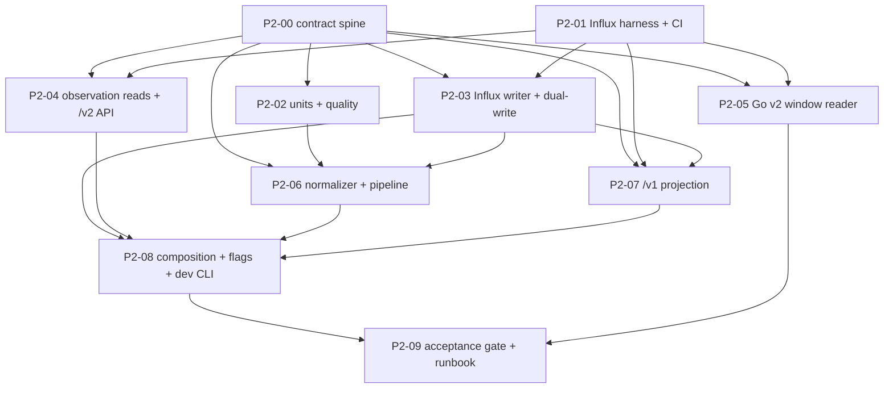

# LimnoPulse V4 Phase 2 — Canonical Telemetry and Dual Schema Implementation Plan

> **For agentic workers:** Execute one task per worktree/session. Every task is test-first: write the failing tests, get them audited and approved, and only then implement. Steps use checkbox (`- [ ]`) syntax for tracking.

**Goal:** Introduce transport-independent metric observations, the InfluxDB `observation_numeric` schema, controlled dual writes and a `/v1` read projection with proven equivalence. Track event, receive and ingest time separately. Never let a device payload carry tenant, site, asset or deployment authority.

**Architecture:**
- **Contract spine.** A short serial spine freezes, as executable fixtures:
  - the catalog and envelope;
  - the Influx schema and line protocol, including legacy dual-write grouping;
  - the repository protocols.
- **Wave 0.** A real-InfluxDB integration harness runs in parallel with the spine.
- **Independent vertical slices:** units/quality, the writer, reads/API and the Go evaluator.
- **Then, in order:** the normalizer/pipeline and the `/v1` projection; one composition owner; a release gate.

Every dependency boundary is a merge to `main`. P2 ships **dark** (D16): no deployed service produces canonical telemetry until P3.

**Tech Stack:**
- Python 3.12+, FastAPI, Pydantic v2, `influxdb-client` 1.50 (already locked), pytest/pytest-asyncio 1.4 (strict mode), uv.
- Go 1.26 from `go.mod`, with `influxdb-client-go/v2` v2.14.0 and `google/uuid` v1.6.0 (already required).
- InfluxDB 2.7.11 for integration tests; GitHub Actions.

**Spec:** `docs/superpowers/specs/2026-08-16-limnopulse-platform-redesign-tech-spec-v4.md` (§§7.2, 7.3, 8, 10, 16, 19.2, 20.7, 22.2, 23.2, 24 Phase 2, 25, 26) and `docs/superpowers/specs/2026-08-25-limnopulse-v4-parallel-execution-design.md`. ADR gates: ADR-005, ADR-006, ADR-007.

**Epic:** #22 (roadmap #14). **Planning baseline:** `main@2918532` (M1 complete; `make verify-python` 2120 passed / 8 skipped; `go test -race ./...` green).

**Revision:** r7.
- r2 applied the findings of five independent audits (three local agents and two cloud sessions, one of which ran real InfluxDB 2.7.11 experiments) and the first Codex review of PR #76.
- r3 applies the second Codex review:
  - `source_type` and `seq` handling in the `/v1` projection;
  - field-preserving `last()`;
  - InfluxDB timestamp bounds;
  - pinned versions carried on replay;
  - sentinel encoding for optional fields.
- r4 applies the third Codex review:
  - a constant Telegraf identity for legacy dual-write, so the source never forks legacy series;
  - `${`-only Flux escaping;
  - provenance determinism wording;
  - query timestamp bounds;
  - an integer-typed `seq` in the projection.
- r5 is clarifications only, from the issue-consistency pass:
  - module placement;
  - mapper `seq` behavior;
  - escaping wording;
  - projection verification status;
  - query bound closure.
- r6 applies the fifth Codex review:
  - deterministic aggregation order in `EvaluateSamples`;
  - a presence-aware `seq` winner in the projection;
  - microsecond canonical time precision.
- r7 applies the final plan↔issue consistency audit:
  - the ADR phase split as a paragraph (headings are pinned by a test);
  - the Go `V2Row`/`V2Querier`;
  - test-local projection fixtures;
  - the harness lifecycle;
  - small wording fixes.
- r7.1 (P2-01 review): CI InfluxDB image pinned by digest to a true 2.7.11; Go integration tests run with -count=1.
- r7.2 (P2-07 review): /v1 projection Flux shape corrected on InfluxDB 2.7.11 (map-free Flux plus Python shaping; summary means within rel 1e-12).

## Global Constraints

### Process and compatibility
- **Branching.** Every worktree starts from `origin/main` only after all blocking task PRs are merged. Branch names are `agent/v4-p2-<nn>-<short-name>`. One executable issue maps to one worktree, one session and one PR.
- **`/v1` stays unchanged.**
  - Preserve every `/v1` path, request, response, status code and role gate.
  - Keep `tests/contracts/openapi/v1.json` byte-identical.
  - The legacy `water_quality` measurement, the Telegraf path and `InfluxTelemetryRepository` keep working unchanged.
- **Default-off switches.** Every new behavior ships behind a default-off switch (see **Rollout switches**). With all P2 switches off, the running application behaves exactly like `main@2918532`.
- **Tenant authority.** Neither the client nor the device supplies authoritative tenant, site, asset or deployment ownership. `tenant_id` comes from the authenticated path/membership boundary or from trusted integration context, never from a telemetry payload.

### Storage
- No DynamoDB `Scan`, no new GSI, no new table. Deployment at event time uses the M1 `DeploymentRepository.get_deployment_at` bounded Component-history query.

### M1 guards
- **Protocols.** M1 protocols in `repositories/v2_contracts.py` are frozen by `tests/unit/test_v2_repository_protocols.py`. P2 adds new protocols in `repositories/telemetry_v2.py`.
- **Forbidden words.** The M1 acceptance gate forbids `redis`, `aws_iot`, `thing_name`, `certificate_arn` and `shadow_name` (case-insensitive substrings) in every `domain/*.py` and `api/v2/**` file, comments included. P2 domain/API code uses opaque `ProviderKey` strings and the `SourceType` transport classes.
- **Legacy-ingestion guard.** `tests/unit/test_local_ingestion_config.py` forbids `postgres`, `postgresql`, `psycopg`, `sqlalchemy`, `firestore` and `firebase` in `src/` and `scripts/`. It also applies secret regexes to `scripts/dev`, `README.md` and `.env.example`.
- **Go substrings.** Go files under `cmd/alert-evaluator` and `internal/alertevaluator`, test files included, must not contain `.Scan(`, `dynamodb.ScanInput`, `service/sqs`, `service/ses`, `api.telegram.org` or `telegram-bot-api` (`tests/unit/test_phase3b_boundaries.py`). Parse Influx results with the client's iterator or `encoding/csv` `Read`, never `bufio.Scanner`.

### Dependencies and tests
- **No new dependencies.** No new runtime or dev dependency and no lockfile change. `urllib3` is already a transitive dependency and may be imported for exception types.
- **Unique test basenames.** `tests/` has no `__init__.py`. Shared helpers live under `tests/support/`, imported as `tests.support.<module>`, and are owned by P2-00/P2-01 only. Waves 1–4 create no file under `tests/support/`.
- **Async tests.** pytest-asyncio runs in strict mode: async tests need `@pytest.mark.asyncio` and async fixtures need `@pytest_asyncio.fixture`.
- **InfluxDB integration tests.**
  - Location: Python tests live in `tests/influx/`; Go tests are named `TestInfluxIntegration*`.
  - Skipping: they skip unless `RUN_INFLUX_INTEGRATION=1`. Default `make verify-python` and `make verify-go` never need InfluxDB.
  - **Coverage of query strings:** every Flux query string a task introduces must be executed by at least one integration test. InfluxDB 2.7.11 panics on some syntactically valid chains, so string-shape tests are not enough.
  - **Time windows:**
    - Integration tests use absolute `range` bounds.
    - Relative-window code paths (`/v1` latest/summary, `/v2` latest) are tested with data seeded relative to a `now` captured once per test.
    - Every comparison asserts the result is non-empty before comparing.
- **Coverage.** Sonar runs only the default suites, so new production code must reach ≥80% line coverage from unit tests alone. `tests/**` and `scripts/dev/**` are excluded from coverage.

### Safety
- **Flux literals.** Every Flux literal built from a runtime value goes through the escaping helper: JSON escaping, then `${` → `\${` to defeat interpolation (`\${` is the only Flux escape for `$`; a lone `$` stays as is, so a bucket such as `raw$archive` keeps working). Every ID is validated before a query is built.
- **Issue #6.** Presence-aware `Evaluation.Value` stays canonical in #6 and out of P2 scope. The P2 Go reader reports values only through the unchanged `WindowResult`.

### Evidence
Every PR records the exact commands and observed results:
- the approved failing-test run and the passing run;
- `make verify-python`, `make verify-go` and `git diff --check`;
- `uv run --locked --extra dev python scripts/dev/export_v1_openapi.py --check`;
- `make verify-influx`, once P2-01 is merged, when the task adds integration tests.

## Entry Decisions (frozen by this plan)

Epic #22 requires the metric/unit and dual-write contracts to be frozen before decomposition. These decisions are the approved answers. Changing one requires amending this plan before the dependent task starts.

| # | Decision | Answer |
|---|---|---|
| D1 | Metric catalog | One global, versioned catalog `metric-catalog@1` with exactly the seven legacy metrics below, display names included. P2 accepts no tenant-defined metric keys. |
| D2 | Unit mapping | Versioned `unit-mapping@1` with explicit per-metric source units. An unknown unit is quarantined, never guessed. |
| D3 | Quality states | In P2 the normalizer writes `quality_state` = `valid` or `out_of_range` only. Clock skew, delay and replay are **flags** (V4 §10.3 "skew is flagged"; ADR-006 "emit a quality flag"). `suspect`, `uncalibrated`, `calibration_unknown` and `impossible_jump` are reserved point states for P6; P6 must decide their thresholds before writing them. `stale` and `missing` are read/evaluation states and are never written. Duplicate and sequence logic need per-Component state and are deferred to P3/P6 (D13). |
| D4 | Determinism | `quality_state` is a pure function of the canonical value and the pinned versions. Flags and provenance are a pure function of the canonical value, the pinned versions, `observed_at`, `received_at` and the replay marker. None of them reads wall-clock time. |
| D5 | Identity and series key | `event_id = observation_event_id(tenant, component, metric, observed_at)`. The InfluxDB series key contains only identity and resolved-ownership tags (`tenant_id`, `site_id`, `asset_id`, `deployment_id`, `device_id`, `component_id`, `probe_id`, `metric_key`, `schema_version`). All of these are fixed by the identity plus the immutable Deployment history. `quality_state` and `source_type` are **fields** (spec delta), so re-classification, replay or redelivery overwrites the same point (last writer wins per field) and never forks a series. A replay or redelivery MUST carry the first-receipt `TrustedSourceContext` unchanged, except for `replay` and `mapping_versions`: `received_at`, `source_type`, `integration_id` and `integration_type` keep their first-receipt values. No per-observation DynamoDB receipt is written. |
| D6 | Bucket | `observation_numeric` lives in the existing `INFLUXDB_BUCKET_RAW` bucket. No per-tenant or per-plan bucket. The runbook records that the bucket's retention must be at least the legacy read window before the `/v1` projection switch. |
| D7 | Legacy dual-write eligibility | Dual-write only when all three hold: the observation's Component is `default_component_id_for_legacy_device(tenant_id, device_id)`; the resolved Asset exists and carries `PondProfile.legacy_pond_id`; and the metric has a `legacy_field`. Ineligible observations, including a missing Asset, are excluded from legacy and counted, not raised. Native v2 probes never appear in `water_quality`. |
| D8 | Legacy series identity | Dual-written legacy points **always** use the stored Telegraf identity, whatever the canonical `source_type`: measurement `water_quality`; tags `device_id`, `pond_id`, `schema_version="1"`, `source="mqtt"`, `tenant_id` and `topic="limnopulse/v1/devices/<device_id>/readings"` (the Telegraf `mqtt_consumer` default `topic_tag`). The legacy measurement is a `/v1` compatibility projection and no reader uses `source`/`topic`. Its series key is therefore a function of `(tenant, pond, device)` only, so a redelivery, a correction or a transport change never forks a legacy series, and Telegraf coexistence never double-counts. `_time` is the exact `observed_at`: Telegraf does not apply agent `precision` to service inputs. A P2-00 test parses `infra/telegraf/telegraf.conf` and fails if the measurement, static tags, topic pattern or `topic_tag` change. |
| D9 | Write switches | `TELEMETRY_V2_WRITE_ENABLED` and `TELEMETRY_LEGACY_DUAL_WRITE_ENABLED` are independent and default to `false`. The write path writes v2 first, then legacy. Any failure raises `TelemetryWriteError` and nothing is reported as written; the caller must not acknowledge and must redeliver (ack contract, P2-06). Idempotent identity makes redelivery safe. An InfluxDB 422 is a **partial write** (other lines may be stored) and maps to `retryable=False`. |
| D10 | `/v1` projection | `V1_TELEMETRY_READ_SOURCE=legacy\|v2` (default `legacy`) swaps the implementation behind the existing `TelemetryRepository` protocol. The v2 projection: reads only the seven legacy metrics; reads only legacy default Components (D7 mirror); reads only the Asset for the legacy pond; includes every quality state (legacy has none); and reproduces legacy series tables and their per-table `sort`/`limit`/`last()` semantics. For data dual-written from legacy default Components, the four `/v1` shapes are byte-identical, sub-second times included, except the summary float means, which match within rel 1e-12; summaries cover completed windows only (r7.2). One narrow case is outside the equivalence domain: an identity rewritten from a present to an absent `sequence`. The legacy line omits `seq`, as Telegraf does, so InfluxDB keeps the old legacy `seq` while v2 stores `-1`. Writing a sentinel into `water_quality` would change legacy-visible `/v1` values, and a read-before-write would add an InfluxDB round trip per batch. Neither cost is justified, so the runbook lists this case as a known limitation. |
| D11 | `/v2` telemetry API | `API_V2_TELEMETRY_ENABLED` (default `false`, valid only with `API_V2_ENABLED=true`) mounts exactly `GET metric-definitions`, `GET observations` and `GET observations/latest`. `API_V2_ENABLED` alone still mounts only the 13 M1 paths. `observations/latest` is a latest-by-`observed_at` data view, not a health or freshness view (ADR-006). |
| D12 | Alert evaluator | `ALERT_EVALUATOR_TELEMETRY_SOURCE=legacy\|v2` (default `legacy`). With `v2`, `/v1` rules (pond, optional device, legacy metric) read `observation_numeric` through a new `WindowReader`. The reader: maps the pond to `asset_id_for_legacy_pond` and the metric to `metric_key`; keeps only legacy default Components (rows whose `component_id != DefaultComponentIDForLegacyDevice(tenant, device)` are dropped before `EvaluateSamples`); and keeps only `quality_state == "valid"` (V4 §16.3 default). Coverage, staleness, aggregation and the completeness delay (`AllowedLateness`/`LatestCompleteSlot`) stay unchanged. Alert events keep legacy metric names. Native probes reach alerts only through AlertRuleV2 (D17). |
| D13 | Trusted mapping and phase split | P2 has no public ingress. The normalizer receives a `TrustedSourceContext` built by trusted code: tests, the P2 dev CLI, and later the P3 worker. P2 delivers the bounded `QuarantinedObservation` record, the no-fallback rule and the ack contract. Moved to **P3/P6 entry gates of #15/#17**, and blocking production canonical writes (D16): quarantine/DLQ persistence, connector-health marking, device/component last-seen, operator reconciliation (§10.2), external-identity-to-DeviceIntegration resolution, sequence gap/regression state, durable queue redrive, and emission of the §23.2 metrics. |
| D14 | Measurement capability | P2 does not require `ProbeProfile.measurement_metric_keys` to list a metric, because legacy default Components carry none. `probe` and `hybrid` Components measure; an `actuator` Component is quarantined. Capability-gated acceptance belongs to P3 trusted mapping and P6. |
| D15 | Out-of-range values | An out-of-range value is written (to v2 and, when eligible, to legacy) with `quality_state=out_of_range` and provenance `plausible_range`. Legacy reads still show it, as today. v2 quality-gated alert reads exclude it. This divergence is intentional, tested in P2-05, and documented in the runbook. |
| D16 | P2 ships dark | No deployed service calls the pipeline in P2; only `scripts/dev/ingest_reading_v2.py` does, and Telegraf keeps writing only `water_quality`. `ALERT_EVALUATOR_TELEMETRY_SOURCE=v2` and `V1_TELEMETRY_READ_SOURCE=v2` may be enabled only where a producer writes every legacy device to `observation_numeric` and the keyed divergence check reports zero missing or different `(pond, device, metric, _time, value)` tuples over max(longest rule window, legacy read window). Production enablement is a P3 exit step. |
| D17 | AlertRuleV2 deferred | `/v2/alert-rules`, §16.2 selectors, §16.3 declared quality policies and §7.3 `metric_key` rules are deferred to a separate backlog issue, to start after P3/P6. They need health condition keys and non-null confidence. P2 delivers only the `/v1`-rule v2 read adapter (§24 Phase 2 "move the v2 alert adapter first", §16.4). |
| D18 | ADR phase split recorded | P2-09 appends a `**Phase split (P2).**` paragraph, with no new Markdown heading, at the end of `## Implementation gate` in ADR-006 and ADR-007. The paragraph names what P2 proves and what P3 must prove before production canonical writes. `tests/unit/test_architecture_inventory.py` pins each ADR's exact heading tuple, so it stays unmodified and green. The orchestrator records the same entry gates on Epic #15. |

### Spec deltas (V4 §10 → this plan)

| V4 text | P2 contract | Reason |
|---|---|---|
| `event_id: "evt_..."` | `obs_<32 hex>` deterministic uuid5 | Canonical-ID convention (`ids.py`); deterministic identity (§10.4). |
| `source.integration_type: "aws_iot"` | `integration_type: ProviderKey` (opaque) plus `source_type: SourceType` | M1 gate forbids AWS names in `domain/*.py`; transport class is separate from provider. |
| Envelope has no mapping versions | `mapping{catalog_version, unit_mapping_version, quality_policy_version}` | ADR-005 requires persisted mapping versions. |
| §10.6 tags include `quality_state`, `source_type` | Both are fields | D5 identity: re-classification and redelivery must not fork series (Codex P1). |
| §10.6 field list | Adds `event_id`, `quality_state`, `source_type`, three version fields and `quality_provenance_json` | Provenance and versions must persist (ADR-005). |
| §10.5 `delayed`, `duplicate` states | Flags | Timeliness must not exclude correct values from quality-gated alerts or change series. |
| §10.5 `suspect` written on skew | Skew is a flag; `suspect` is reserved | §10.3 says skew "is flagged"; avoids legacy/v2 alert divergence on device clock drift. |

## Execution Graph and Merge Gates



| Wave | Tasks allowed in parallel | Start condition |
|---:|---|---|
| 0 | P2-00, P2-01 | This plan (PR #76) merged |
| 1 | P2-02 (needs P2-00); P2-03, P2-04, P2-05 (need P2-00 and P2-01) | Their blockers merged and green |
| 2 | P2-06 (needs P2-02, P2-03); P2-07 (needs P2-01, P2-03) | Their blockers merged and green |
| 3 | P2-08 only | P2-03, P2-04, P2-06, P2-07 merged and green |
| 4 | P2-09 only | P2-05 and P2-08 merged and green |

| Task | Issue | Blocked by | Blocks |
|---|---|---|---|
| P2-00 | #66 | plan | P2-02, P2-03, P2-04, P2-05, P2-06, P2-07 |
| P2-01 | #67 | plan | P2-03, P2-04, P2-05, P2-07 |
| P2-02 | #68 | P2-00 | P2-06 |
| P2-03 | #69 | P2-00, P2-01 | P2-06, P2-07, P2-08 |
| P2-04 | #70 | P2-00, P2-01 | P2-08 |
| P2-05 | #71 | P2-00, P2-01 | P2-09 |
| P2-06 | #72 | P2-00, P2-02, P2-03 | P2-08 |
| P2-07 | #73 | P2-00, P2-01, P2-03 | P2-08 |
| P2-08 | #74 | P2-03, P2-04, P2-06, P2-07 | P2-09 |
| P2-09 | #75 | P2-05, P2-08 (others transitively) | Epic #22 |

## Locked Cross-Task Contracts

### Versions and limits

```python
TELEMETRY_SCHEMA_VERSION = 2
METRIC_CATALOG_VERSION = "metric-catalog@1"
UNIT_MAPPING_VERSION = "unit-mapping@1"
QUALITY_POLICY_VERSION = "quality-policy@1"
MAX_OBSERVATIONS_PER_BATCH = 1000
MAX_QUALITY_JSON_FIELD_BYTES = 512
MAX_QUARANTINE_EXCERPT_BYTES = 2048
MAX_SEQUENCE = 2**63 - 1             # signed 64-bit line-protocol integer
MAX_EXACT_INTEGER = 2**53            # |int| >= this is value_invalid (exact float)
MIN_TELEMETRY_TIME = datetime(1970, 1, 1, tzinfo=UTC)          # inclusive
MAX_TELEMETRY_TIME = datetime(2262, 1, 1, tzinfo=UTC)          # exclusive; int64-ns line-protocol safe
ABSENT_SEQUENCE = -1                 # field sentinel: optional fields are always written (D5)
ABSENT_STRING = ""                   # field sentinel for source_event_id / integration_id
SOURCE_METADATA_ALLOWLIST = frozenset({"firmware_version"})  # values ≤ 64 chars, never tagged
LEGACY_MQTT_TOPIC_TEMPLATE = "limnopulse/v1/devices/{device_id}/readings"
```

### Metric catalog `metric-catalog@1`

- Metric keys match M1 `CAPABILITY_KEY_PATTERN`.
- `legacy_field` values are exactly the values of `domain/alerts.py::AlertMetric` and of Go `allowedMetrics`.
- The plausible range is inclusive.
- Catalog order is the table order.

| metric_key | display_name | canonical_unit | value_type | plausible range | legacy_field | legacy Influx type |
|---|---|---|---|---|---|---|
| `water.temperature` | `Water temperature` | `degC` | float | [-5, 60] | `temp_c` | float |
| `water.ph` | `pH` | `pH` | float | [0, 14] | `ph` | float |
| `water.dissolved_oxygen` | `Dissolved oxygen` | `mg/L` | float | [0, 50] | `do_mg_l` | float |
| `water.turbidity` | `Turbidity` | `NTU` | float | [0, 4000] | `turbidity_ntu` | float |
| `water.salinity` | `Salinity` | `ppt` | float | [0, 70] | `salinity_ppt` | float |
| `device.battery_voltage` | `Battery voltage` | `V` | float | [0, 60] | `battery_v` | float |
| `device.rssi` | `Signal strength (RSSI)` | `dBm` | integer | [-150, 0] | `rssi` | integer |

The legacy `seq` field is not a metric. It maps to `observation.sequence` (integer, `0 ≤ seq ≤ MAX_SEQUENCE`) and back to the legacy integer field `seq`.

**Catalog API (`domain/metric_catalog.py`):**
- `METRIC_CATALOGS: Mapping[str, tuple[MetricDefinition, ...]]` contains `{"metric-catalog@1": (...)}`.
- `metric_catalog(version=METRIC_CATALOG_VERSION, *, catalogs=METRIC_CATALOGS) -> tuple[MetricDefinition, ...]`.
- `metric_definition(metric_key, *, version=METRIC_CATALOG_VERSION, catalogs=METRIC_CATALOGS) -> MetricDefinition | None`.
- `metric_for_legacy_field(field, *, version=..., catalogs=...) -> MetricDefinition | None`.
- An unknown version raises `ValueError`. The `catalogs` parameter exists so tests can inject a test-only `@2`.

### Unit mapping `unit-mapping@1`

- Unit codes are case-sensitive.
- A source unit outside this table is quarantined with `unit_unsupported`.
- `convert_to_canonical` returns `float(value)` for identity conversions (bit-exact for floats). Non-identity conversions are compared with `math.isclose(rel_tol=1e-12, abs_tol=1e-12)`.

| metric_key | accepted source unit → canonical |
|---|---|
| `water.temperature` | `degC` → x; `degF` → (x − 32) × 5 / 9; `K` → x − 273.15 |
| `water.ph` | `pH` → x |
| `water.dissolved_oxygen` | `mg/L` → x; `ppm` → x; `ug/L` → x / 1000 |
| `water.turbidity` | `NTU` → x |
| `water.salinity` | `ppt` → x; `g/kg` → x |
| `device.battery_voltage` | `V` → x; `mV` → x / 1000 |
| `device.rssi` | `dBm` → x (must be integral after conversion, else `value_invalid`) |

- **Invalid values:** booleans, strings, NaN, ±Infinity and integers with `abs ≥ MAX_EXACT_INTEGER` are `value_invalid`.
- **Intentionally unsupported:** percent-saturation dissolved oxygen, which needs temperature and salinity.
- **Registry:** `UNIT_MAPPINGS: Mapping[str, ...]` is keyed by version. `convert_to_canonical(..., unit_mappings=UNIT_MAPPINGS)` lets tests inject `@2`.

### Quality policy `quality-policy@1`

Definitions:
- `delay = received_at − observed_at`
- `delay_ms = (received_us − observed_us) // 1000` (floor division, including negative values)
- `QUALITY_POLICIES: Mapping[str, QualityPolicy]` is keyed by version and injectable.

| Condition | Effect | Provenance entry |
|---|---|---|
| always | — | `schema_validation`, `unit_mapping` (first two, in this order) |
| canonical value < min or > max | state `out_of_range` | `plausible_range` |
| `observed_at − received_at > 300 s` | flag `clock_skew_future` | `clock_skew` |
| `delay > 30 days` | flag `clock_skew_past_extreme` | `clock_skew` |
| `delay > 300 s` | flag `delayed` | `timeliness` |
| `TrustedSourceContext.replay` | flag `replay` | `replay` |

Rules:
- The state is `out_of_range` when the value is outside the range, otherwise `valid`.
- Flags are unique and sorted by value.
- Provenance entries are unique and in table order.
- `delivery.delayed` is true exactly when the `delayed` flag is present; `delivery.replay` is true exactly when the `replay` flag is present.
- `confidence` is always `null` in P2.

### Enumerations (`domain/telemetry_v2.py`)

```python
class MetricValueType(StrEnum): FLOAT = "float"; INTEGER = "integer"

class SourceType(StrEnum):            # transport class; provider identity stays an opaque ProviderKey
    LEGACY_MQTT = "legacy_mqtt"       # local Mosquitto/Telegraf compatibility payloads
    HTTPS = "https"
    MQTT = "mqtt"
    VENDOR_WEBHOOK = "vendor_webhook"
    VENDOR_POLL = "vendor_poll"
    EDGE = "edge"

class QualityState(StrEnum):          # V4 §10.5, all ten values
    VALID = "valid"; SUSPECT = "suspect"; STALE = "stale"; OUT_OF_RANGE = "out_of_range"
    UNCALIBRATED = "uncalibrated"; CALIBRATION_UNKNOWN = "calibration_unknown"
    DUPLICATE = "duplicate"; DELAYED = "delayed"; IMPOSSIBLE_JUMP = "impossible_jump"; MISSING = "missing"

POINT_QUALITY_STATES = frozenset({VALID, SUSPECT, OUT_OF_RANGE, IMPOSSIBLE_JUMP, UNCALIBRATED, CALIBRATION_UNKNOWN})
P2_WRITTEN_QUALITY_STATES = frozenset({VALID, OUT_OF_RANGE})

class QualityFlag(StrEnum):
    DELAYED = "delayed"; CLOCK_SKEW_FUTURE = "clock_skew_future"
    CLOCK_SKEW_PAST_EXTREME = "clock_skew_past_extreme"; REPLAY = "replay"
    DUPLICATE = "duplicate"; SEQUENCE_GAP = "sequence_gap"; SEQUENCE_REGRESSION = "sequence_regression"  # last three reserved

class QualityProvenance(StrEnum):
    SCHEMA_VALIDATION = "schema_validation"; UNIT_MAPPING = "unit_mapping"
    PLAUSIBLE_RANGE = "plausible_range"; CLOCK_SKEW = "clock_skew"
    TIMELINESS = "timeliness"; REPLAY = "replay"

class QuarantineReason(StrEnum):
    METRIC_UNKNOWN = "metric_unknown"; UNIT_UNSUPPORTED = "unit_unsupported"
    VALUE_INVALID = "value_invalid"; OBSERVED_AT_INVALID = "observed_at_invalid"
    COMPONENT_NOT_OWNED = "component_not_owned"; COMPONENT_NOT_MEASURING = "component_not_measuring"
    DEPLOYMENT_UNRESOLVED = "deployment_unresolved"
```

These values are frozen by a P2-00 test, in the same way as `test_frozen_enum_values`.

### Models (`domain/telemetry_v2.py`)

General rules:
- All models are frozen Pydantic v2 models with `extra="forbid"`.
- Every datetime must be timezone-aware and is normalized to UTC; a naive datetime is rejected.
- Every telemetry datetime (`observed_at`, `received_at`, `ingested_at`) must lie in `[MIN_TELEMETRY_TIME, MAX_TELEMETRY_TIME)`, which InfluxDB's signed 64-bit nanosecond time can represent. The mapper and parsers quarantine an out-of-range `ts` as `observed_at_invalid`.
- **Canonical precision is microseconds.**
  - Python `datetime` holds µs, and `_time` is µs × 1000.
  - A source `ts` whose fractional seconds have non-zero digits beyond the sixth (e.g. `…00.123456789Z`) is quarantined as `observed_at_invalid` (detail `sub-microsecond precision unsupported`). It is never silently truncated: Telegraf stores such a value at full nanosecond precision, so truncation would fork the legacy point, and two readings within one µs would collapse to one `event_id`.
  - Nine-digit values with trailing zeros (`….123456000Z`) are accepted.
- IDs use the M1 validators: `SafeId` for tenant, `DeviceId` for device, and the canonical prefixes `site`, `ast`, `cmp`, `prb`, `dep`, `di` and `obs`.
- Collections are tuples.

```text
MetricDefinition        metric_key, display_name, canonical_unit, value_type, plausible_min, plausible_max,
                        legacy_field | None
TrustedSourceContext    tenant_id, device_id, integration_id (di_) | None, integration_type: ProviderKey,
                        source_type: SourceType, connector_version (≤64) | None, received_at, replay=False,
                        mapping_versions: NormalizationVersions | None = None
                        — a replay producer sets mapping_versions to the versions recorded when the event
                          was first normalized (the queued event in P3, or the stored point's version fields),
                          so a replay after a catalog/unit revision reproduces the original mapping (ADR-005)
SourceObservation       component_id (cmp_), metric_key (≤64), value: StrictInt | StrictFloat (finite),
                        source_unit (1–16), observed_at, sequence: 0..MAX_SEQUENCE | None,
                        source_event_id (1–128 printable) | None,
                        source_metadata: dict[str, str] keys ⊆ SOURCE_METADATA_ALLOWLIST
                        — has NO tenant/site/asset/deployment/device field; extra fields are rejected
ObservationSource       integration_id, integration_type, source_type, connector_version, received_at
ObservationResolution   tenant_id, site_id, asset_id, deployment_id, device_id, component_id, probe_id | None
ObservationMeasurement  metric_key, value: finite float, value_type, source_unit, canonical_unit,
                        observed_at, sequence | None
ObservationDelivery     ingested_at, delayed: bool, replay: bool
ObservationQuality      state ∈ POINT_QUALITY_STATES, flags: tuple[QualityFlag, ...] (sorted unique),
                        confidence: None, provenance: tuple[QualityProvenance, ...] (non-empty, unique, table order)
NormalizationVersions   catalog_version=METRIC_CATALOG_VERSION, unit_mapping_version=UNIT_MAPPING_VERSION,
                        quality_policy_version=QUALITY_POLICY_VERSION
CanonicalObservation    schema_version: Literal[2], event_id (obs_), source_event_id | None,
                        source: ObservationSource, resolved: ObservationResolution,
                        observation: ObservationMeasurement, delivery: ObservationDelivery,
                        quality: ObservationQuality, mapping: NormalizationVersions, source_metadata
                        validators: event_id == observation_event_id(...); delivery flags mirror quality flags
QuarantinedObservation  reason, tenant_id, device_id, component_id | None, metric_key | None, observed_at | None,
                        received_at, source_event_id | None, detail (≤256), source_excerpt_json (≤2048 bytes), truncated
StoredObservation       event_id, observed_at, received_at, ingested_at, metric_key, value, canonical_unit,
                        site_id, asset_id, device_id, component_id, probe_id | None, deployment_id,
                        quality_state, quality_flags, quality_provenance, sequence | None, source_type
NormalizationResult     accepted: tuple[CanonicalObservation, ...], quarantined: tuple[QuarantinedObservation, ...],
                        counts() -> Mapping[str, int]   # closed keys: accepted, quarantined.<reason>, flag.<flag>,
                                                          # state.<state>; no tenant/device labels (§23.2 emission is P3)
```

### Canonical identity

```python
def observation_event_id(tenant_id: str, component_id: str, metric_key: str, observed_at: datetime) -> str:
    discriminator = (
        f"limnopulse/v4/observation/{tenant_id}/{component_id}/{metric_key}/"
        f"{format_utc_timestamp(observed_at)}"
    )
    return f"obs_{uuid5(NAMESPACE_URL, discriminator).hex}"
```

The identity deliberately excludes mapping versions, quality, `received_at`, `ingested_at` and `source_event_id`. A replay under a later catalog version therefore keeps the same identity (ADR-005), and D5 keeps it in the same series.

### InfluxDB `observation_numeric` schema and canonical line protocol (`domain/telemetry_v2_schema.py`)

**Names:**
- `OBSERVATION_MEASUREMENT = "observation_numeric"`, `LEGACY_MEASUREMENT = "water_quality"`.
- `OBSERVATION_TAG_KEYS`, `OBSERVATION_REQUIRED_TAG_KEYS`, `OBSERVATION_FIELD_KEYS`, `LEGACY_TAG_KEYS`, `LEGACY_INTEGER_FIELDS = frozenset({"rssi", "seq"})`.

**Functions:**
- `observation_tags(o) -> dict[str, str]`
- `validate_observation_tags(tags: Mapping[str, str]) -> None` (raises `ValueError`)
- `encode_observation_line(o) -> str`
- `build_legacy_points(observations, legacy_pond_by_asset: Mapping[str, str]) -> tuple[LegacyPoint, ...]`
- `encode_legacy_line(p) -> str`
- `flux_string_literal(value: str) -> str`

**Time and storage:** Bucket `INFLUXDB_BUCKET_RAW`. `_time` = `observed_at` in nanoseconds, computed as integer microseconds × 1000 (never via a float `timestamp()`).

**Tags** form a closed allowlist; they are written in sorted key order:
- `asset_id`, `component_id`, `deployment_id`, `device_id`, `metric_key`
- `probe_id` (only when present)
- `schema_version` (`"2"`), `site_id`, `tenant_id`

**Fields**, in sorted key order:

| Field | Type | Notes |
|---|---|---|
| `catalog_version` | string | |
| `delay_ms` | integer | |
| `event_id` | string | |
| `ingested_at_ns` | integer | |
| `integration_id` | string | always written; `""` (`ABSENT_STRING`) when absent |
| `quality_flags_json` | string | compact sorted JSON array, ≤ 512 bytes |
| `quality_policy_version` | string | |
| `quality_provenance_json` | string | compact JSON array, ≤ 512 bytes |
| `quality_state` | string | |
| `received_at_ns` | integer | |
| `sequence` | integer | always written; `-1i` (`ABSENT_SEQUENCE`) when absent |
| `source_event_id` | string | always written; `""` (`ABSENT_STRING`) when absent |
| `source_type` | string | |
| `source_unit` | string | |
| `unit_mapping_version` | string | |
| `value` | float | always float, even for integer metrics; avoids field-type conflicts |

**Complete field set.** Every point carries the complete field set, so a rewrite of the same identity replaces every field. InfluxDB merges same-point writes field by field and cannot clear an omitted field, so absence is encoded with sentinels. Readers (P2-04, P2-07, P2-05) decode `sequence == -1` and `""` to `None`/absent. The Go reader maps an absent sequence to `Seq = 0`, like a legacy missing `seq`. A `/v1` projection with an absent `seq` omits it, like legacy.

**Formatting:**
- A float uses `repr(float(v))` (`25.0`, `4.82`, `1e-05`); the encoder raises on non-finite values (defense in depth).
- An integer is written as `<n>i` and must lie in the signed 64-bit range.
- String field values escape `\` and `"`. Tag keys/values and the measurement escape `,`, `=` and space.
- One point per line; the encoder output has no trailing newline.

**Cardinality guard** (`validate_observation_tags`):
- It rejects any key outside the allowlist and any missing required tag.
- IDs must match their validators, `metric_key` must be in the catalog, and `schema_version` must equal `"2"`.
- Event IDs, `source_event_id`, firmware, integration IDs, quality, source type and metadata are never tags.

**Flux literal helper:** `flux_string_literal` returns `json.dumps(value)` with every `${` replaced by `\${`. A lone `$` is left unchanged, and tests cover both `${x}` and `raw$archive`. P2-03, P2-04 and P2-07 use it. Go code applies the same rule in its v2 query.

### Legacy `water_quality` dual-write point

```text
water_quality,device_id=<d>,pond_id=<p>,schema_version=1,source=mqtt,tenant_id=<t>,topic=limnopulse/v1/devices/<d>/readings <fields> <observed_at ns, exact>
```

- `LegacyPoint` is a frozen dataclass with:
  - `tenant_id`, `pond_id`, `device_id` and `observed_at` (`source="mqtt"` and the topic are derived constants, D8);
  - `fields: Mapping[str, float | int]`, keyed by legacy field name or `seq`.
- Field types:
  - the six float metrics are written as floats;
  - `rssi` and `seq` are written as integers (`-67i`, `1i`), matching the Telegraf schema.
- Fields are written in sorted key order.
- `build_legacy_points`:
  - groups eligible observations by `(tenant, pond, device, exact observed_at)`;
  - resolves a conflicting field by latest `ingested_at`, then greater `event_id`;
  - takes `seq` from the winning observation (a `None` sequence ranks lowest, and `seq` is omitted when all are `None`).
- P2-03 performs the Asset lookups and calls this pure function.

### Repository protocols (`repositories/telemetry_v2.py`)

```python
@runtime_checkable
class ObservationWriter(Protocol):
    async def write_observations(self, observations: Sequence[CanonicalObservation]) -> None: ...

@runtime_checkable
class LegacyObservationWriter(Protocol):
    async def write_legacy_points(self, points: Sequence[LegacyPoint]) -> None: ...

@dataclass(frozen=True)
class ObservationSelector:
    kind: Literal["asset", "component", "device"]
    entity_id: str  # validated: ast_/cmp_ canonical, device via require_device_id

@runtime_checkable
class ObservationReader(Protocol):
    async def query_observations(
        self, *, tenant_id: str, selector: ObservationSelector,
        metric_keys: frozenset[str] | None, quality_states: frozenset[QualityState] | None,
        start: datetime, stop: datetime, limit: int,
    ) -> list[StoredObservation]: ...

    async def query_latest_observations(
        self, *, tenant_id: str, selector: ObservationSelector,
        metric_keys: frozenset[str] | None, lookback: timedelta, now: datetime,
    ) -> list[StoredObservation]: ...
```

- A P2-00 test freezes the method names, parameter names/kinds and annotations, like `test_v2_repository_protocols.py`.
- Windows are half-open: `[start, stop)` and `[now − lookback, now)`, by `observed_at`.
- `core/errors.py` gains `TelemetryWriteError(LimnopulseError)` with a keyword-only `retryable: bool` attribute.

### Cross-language vectors and loader

`scripts/dev/export_telemetry_v2_vectors.py [--check]` generates `testdata/telemetry_v2/contract_vectors.json` deterministically from the Python contract. `--check` exits 1 on drift. The script has no `--output` flag; its test monkeypatches the module-level output path to a `tmp_path` copy.

The file contains:
- the versions;
- the measurement names, tag keys and field keys;
- the catalog rows, including display names;
- deterministic ID vectors for at least five inputs each: `asset_id_for_legacy_pond`, `default_component_id_for_legacy_device` and `observation_event_id`. The inputs include `tnt_local_001`/`pond_local_001`/`local-device-001`.

It also contains named **scenarios** with literal IDs. Each scenario states:
- its tenant, ponds, devices, components and source type;
- its canonical observations (JSON);
- the exact `observation_numeric` lines;
- the exact `water_quality` lines and their count.

Scenarios:

| Scenario | Content | v2 lines | Legacy lines |
|---|---|---|---|
| `legacy_sample` | `examples/telemetry/reading.local.json` for `local-device-001` in `tnt_local_001`/`pond_local_001`, `legacy_mqtt` | 7 | 1 (with `topic`) |
| `sub_second` | Same as `legacy_sample`, at `…:00.750Z` | 7 | 1 (exact time) |
| `two_probes_same_metric` | Two probe Components of one native v2 Device, both `water.dissolved_oxygen`, at the same `observed_at`, deployed to a **legacy pond Asset** | 2 | 0 |
| `out_of_range` | Legacy default Component, `water.dissolved_oxygen = 75.0` | 1 (`out_of_range`) | 1 |
| `delayed_replay` | Flags `delayed` and `replay` | 1+ | 1 |
| `relocation` | One legacy default Component before and after a move from `pond_west` to `pond_east`; assets from `asset_id_for_legacy_pond`, distinct deployments | 2+ | 2 |
| `unit_converted` | Source `degF`, canonical `degC` | 1 | 1 |
| `multi_point_series` | ≥ 30 points at 1-minute cadence, 2 devices, 2 legacy ponds | — | — |

The static scenarios are for byte-level encoder, seeding and parity tests. Relative-window tests rebase them to a captured `now` through the production encoder.

`tests/support/telemetry_v2_vectors.py` (owned by P2-00) provides `load_vectors()` and `scenario(name) -> TelemetryScenario`, which exposes the observations, `v2_lines` and `legacy_lines`, plus `rebased(now)`.

### Rollout switches

| Setting / env | Default | Owner | Effect |
|---|---|---|---|
| `TELEMETRY_V2_WRITE_ENABLED` | `false` | P2-08 | Write `observation_numeric` points (consumed by the dev CLI in P2; P3 worker later). |
| `TELEMETRY_LEGACY_DUAL_WRITE_ENABLED` | `false` | P2-08 | Write eligible `water_quality` points from the normalizer path. |
| `API_V2_TELEMETRY_ENABLED` | `false` | P2-08 | Mount the three `/v2` telemetry routes; requires `API_V2_ENABLED=true` (validation error otherwise). |
| `V1_TELEMETRY_READ_SOURCE` | `legacy` | P2-08 | `legacy` or `v2` implementation behind the `/v1` `TelemetryRepository` (D16 precondition). |
| `ALERT_EVALUATOR_TELEMETRY_SOURCE` | `legacy` | P2-05 | Go `WindowReader` selection (`legacy` or `v2`); also `--telemetry-source` (D16 precondition). |

P2-08 creates these app-state names:
- `app.state.observation_reader`;
- `app.state.observation_writer` (None unless a write switch is on);
- `app.state.observation_write_service`.

`app.state.telemetry_repository` keeps its name and becomes the projection-selected implementation. Every new name is added to the lifespan skip-list.

### InfluxDB integration harness contract (P2-01)

**Environment variables:**
- `RUN_INFLUX_INTEGRATION=1`
- `INFLUX_INTEGRATION_URL` (default `http://127.0.0.1:8086`)
- `INFLUX_INTEGRATION_TOKEN` (default `local-dev-token`)
- `INFLUX_INTEGRATION_ORG` (default `limnopulse`)

**Python:**
- `tests/support/influx_harness.py` never skips on import. It provides:
  - the `influx_bucket` fixture factory, which calls `pytest.skip` unless `RUN_INFLUX_INTEGRATION=1` and otherwise creates a uniquely named bucket with no retention rule, deleted at teardown;
  - `influx_clients(bucket)`, which yields a `query_api`/`write_api` pair;
  - `write_lines(bucket, lines)`.
- `tests/influx/conftest.py` (P2-01) re-exports the fixtures and marks every `tests/influx` item skipped without the env.

**Go:**
- P2-01 owns `internal/alertevaluator/influx/integration_harness_test.go` (`package influx`, so P2-05 tests can call it), which provides `newIntegrationBucket(t) (client, bucket)` and `writeLines(t, …)` and creates/deletes buckets through `BucketsAPI()`.
- It also provides `TestInfluxIntegrationHarnessSmoke`.

**`scripts/dev/run_local_influxd.sh`** runs InfluxDB 2.7.11 without Docker:
- downloads `influxdb2-2.7.11_linux_amd64.tar.gz`, checks SHA-256 `8d7872013cad3524fb728ca8483d0adc30125ad1af262ab826dcf5d1801159cf`, and unpacks into `${XDG_CACHE_HOME:-$HOME/.cache}/limnopulse/influxd`. The tarball has no `influx` CLI;
- binds `127.0.0.1:8086` by default (`INFLUXD_PORT` overrides), waits for `/health`, and leaves influxd running in the background with a PID file in the cache dir. It exits 0 and is idempotent on re-run: it reuses a running instance;
- runs setup through `curl -X POST /api/v2/setup`. A `conflict` "onboarding has already been completed" response counts as success.

**CI:**
- `.github/workflows/verify.yml` gains job `influx`, running exactly `make verify-influx`.
- The job uses service container `influxdb:2.7.11@sha256:d92a10e9e75aff18eca38ff3a8f0b4a800706a5dd44d1b0ece264af04458525b`, initialized with the defaults above. It is pinned by digest because the `influxdb:2.7.11-alpine` tag was rebuilt with InfluxDB 2.7.12. Readiness comes from service `options: --health-cmd "influx ping"`, not an extra `run:` step.
- `make verify-influx` runs:
  - `$(UV) sync --locked --extra dev`
  - `RUN_INFLUX_INTEGRATION=1 $(UV) run --locked --no-sync python -m pytest -q tests/influx`
  - `RUN_INFLUX_INTEGRATION=1 go test -race -count=1 -run 'TestInfluxIntegration' ./...`
- `verify-influx` joins `.PHONY`. The aggregate `make verify` is unchanged; `test_ci_contract.py` keeps it as a separate expectation.

### `/v2` telemetry API (P2-04, mounted by P2-08)

```text
GET /v2/tenants/{tenant_id}/metric-definitions
GET /v2/tenants/{tenant_id}/observations
GET /v2/tenants/{tenant_id}/observations/latest
```

**Roles and errors:**
- Roles: `READ_ROLES`.
- 403 `tenant access denied` comes before any lookup; 503 on `TelemetryQueryError`.
- Request models use `extra="forbid"`.
- `now` comes from an injected clock.

**Schema names:** every response/request model name is prefixed `V2` (for example `V2ObservationResponse`, `V2MetricDefinitionResponse`), and a test proves the names are disjoint from the `/v1` component names. Otherwise FastAPI would rename a colliding v1 component and drift the `/v1` golden when the flag is on.

**`metric-definitions`** returns `{"items": [...]}` in catalog order. Each item carries `metric_key`, `display_name`, `canonical_unit`, `value_type`, `plausible_min`, `plausible_max`, `legacy_field` and `catalog_version`.

**`observations`** returns `{"items": [...]}`.
- Query parameters:
  - exactly one of `asset_id`, `component_id` or `device_id`, otherwise 422;
  - `metric_key` (repeatable, each value in the catalog, otherwise 422);
  - `quality_state` (repeatable, point states only, otherwise 422);
  - `start` and `stop`, both timezone-aware ISO-8601. Each supplied bound must lie in the **closed** range `[MIN_TELEMETRY_TIME, MAX_TELEMETRY_TIME]`, validated **before** any default is derived, otherwise 422. The range is closed because the query window itself is half-open, so `stop = MAX_TELEMETRY_TIME` still excludes it. Endpoint tests cover both extremes and `stop=0001-01-01T00:00:00Z`. They default to `stop = now` and `start = stop − 1 h`. The window is half-open `[start, stop)` by `observed_at`. `stop` must be after `start`, and the range is at most 31 days, otherwise 422;
  - `limit` from 1 to 1000, default 500.
- A selector entity missing in the tenant gives 404 with zero reader calls.
- Ordering: by `observed_at`, `component_id`, `metric_key` ascending, with the limit applied after the global sort. The Flux pattern is pivot → `group()` → sort → `limit`; never `group()` before pivot.

**`observations/latest`** returns `{"items": [...]}`.
- It takes the same selector and an optional `metric_key`, over the window `[now − 24 h, now)`.
- It returns one item per `(component_id, metric_key)`: the latest by `observed_at`, ordered by `component_id`, `metric_key`.
- The Flux pattern is pivot → `group(component_id, metric_key)` → `sort(_time)` → `last(column: "_time")` → `group()` → sort.
- It is **not** a health or freshness view. Online/health status is P6 and uses `received_at`/`ingested_at`.

**Item fields:**
- identity and time: `event_id`, `observed_at`, `received_at`, `ingested_at`;
- measurement: `metric_key`, `value`, `unit`;
- ownership: `site_id`, `asset_id`, `device_id`, `component_id`, `probe_id`, `deployment_id`;
- quality: `quality: {state, flags, provenance}`;
- delivery: `sequence`, `source_type`.

`integration_id`, `source_event_id` and metadata are not exposed.

### `/v1` projection semantics (P2-07)

`V2ProjectedTelemetryRepository(*, query_api, org, bucket, domain_repository)` implements the existing `TelemetryRepository` over `observation_numeric`. P2-07's equivalence tests on InfluxDB 2.7.11 are the authority. r7.2 replaces the earlier Flux-side legacy shaping (per-point pivot, `map` to the legacy shape, `union`, legacy tail) with **map-free Flux plus Python shaping**:

```text
source  = from(bucket: B) |> range(<same bounds as legacy>)
            |> filter(_measurement == "observation_numeric") |> filter(tenant_id == T)
            |> filter(asset_id == A1 or …)                    // pond assets only
            |> filter(component_id == C1 or …)                // legacy default components only
            |> filter(metric_key == M1 or …)                  // 7 legacy metrics (3 for summary)
readings: source |> filter(_field == "value") |> group(tenant_id, asset_id, device_id)
            |> pivot(rowKey: ["_time"], columnKey: ["metric_key"]) |> sort(_time) |> limit(n)
latest:   source(-24h) |> filter(_field == "value") |> last()        // storage last() per series and metric
seq:      source([first returned _time, last returned _time + 1 µs))
            |> filter(_field == "sequence" or "ingested_at_ns" or "event_id") |> pivot(rowKey: ["_time"], columnKey: ["_field"])
            |> filter(sequence != -1)                                  // absent sequences rank lowest
            |> group(tenant_id, asset_id, device_id)                   // one table per legacy series
            |> sort(["_time", "ingested_at_ns", "event_id"], desc: true) |> unique(column: "_time")   // latest: the same, over the newest points' span
summary:  data = source(-period, 3 metrics) |> filter(_field == "value") |> group(columns: ["metric_key"])
            data |> aggregateWindow(every: <i>, fn: mean, createEmpty: false) |> yield("series")
            data |> mean()/min()/max()/count() |> yield(...)
```

**Flux constraints (2.7.11).**
1. Filters are `==`/`or` chains, which storage pushes down; `contains()` is not pushed down and scans the whole tenant.
2. Readings, latest and `seq` use one `from()` per query: two yields sharing one source lose the pushdown. The summary keeps the legacy single-source, multi-yield shape.
3. No per-row `map`. A vectorized `map` emits its columns in a varying order, so a later `pivot` panics non-deterministically (`column _start:time is not of type string`). A row-based `map` is deterministic but too slow (~0.06 ms per row).
4. The `seq` winner is ranked per legacy series with `sort(desc) |> unique(column: "_time")`, never with one table per timestamp (`group(..., "_time")`).
5. The `seq` query only spans the rows the first query returned, so its cost follows `limit`, not the read range.
6. The summary groups by `metric_key` and applies `aggregateWindow(fn: mean)`, `mean()`, `min()`, `max()` and `count()`, like legacy. The filters and the group are pushed down (`ReadGroup`); the aggregates run in the Flux engine; raw rows never reach the client. The cost profile is the same as legacy.

**Python shaping.**
- `metric_key` → legacy field name; Asset → pond via the requested pond or `list_ponds`.
- `rssi` (stored as a float) becomes an `int` when integral and is hidden otherwise; `seq` comes from the integer `sequence` column. Models are built from `int` values, with no reliance on Pydantic lax coercion.
- A legacy series is one (tenant, pond, device): `source` and `topic` are constant per device (D8). Readings keep the legacy per-series `limit` and come in series-key (`device_id`) order, then by time.
- Latest keeps, per series, only the fields whose last point is at the series' newest time (the legacy pivot of `last()` rows). It then takes the newest series per pond, with the first series in `device_id` order winning a tie.
- `seq` is merged only into a returned row with the same `_time`.

**Rules.**
- **Component set.** It is `{default_component_id_for_legacy_device(t, d.device_id) for d in domain_repository.list_devices(t)}`. Native v2 Components are never visible through `/v1`.
- **Asset → pond.** Only the Asset for the legacy pond (`asset_id_for_legacy_pond`). A pond ID from `list_ponds` that fails `require_safe_id` is skipped (it can never be dual-written, D7).
- **`seq` tie-break.** `seq` for a legacy `(series, _time)` is the sequence of the point with the greatest `ingested_at_ns`, then the greatest `event_id`, among points whose sequence is present. This is the same rule as `build_legacy_points`; if all are absent, `seq` is omitted.
- **Summary.**
  - Keep the legacy period/interval table (24h→5m, 7d/30d→1h) and the `do_mg_l`, `ph` and `temp_c` series with mean/min/max/count.
  - Errors are wrapped in `TelemetryQueryError`.
  - **Parity rule (r7.2 relaxation).** `min`, `max`, `count`, the window timestamps and the window set are exact. The float means (`statistics.*.mean` and every `series[*]` window mean) match within `math.isclose(rel_tol=1e-12, abs_tol=0)`.
  - Reason: the engine sums the `ReadGroup` stream, which is ordered per shard group and then by series key. The v2 series keys differ from the legacy ones by design (`component_id` and the other ownership tags), so last-ulp agreement would need a shard-aware reimplementation, which is fragile and version-sensitive. No consumer depends on last-ulp means: the alert evaluator has its own Go reader, and dashboards round.
  - The last summary window is stamped with the query's `now()`, as in legacy. Summary equivalence covers completed windows only.
- **Error propagation.** The other methods, including the `seq` query, propagate errors exactly like the legacy adapter.
- **Integer fields.** `seq` stays an integer end to end, so sequences up to `MAX_SEQUENCE` stay exact; a boundary test covers `2**53 + 1` and `2**63 - 1`.
- **No time flooring.** Legacy dual-write stores exact time.
- **Version sensitivity.** These shapes and the parity rule follow storage behavior of the pinned InfluxDB 2.7.11. The equivalence suite on the pinned CI image is the guard for future upgrades.

### Go evaluator v2 reader (P2-05)

```text
from(bucket: <b>)
  |> range(start: time(v: <Start>), stop: time(v: <End>))
  |> filter(fn: (r) => r["_measurement"] == "observation_numeric")
  |> filter(fn: (r) => r["tenant_id"] == <tenant>)
  |> filter(fn: (r) => r["asset_id"] == <AssetIDForLegacyPond(tenant, pond)>)
  [|> filter(fn: (r) => r["device_id"] == <device>)]
  |> filter(fn: (r) => r["metric_key"] == <MetricKeyForLegacyMetric(metric)>)
  |> filter(fn: (r) => r["_field"] == "value" or r["_field"] == "sequence" or r["_field"] == "quality_state")
  |> pivot(rowKey: ["_time", "device_id", "component_id"], columnKey: ["_field"], valueColumn: "_value")
  |> filter(fn: (r) => r["quality_state"] == "valid")
  |> keep(columns: ["_time", "device_id", "component_id", "value", "sequence"])
  |> group()
  |> sort(columns: ["_time", "device_id", "component_id"])
```

**Escaping and identifiers:**
- Every literal goes through `fluxString`; the v2 query also replaces `${` with `\${`, and a lone `$` is unchanged.
- `AssetIDForLegacyPond` and `DefaultComponentIDForLegacyDevice` use `uuid.NewSHA1(uuid.NameSpaceURL, …)` with the Python discriminators and return `"<prefix>_" + hex` without dashes. They must equal the Python vectors.

**Rows to samples:**
- Rows with `component_id != DefaultComponentIDForLegacyDevice(tenant, device_id)` are dropped.
- The remaining rows become `alertevaluator.Sample{Time, DeviceID, Value, Seq}` and pass through `EvaluateSamples`. Its semantics are unchanged except for the deterministic-order fix below. A `sequence` of `-1` (`ABSENT_SEQUENCE`) gives `Seq = 0`, like a legacy missing `seq`.

**Parity** means identical `WindowResult` values for the legacy reader on `water_quality` and the v2 reader on `observation_numeric`:
- Scenarios: `legacy_sample`, `sub_second`, `delayed_replay`, `relocation`, `unit_converted` and `multi_point_series`.
- `out_of_range` asserts the documented divergence.
- `two_probes_same_metric` asserts that a `/v1` rule sees no data from native probes.
- Query errors take the same `query_error` path as legacy.

## File Ownership Map

| Task | Exclusive responsibility | Restriction |
|---|---|---|
| P2-00 | `domain/telemetry_v2.py`, `domain/metric_catalog.py`, `domain/telemetry_v2_schema.py`, `repositories/telemetry_v2.py`, `TelemetryWriteError` in `core/errors.py`, `testdata/telemetry_v2/`, `scripts/dev/export_telemetry_v2_vectors.py`, `tests/support/telemetry_v2_vectors.py` | No adapters, services, routers, settings or Go code |
| P2-01 | `tests/support/influx_harness.py`, `tests/influx/conftest.py`, `tests/influx/test_influx_harness_smoke.py`, `internal/alertevaluator/influx/integration_harness_test.go`, `scripts/dev/run_local_influxd.sh`, `Makefile` (`verify-influx` only), `.github/workflows/verify.yml` (`influx` job only), `tests/unit/test_ci_contract.py`, `docs/verification.md` | No runtime code |
| P2-02 | `domain/telemetry_units.py`, `domain/telemetry_quality.py` | Pure functions only; no I/O |
| P2-03 | `adapters/influxdb_v2_writer.py`, `services/telemetry_v2_writes.py` | No settings, `main.py` or `/v1` files |
| P2-04 | `adapters/influxdb_v2_reader.py`, `services/telemetry_v2.py`, `api/v2/routers/observations.py`, `api/v2/routers/metric_definitions.py`, `api/v2/schemas/observations.py`, `api/v2/schemas/metric_definitions.py`, `api/v2/telemetry_dependencies.py` | Routers unmounted; no edit to `api/v2/router.py`, `api/v2/dependencies.py` or `main.py` |
| P2-05 | `internal/alertevaluator/influx/{query_v2,client_v2,legacy_ids}.go` and their tests (`query_v2_test.go`, `client_v2_test.go`, `legacy_ids_test.go`, `parity_integration_test.go`), `internal/alertevaluator/config.go`, `config_test.go`, `cmd/alert-evaluator/main.go`, `main_test.go`, `internal/alertevaluator/quality.go` + `quality_test.go` (deterministic summation order only), `docs/alert-evaluator-phase-3b.md` (telemetry-source section) | No Python; no semantic change to `EvaluateSamples` beyond deterministic order; no change to `state_machine.go` or the legacy `query.go`/`client.go` behavior |
| P2-06 | `services/telemetry_normalizer.py`, `domain/legacy_telemetry_mapping.py`, `services/telemetry_pipeline.py` | No InfluxDB I/O; no settings |
| P2-07 | `adapters/influxdb_v1_projection.py` | No change to `/v1` routers, services, schemas, `repositories/telemetry.py` or `adapters/influxdb.py` |
| P2-08 | `core/config.py`, `main.py`, `api/router.py`, `api/v2/router.py`, `scripts/dev/ingest_reading_v2.py`, `.env.example`, `README.md`, `docs/architecture.md` (new section only; pinned header unchanged), `tests/api/test_v2_composition.py`, `tests/api/test_app_runtime.py` | Integration hotspot owner; no feature logic |
| P2-09 | `tests/contracts/test_p2_acceptance_gate.py`, `tests/influx/test_p2_acceptance_influx.py`, `docs/p2-telemetry-rollout-runbook.md`, `docs/adr/ADR-006-*.md` and `docs/adr/ADR-007-*.md` (append the `**Phase split (P2).**` paragraph at the end of `## Implementation gate`; no new heading), README runbook link | No production feature code |

Each task also owns the new test files named in its section.

---

### Task 1: P2-00 — Freeze the canonical telemetry contract spine

**Branch:** `agent/v4-p2-00-telemetry-contract-spine` · **Blocked by:** plan merged · **Blocks:** P2-02, P2-03, P2-04, P2-05, P2-06, P2-07

**Files:**
- Create:
  - `src/limnopulse_api/domain/telemetry_v2.py`
  - `src/limnopulse_api/domain/metric_catalog.py`
  - `src/limnopulse_api/domain/telemetry_v2_schema.py`
  - `src/limnopulse_api/repositories/telemetry_v2.py`
  - `scripts/dev/export_telemetry_v2_vectors.py`
  - `testdata/telemetry_v2/contract_vectors.json`
  - `tests/support/telemetry_v2_vectors.py`
- Modify: `src/limnopulse_api/core/errors.py`
- Test:
  - `tests/unit/test_telemetry_v2_contracts.py`
  - `tests/unit/test_metric_catalog.py`
  - `tests/unit/test_telemetry_v2_schema.py`
  - `tests/unit/test_telemetry_v2_protocols.py`
  - `tests/unit/test_telemetry_v2_vectors.py`
  - `tests/unit/test_telegraf_legacy_identity.py`

**Interfaces:**
- Consumes:
  - from M1: the `ids.py` validators and deterministic legacy IDs;
  - from `v2_common`: `SafeId`, `DeviceId`, `ProviderKey`, `CAPABILITY_KEY_PATTERN` and `format_utc_timestamp`;
  - `AlertMetric`;
  - `infra/telegraf/telegraf.conf`.
- Produces everything in the spine sections of **Locked Cross-Task Contracts**: Versions and limits, Metric catalog (incl. API), Enumerations, Models, Canonical identity, the InfluxDB schema and line protocol, the legacy dual-write point, Repository protocols, Cross-language vectors and loader. The unit-mapping and quality-policy **registries and functions** belong to P2-02, and P2-00 only freezes their version constants.
- **Module placement:**
  - `domain/telemetry_v2.py`: constants, enums, models, `observation_event_id`, `NormalizationResult`.
  - `domain/metric_catalog.py`: catalog data and API.
  - `domain/telemetry_v2_schema.py`: measurement/tag/field names, `LegacyPoint`, encoders, guard, `build_legacy_points`, `flux_string_literal`.
  - `repositories/telemetry_v2.py`: protocols and `ObservationSelector`.
  - Owned by later tasks: `TelemetryWriteOutcome` (P2-03, `services/telemetry_v2_writes.py`), `LegacyMappingResult` (P2-06, `domain/legacy_telemetry_mapping.py`) and `PipelineOutcome` (P2-06, `services/telemetry_pipeline.py`).

- [ ] **Step 1: Write failing contract tests.**
  - Enum values are frozen.
  - The catalog equals the table, display names included; `{m.legacy_field} == {v.value for v in AlertMetric}`; keys match `CAPABILITY_KEY_PATTERN`; an unknown version raises.
  - Models reject naive datetimes, extra fields, NaN/Infinity, booleans as values, a sequence above `MAX_SEQUENCE`, bad ID prefixes and non-allowlisted metadata.
  - `SourceObservation` has no tenant/site/asset/deployment/device field.
  - `CanonicalObservation` rejects a mismatched `event_id` and inconsistent delivery/flag mirrors.
  - `observation_event_id` is stable and independent of versions, quality, `received_at`, `ingested_at` and `source_event_id`.
  - `NormalizationResult.counts()` keys are closed.
- [ ] **Step 2: Write failing schema tests.**
  - `encode_observation_line` output equals each scenario's golden lines byte-for-byte: sorted tags/fields, escaping, `repr` floats, integer suffixes and range, integer-nanosecond time.
  - Integers carry the `i` suffix and are rejected outside the signed 64-bit range; time is integer µs × 1000.
  - The optional `probe_id` tag is omitted when absent. Optional fields are always written, with sentinels `sequence=-1i`, `source_event_id=""` and `integration_id=""`. JSON fields over 512 bytes, non-finite values and datetimes outside `[MIN_TELEMETRY_TIME, MAX_TELEMETRY_TIME)` are rejected.
  - The guard rejects unknown or missing tags, invalid IDs, unknown metrics, `quality_state`/`source_type`/event IDs/metadata as tags, and a wrong `schema_version`.
  - `build_legacy_points` + `encode_legacy_line` honor D7, D8 and the grouping/tie-break rules, with exact sub-second time, constant `source=mqtt` and `topic` tags for every source type, and `rssi`/`seq` as integers.
  - `flux_string_literal` escapes quotes, backslashes, newlines and `${`.
- [ ] **Step 3: Write the failing Telegraf identity test.**
  - It parses `infra/telegraf/telegraf.conf` and asserts measurement `water_quality`, static tags `source="mqtt"`/`schema_version="1"`, topic `limnopulse/v1/devices/+/readings`, `topic_parsing` device tag, and **no** `topic_tag` override.
  - It also asserts that D8's encoder reproduces that identity.
- [ ] **Step 4: Write failing protocol, vector and loader tests.**
  - Signatures are frozen.
  - `export_telemetry_v2_vectors.py --check` passes on the committed file and fails on a mutated copy (monkeypatched output path).
  - The ID vectors equal `ids.py`.
  - The loader round-trips every scenario.
  - `rebased(now)` keeps relative spacing and recomputes `event_id`.
- [ ] **Step 5: Run and record red.** Run every test file above and record the failure. Commit the tests alone (`test(p2-00): …`), then follow the **Execution Protocol** test gate.
- [ ] **Step 6: Implement.** After approval, implement, generate the vectors and make the tests pass.
- [ ] **Step 7: Run the shared gates.** `make verify-python`, `make verify-go`, `git diff --check`, the `/v1` OpenAPI `--check` and `export_telemetry_v2_vectors.py --check`. `tests/contracts/test_m1_acceptance_gate.py` must stay green; it scans the new domain files for forbidden words.

**Acceptance criteria:**
- [ ] Every Locked Contract name, value and signature exists exactly as written, frozen by tests.
- [ ] The golden lines are byte-stable and regenerated only by the export script.
- [ ] The legacy identity is tied to `telegraf.conf` by a test.
- [ ] No adapter, service, router, setting or Go file changes.
- [ ] The `/v1` golden is unchanged.

**Rollback:** Revert. Nothing consumes the spine at runtime.

---

### Task 2: P2-01 — Real-InfluxDB integration harness and CI gate

**Branch:** `agent/v4-p2-01-influx-integration-harness` · **Blocked by:** plan merged · **Blocks:** P2-03, P2-04, P2-05, P2-07

**Files:**
- Create:
  - `tests/support/influx_harness.py`
  - `tests/influx/conftest.py`
  - `tests/influx/test_influx_harness_smoke.py`
  - `internal/alertevaluator/influx/integration_harness_test.go`
  - `scripts/dev/run_local_influxd.sh`
- Modify:
  - `Makefile`
  - `.github/workflows/verify.yml`
  - `tests/unit/test_ci_contract.py`
  - `docs/verification.md`
- Test: `tests/unit/test_influx_harness_contract.py`

**Interfaces:** Produces the harness contract above. Consumes nothing from P2-00.

- [ ] **Step 1: Write failing tests.**
  - `test_ci_contract.py` covers:
    - the job set `{python, go, opentofu, compose, frontend, influx}`; `python`, `go`, `opentofu`, `compose` and `influx` each run exactly `make <target>`, and `frontend` keeps its pinned npm steps;
    - the exact `verify-influx` recipe via `make -n`, with `verify-influx` in `.PHONY` and outside the `verify` aggregate;
    - the SHA-pinned action set and no `secrets.`;
    - the service image `influxdb:2.7.11@sha256:d92a10e9e75aff18eca38ff3a8f0b4a800706a5dd44d1b0ece264af04458525b` (a true 2.7.11; the `-alpine` tag drifted to 2.7.12) with a health-cmd.
  - `test_influx_harness_contract.py` covers:
    - the env names and defaults;
    - the harness module importable without skipping;
    - the fixture skipping without the env (a `pytester` test);
    - the script pins (version, SHA-256, loopback, curl setup, conflict-as-success);
    - the docs phrases.
  - The Python smoke test writes one point and reads it back with Flux in an isolated bucket, and the bucket is deleted at teardown.
  - The Go smoke test (`TestInfluxIntegrationHarnessSmoke`) does the same through `BucketsAPI`.
- [ ] **Step 2: Run red, commit, test gate.** Run the failing tests and commit them alone, then go through the test gate.
- [ ] **Step 3: Implement** after approval.
- [ ] **Step 4: Prove it.** Run `scripts/dev/run_local_influxd.sh` and `make verify-influx` locally and record the output. Push, then confirm the CI `influx` job is green.
- [ ] **Step 5: Run the shared gates.**

**Acceptance criteria:**
- [ ] `make verify-influx` is green locally (no Docker) and in CI, including the Go smoke test.
- [ ] Default suites skip `tests/influx` cleanly.
- [ ] Bucket isolation and teardown are proven.
- [ ] No credentials: the dev token exists only in the throwaway service container.

**Rollback:** Remove the job and target. No runtime effect.

---

### Task 3: P2-02 — Unit conversion and deterministic quality classification

**Branch:** `agent/v4-p2-02-units-quality` · **Blocked by:** P2-00 · **Blocks:** P2-06

**Files:**
- Create: `src/limnopulse_api/domain/telemetry_units.py`, `src/limnopulse_api/domain/telemetry_quality.py`
- Test: `tests/unit/test_telemetry_units.py`, `tests/unit/test_telemetry_quality.py`

**Interfaces:**
- `UNIT_MAPPINGS`
- `convert_to_canonical(metric: MetricDefinition, value: int | float, source_unit: str, *, unit_mapping_version: str = UNIT_MAPPING_VERSION, unit_mappings=UNIT_MAPPINGS) -> float`, which raises `UnitConversionError(reason: QuarantineReason, detail: str)`.
- `QualityPolicy` and `QUALITY_POLICIES`
- `classify_quality(metric, canonical_value, *, observed_at, received_at, replay, quality_policy_version=QUALITY_POLICY_VERSION, policies=QUALITY_POLICIES) -> ObservationQuality`
- `delay_ms(observed_at, received_at) -> int`
- An unknown version raises `ValueError`.

- [ ] **Step 1: Write failing unit-conversion tests.**
  - Every row of the unit table, with identity conversions returning a bit-exact `float(value)`.
  - An unknown unit gives `unit_unsupported`.
  - Booleans, NaN, Infinity, `|int| ≥ 2**53` and non-integral `device.rssi` give `value_invalid`.
  - An injected test-only `unit-mapping@2` changes the result only when it is selected.
- [ ] **Step 2: Write failing quality tests.**
  - Inclusive range boundaries.
  - Exact threshold boundaries: 300 s vs 300 s + 1 µs for both delay and future skew; 30 days vs 30 days + 1 µs.
  - Skew and delay never change the state.
  - Sorted unique flags; exact provenance order.
  - Replay flag; `confidence is None`; `delay_ms` floor for negative values.
  - Determinism, proven by an AST test that the module never references `now`, `utcnow`, `today`, `time.time` or `monotonic`.
  - An injected test-only `quality-policy@2` is honored only when selected.
- [ ] **Step 3: Run red, commit, test gate,** then implement after approval.
- [ ] **Step 4: Run the shared gates.**

**Acceptance criteria:**
- [ ] Exactly the locked tables and thresholds, versioned and injectable.
- [ ] Pure and deterministic.
- [ ] An out-of-range value is never `valid`, and its provenance includes `plausible_range`.
- [ ] Only `valid` and `out_of_range` are produced.

**Rollback:** Revert.

---

### Task 4: P2-03 — InfluxDB v2 writer and dual-write service

**Branch:** `agent/v4-p2-03-influx-v2-writer` · **Blocked by:** P2-00, P2-01 · **Blocks:** P2-06, P2-07, P2-08

**Files:**
- Create: `src/limnopulse_api/adapters/influxdb_v2_writer.py`, `src/limnopulse_api/services/telemetry_v2_writes.py`
- Test: `tests/unit/test_influxdb_v2_writer.py`, `tests/unit/test_telemetry_v2_write_service.py`, `tests/influx/test_influx_v2_writer_integration.py`

**Interfaces:**
- **`InfluxObservationWriter(*, write_api, bucket, org, max_lines_per_request=5000)`** implements `ObservationWriter` and `LegacyObservationWriter`.
  - It encodes with the P2-00 encoders, writes with `WritePrecision.NS` through `anyio.to_thread.run_sync`, and chunks requests.
  - Error mapping:
    - `ApiException` with status 429 or ≥ 500 → `TelemetryWriteError(retryable=True)`;
    - 422 (partial write, for example a field-type conflict) and other 4xx → `retryable=False`, with a schema-conflict log entry that contains no payload values;
    - `urllib3.exceptions.HTTPError` (connection refused, connect/read timeout) and `OSError` → `retryable=True`.
- **`ObservationWriteService(*, writer: ObservationWriter | None, legacy_writer: LegacyObservationWriter | None, site_assets: SiteAssetReader, v2_write_enabled: bool, legacy_dual_write_enabled: bool)`.** A writer may be `None` only when its switch is off; any other combination is a `ValueError` at construction.
  - `async write(observations) -> TelemetryWriteOutcome(v2_points: int, legacy_points: int, legacy_excluded: int)`.
  - Writes v2 first, then legacy.
  - Resolves `legacy_pond_by_asset` through Asset lookups, cached per call; a missing Asset is excluded and counted.
  - Calls `build_legacy_points`.
  - Rejects batches over `MAX_OBSERVATIONS_PER_BATCH`.

- [ ] **Step 1: Write failing unit tests** (fake `write_api`).
  - The exact golden lines are written per scenario.
  - Chunking.
  - Every error-class mapping, including 422.
  - All four switch combinations.
  - D7 exclusions: native probe, Asset without a legacy pond, missing Asset, non-legacy metric.
  - A v2 failure means no legacy write is attempted.
  - A legacy failure after v2 success raises and reports nothing as written.
  - An Asset-lookup exception is retryable.
- [ ] **Step 2: Write failing integration tests** (real InfluxDB).
  - Writing the same scenario twice and in shuffled order yields an identical stored point set.
  - Re-writing the same identity with a **different quality classification** (a value corrected to out-of-range), a **different `received_at`**, and `sequence`/`source_event_id` changed from a value to absent yields exactly one point per identity. Every **`observation_numeric`** field equals the last write, so the sentinels replace the stale values. The legacy `seq` keeps its old value, which is the D10 known limitation, and the test asserts that too.
  - A dual-written legacy point plus a Telegraf-shaped line for the same reading yield one point, and one row through `InfluxTelemetryRepository.query_readings`. The Telegraf-shaped line is built from the parsed `telegraf.conf` plus Telegraf defaults (`topic`), whole-second and sub-second.
  - A closed loopback port raises `TelemetryWriteError(retryable=True)`.
- [ ] **Step 3: Run red, commit, test gate,** then implement after approval.
- [ ] **Step 4: Run** `make verify-influx` (local `run_local_influxd.sh`) **and the shared gates.**

**Acceptance criteria:**
- [ ] The written lines are byte-exact.
- [ ] Independent switches.
- [ ] A failure is never swallowed; a 422 partial write is classified as permanent.
- [ ] Idempotency on real InfluxDB, including re-classification and redelivery.
- [ ] The legacy identity equals Telegraf's stored identity.

**Rollback:** Both switches off (default). Never delete written points as rollback.

---

### Task 5: P2-04 — Observation reads and unmounted `/v2` telemetry API

**Branch:** `agent/v4-p2-04-observation-reads` · **Blocked by:** P2-00, P2-01 · **Blocks:** P2-08

**Files:**
- Create:
  - `src/limnopulse_api/adapters/influxdb_v2_reader.py`
  - `src/limnopulse_api/services/telemetry_v2.py`
  - `src/limnopulse_api/api/v2/telemetry_dependencies.py`
  - `src/limnopulse_api/api/v2/routers/observations.py`
  - `src/limnopulse_api/api/v2/routers/metric_definitions.py`
  - `src/limnopulse_api/api/v2/schemas/observations.py`
  - `src/limnopulse_api/api/v2/schemas/metric_definitions.py`
- Test: `tests/unit/test_influxdb_v2_reader.py`, `tests/unit/test_telemetry_v2_read_service.py`, `tests/api/test_v2_observations.py`, `tests/influx/test_influx_v2_reader_integration.py`

**Interfaces:**
- `InfluxObservationReader(*, query_api, org, bucket)` implements `ObservationReader` using the locked Flux patterns and `flux_string_literal`.
- `ObservationReadService(*, reader, site_assets: SiteAssetReader, devices: DeviceReader, components: ComponentReader, clock: Callable[[], datetime])` checks selector ownership (404 via `NotFoundError`) before any InfluxDB call.
- `observations.router` and `metric_definitions.router` follow the M1 conventions: `V2JsonSafeRoute`, `require_tenant_role(*READ_ROLES)` and the error responses.
- `telemetry_dependencies.py` provides:
  - `ObservationReaderDep`, read from `app.state.observation_reader` (503 when missing);
  - a clock dependency.

- [ ] **Step 1: Write failing reader unit tests** (fake `query_api`).
  - The filters, all escaped.
  - Injection attempts, including `${`, are inert.
  - Parsing of every field, including sentinel decoding (`-1`/`""` → `None`).
  - Global sort and limit; latest is one item per `(component, metric)`.
- [ ] **Step 2: Write failing service and API tests** (isolated app with the unmounted routers).
  - The 403/404/422/503 matrix.
  - Query-bound tests: `start`/`stop` at `MIN_TELEMETRY_TIME` and `MAX_TELEMETRY_TIME`, just outside both, and `stop=0001-01-01T00:00:00Z`, which gives 422, never 500.
  - The exactly-one-selector rule; the 31-day range limit; naive timestamps rejected; unknown `metric_key` rejected.
  - A cross-tenant selector gives 404 with zero reader calls.
  - `{"items": [...]}` shapes.
  - `V2`-prefixed schema names, disjoint from the `/v1` component names.
  - Metric-definitions equal the catalog.
- [ ] **Step 3: Write failing integration tests.**
  - Seed the `two_probes_same_metric`, `legacy_sample` and `relocation` vector lines (absolute windows): assert two distinguishable probe series, ordering, the half-open bounds and the global limit.
  - Seed the `multi_point_series` scenario rebased to `now`, then assert latest semantics.
  - A replay (older `observed_at`, newer `received_at`) never becomes latest.
  - A future-skewed point (`observed_at > now`) is never returned by latest.
- [ ] **Step 4: Run red, commit, test gate,** then implement after approval.
- [ ] **Step 5: Run** `make verify-influx` **and the shared gates.** The `/v1` golden and `test_v2_composition.py` stay unchanged.

**Acceptance criteria:**
- [ ] Exact API contract.
- [ ] No InfluxDB call precedes the tenant and ownership checks.
- [ ] Two probes are distinguishable.
- [ ] `latest` is not a health view.
- [ ] Routers stay unmounted.

**Rollback:** Keep the routers unmounted (`API_V2_TELEMETRY_ENABLED=false`).

---

### Task 6: P2-05 — Go alert evaluator v2 window reader and source switch

**Branch:** `agent/v4-p2-05-evaluator-v2-reader` · **Blocked by:** P2-00, P2-01 · **Blocks:** P2-09

**Files:**
- Create: `internal/alertevaluator/influx/query_v2.go`, `internal/alertevaluator/influx/client_v2.go`, `internal/alertevaluator/influx/legacy_ids.go`
- Modify: `internal/alertevaluator/config.go`, `cmd/alert-evaluator/main.go`, `internal/alertevaluator/quality.go` (deterministic summation order only), `docs/alert-evaluator-phase-3b.md` (telemetry-source section)
- Test: `internal/alertevaluator/influx/query_v2_test.go`, `internal/alertevaluator/influx/legacy_ids_test.go`, `internal/alertevaluator/influx/parity_integration_test.go` (`TestInfluxIntegration*`, using the P2-01 Go helpers), `internal/alertevaluator/config_test.go`, `internal/alertevaluator/quality_test.go`, `cmd/alert-evaluator/main_test.go`

**Interfaces:**
- `V2WindowReader{Bucket string; Querier V2Querier}` implements `alertevaluator.WindowReader`. The types live in `query_v2.go`:
  - `type V2Querier interface { Query(context.Context, string) ([]V2Row, error) }`;
  - `V2Row{Time time.Time; DeviceID, ComponentID string; Value float64; Sequence int64}`.
  - The legacy `Row`/`Querier` are unchanged.
- `BuildV2Query(bucket, rule, spec) (string, error)`.
- `ClientV2Querier{API api.QueryAPI}` implements `V2Querier` and is unit-testable via `api.NewQueryTableResult(io.NopCloser(...))` in `client_v2_test.go`.
- `AssetIDForLegacyPond(tenantID, pondID string) string`, `DefaultComponentIDForLegacyDevice(tenantID, deviceID string) string` and `MetricKeyForLegacyMetric(metric string) (string, bool)`.
- `RunConfig.TelemetrySource`: `legacy` or `v2`, default `legacy`, set via `ALERT_EVALUATOR_TELEMETRY_SOURCE` or `--telemetry-source`. An invalid value is a configuration error; the staging/prod validation rules are unchanged.
- `main.go` selects the reader.

- [ ] **Step 1: Write failing Go unit tests.**
  - ID and metric vectors from `testdata/telemetry_v2/contract_vectors.json`, with the repository-root path resolved via `runtime.Caller`.
  - Flux fragments, with escaping (`${` → `\${`; a lone `$` unchanged; `raw$archive` bucket).
  - An unknown metric and an invalid window are rejected.
  - Row parsing for float/int `value` and `sequence`, including the `-1` sentinel → `Seq = 0`.
  - Non-default components dropped; NaN dropped.
  - Config default, env, flag and invalid value; `main` reader selection.
  - `quality_test.go`: `EvaluateSamples` over the same multi-bucket, multi-device sample set returns a bit-identical `Value` across 200 repeated evaluations and across shuffled input orders, for `mean` and `last`. Every existing quality test stays green.
- [ ] **Step 2: Write failing parity integration tests** (`TestInfluxIntegrationParity*`).
  - For the parity scenarios × aggregation (`min`/`max`/`mean`/`last`) × {pond-wide, device-scoped}, seed both the legacy and v2 lines. Assert identical `WindowResult` from the legacy reader and `V2WindowReader`.
  - `out_of_range` asserts the D15 divergence.
  - `two_probes_same_metric` asserts no samples for a `/v1` rule.
  - Shuffled write order gives an identical result.
  - A query error gives an identical `query_error` outcome.
- [ ] **Step 3: Run red, commit, test gate,** then implement after approval.
- [ ] **Step 4: Run** `make verify-go`, `make verify-influx`, `make verify-python` (boundary tests read Go code) **and** `git diff --check`.

**Acceptance criteria:**
- [ ] With the default `legacy`, the Flux and behavior are identical to `main`.
- [ ] The Go IDs and metric map equal the Python vectors.
- [ ] Parity is proven on real InfluxDB, with order independence (ADR-006/007).
- [ ] Native probes are excluded from `/v1` rules.
- [ ] `EvaluateSamples` sums in a deterministic order: `mean` iterates buckets in ascending index and devices in ascending ID; `last` iterates devices in ascending ID. Repeated evaluation of the same samples is bit-identical, and no other semantic change is made. This fixes the existing Go map-iteration order (Codex P1), which otherwise makes float parity flaky. The state machine is untouched, and the completeness delay is cited as the existing `AllowedLateness`.

**Rollback:** `ALERT_EVALUATOR_TELEMETRY_SOURCE=legacy` (default).

---

### Task 7: P2-06 — Telemetry normalizer, legacy mapper and ack-safe pipeline

**Branch:** `agent/v4-p2-06-normalizer-pipeline` · **Blocked by:** P2-00, P2-02, P2-03 · **Blocks:** P2-08

**Files:**
- Create: `src/limnopulse_api/services/telemetry_normalizer.py`, `src/limnopulse_api/domain/legacy_telemetry_mapping.py`, `src/limnopulse_api/services/telemetry_pipeline.py`
- Test: `tests/unit/test_telemetry_normalizer.py`, `tests/unit/test_legacy_telemetry_mapping.py`, `tests/unit/test_telemetry_pipeline.py`

**Interfaces:**

**`map_legacy_reading(context: TrustedSourceContext, payload: Mapping[str, Any]) -> LegacyMappingResult(observations, quarantined)`**
- The Component is `default_component_id_for_legacy_device(context.tenant_id, context.device_id)`.
- A missing, naive or unparseable `ts` gives one `observed_at_invalid` quarantine for the whole reading, with no observations.
- `seq` becomes `sequence`. A bool, negative or out-of-range `seq` gives one `value_invalid` quarantine record (for `seq`), and the reading's metric observations are still emitted with `sequence=None`.
- Each present legacy field becomes a `SourceObservation` with the catalog `metric_key` and the canonical unit as `source_unit`:
  - `null` is skipped;
  - a bool, string, NaN or Infinity value becomes a `value_invalid` quarantine for that field.
- Unknown keys, including `tenant_id`, `pond_id`, `asset_id`, `site_id` and `deployment_id`, are ignored and never influence anything.

**`TelemetryNormalizer(*, components: ComponentReader, deployments: DeploymentRepository, clock, catalogs=METRIC_CATALOGS, unit_mappings=UNIT_MAPPINGS, policies=QUALITY_POLICIES, default_versions: NormalizationVersions = NormalizationVersions())`**
- `async normalize(context, observations) -> NormalizationResult`.
- The pinned versions are `context.mapping_versions` when set (a replay), otherwise `default_versions`.
- It processes each observation in order:
  1. Component ownership (tenant and `context.device_id`) → `component_not_owned`; an `actuator` Component → `component_not_measuring`.
  2. Catalog metric for the pinned version → `metric_unknown`.
  3. Unit conversion → `unit_unsupported` / `value_invalid`.
  4. `get_deployment_at(tenant, component, observed_at)` → `deployment_unresolved`. It never calls `get_current_deployment` or falls back.
  5. Quality classification, then build the `CanonicalObservation`:
     - `probe_id` from the Component's probe profile;
     - site and asset from the Deployment;
     - `ingested_at` from the clock;
     - the pinned versions;
     - source fields from the context, with `received_at` unchanged.
- Lookups are cached per call. A batch is at most `MAX_OBSERVATIONS_PER_BATCH`. The excerpt is bounded and truncated with a flag.

**`TelemetryPipeline(*, normalizer, write_service)`**
- `async ingest(context, observations) -> PipelineOutcome(written: TelemetryWriteOutcome, quarantined: tuple[QuarantinedObservation, ...], counts)`.
- `async ingest_legacy_reading(context, payload) -> PipelineOutcome`, which includes the mapper quarantines.
- **Ack contract:** a caller acknowledges a message only after `ingest*` returns. `TelemetryWriteError` propagates, meaning no acknowledgement and redelivery. Quarantined records must be persisted by the caller before acknowledging (P3).

- [ ] **Step 1: Write failing mapper tests.**
  - `examples/telemetry/reading.local.json` yields exactly seven observations with sequence 1.
  - A missing, naive, unparseable, out-of-range (`[MIN_TELEMETRY_TIME, MAX_TELEMETRY_TIME)`) or sub-microsecond-precision (`…123456789Z`) `ts` quarantines the reading. `…123456000Z` is accepted. Bad values quarantine per field. A bad `seq` quarantines only `seq`, and the observations are still emitted with `sequence=None`. `null` is skipped.
  - Payload tenant/pond/asset claims are ignored, so the output is identical with and without them.
- [ ] **Step 2: Write failing normalizer tests.**
  - **Fixtures:** build `InMemoryM1Repositories` directly. Seed legacy Device/Component/Asset/Deployment rows with the `domain/legacy_projection.py` builders and the repository `create_*`/`start_deployment`/`end_deployment` methods. `DeploymentService` rejects moves of legacy default Components, and the scenario facade uses `asyncio.run`. Native probes use `M1AcceptanceScenario` constructed over the same repositories in synchronous setup.
  - **Deployment resolution:**
    - the Deployment at event time is used before and after a West→East relocation, including the exact half-open boundary instant;
    - after the move, a replay (`replay=True`) with an earlier `observed_at` resolves to the old Deployment and has the same `event_id`;
    - no Deployment gives `deployment_unresolved`, even while a current Deployment exists.
  - **Ownership:** wrong-tenant or wrong-device Component; actuator vs hybrid.
  - **Values and quality:**
    - unit conversion keeps the original `source_unit`;
    - out-of-range with provenance; delayed and replay flags;
    - `ingested_at` comes from the clock.
  - **Identity:** two probes of the same metric get distinct identities.
  - **Versions and limits:**
    - with an injected test-only `metric-catalog@2`/`unit-mapping@2`, the default normalization stamps `@2`;
    - a replay whose `TrustedSourceContext.mapping_versions` pins `@1` reproduces the `@1` value, quality and versions with an equal `event_id`. This is tested both on `normalize` and end-to-end through `TelemetryPipeline.ingest`;
    - an unknown version raises;
    - the batch bound and quarantine truncation.
- [ ] **Step 3: Write failing pipeline tests.**
  - With an in-memory at-least-once queue fake and a fault-injecting `ObservationWriteService` (v2 fails; legacy fails after v2; mid-chunk failure), the message is never acknowledged.
  - After redelivery with faults cleared, the stored point set equals the no-fault baseline.
  - The outcome counts match.
- [ ] **Step 4: Run red, commit, test gate,** then implement after approval.
- [ ] **Step 5: Run the shared gates.**

**Acceptance criteria:**
- [ ] ADR-006 event-time resolution, the no-fallback rule and the bounded quarantine record.
- [ ] No device-supplied tenant authority.
- [ ] ADR-005: replay after a catalog revision preserves the mapping version and identity.
- [ ] Ack contract: nothing is acknowledged after a failed write, and redelivery recovers without loss.

**Rollback:** Revert. No runtime consumer until P2-08's dev CLI.

---

### Task 8: P2-07 — `/v1` telemetry read projection from `observation_numeric`

**Branch:** `agent/v4-p2-07-v1-telemetry-projection` · **Blocked by:** P2-00, P2-01, P2-03 · **Blocks:** P2-08

**Files:**
- Create: `src/limnopulse_api/adapters/influxdb_v1_projection.py`
- Test: `tests/unit/test_influxdb_v1_projection.py`, `tests/influx/test_v1_projection_equivalence.py`

**Interfaces:** `V2ProjectedTelemetryRepository(*, query_api, org, bucket, domain_repository)` implements `TelemetryRepository` with the projection semantics above.

- [ ] **Step 1: Write failing unit tests** (fake `query_api` and fake domain repository).
  - Flux filters and escaping.
  - The legacy-default component set from `list_devices`.
  - The asset→pond mapping from `list_ponds`.
  - Legacy grouping before `last()`/pivot/`limit`.
  - The summary aggregates grouped by `metric_key`.
  - Python `rssi` → `int` when integral (hidden otherwise); `seq` from the integer `sequence` column, never coerced; no `map` or `contains()` in any query.
  - Summary period validation and `TelemetryQueryError` wrapping; the other methods propagate errors.
- [ ] **Step 2: Write failing equivalence tests** (real InfluxDB).
  - **Setup:** dual-write through the P2-03 `ObservationWriteService`, with both switches on, into one bucket. Write these scenarios:
    - `legacy_sample`, `sub_second`, `out_of_range`;
    - the `multi_point_series` scenario rebased to the captured `now` (≥ 30 points, 2 devices, 2 ponds), with a `limit` smaller than the rows;
    - **test-local** observations built in this test file, not added to the frozen vectors:
      - extra legacy devices in one pond, so that pond has ≥ 3 devices;
      - a pond whose points span two shard groups (summary under the r7.2 mean tolerance);
      - one device with mixed `quality_state`;
    - native probes on a legacy pond Asset;
    - two observations at the same `(device, observed_at)` with conflicting sequences (the tie-break), and sequences `2**53 + 1` and `2**63 - 1` (integer exactness);
    - another tenant.
  - **Domain-level equality:** for the four methods, `InfluxTelemetryRepository` and `V2ProjectedTelemetryRepository` return equal objects, and every compared result is non-empty. The exception is the summary float means, which match within rel 1e-12; summaries cover completed windows only (r7.2).
  - **HTTP-level equality:** two apps, each with its repository injected, return byte-identical JSON for the four `/v1` endpoints, except the summary float means, which match within rel 1e-12; summaries cover completed windows only (r7.2).
  - **Exclusions:** native probes and the other tenant are absent.
- [ ] **Step 3: Run red, commit, test gate,** then implement after approval.
- [ ] **Step 4: Run** `make verify-influx` **and the shared gates.**

**Acceptance criteria:**
- [ ] Byte and semantic `/v1` equivalence is proven on real InfluxDB: byte-identical except the summary float means, which match within rel 1e-12; summaries cover completed windows only.
- [ ] No `/v1` file changes.
- [ ] Error semantics identical.

**Rollback:** `V1_TELEMETRY_READ_SOURCE=legacy` (default).

---

### Task 9: P2-08 — Compose and feature-gate canonical telemetry

**Branch:** `agent/v4-p2-08-telemetry-composition` · **Blocked by:** P2-03, P2-04, P2-06, P2-07 · **Blocks:** P2-09

**Files:**
- Create: `scripts/dev/ingest_reading_v2.py`
- Modify:
  - `src/limnopulse_api/core/config.py`
  - `src/limnopulse_api/main.py`
  - `src/limnopulse_api/api/router.py`
  - `src/limnopulse_api/api/v2/router.py`
  - `.env.example`
  - `README.md`: rewrite the "There are no `/v2` telemetry…" sentence and add a P2 section
  - `docs/architecture.md`: new section only; keep `**Version:** 1.4` and `**Updated:** 2026-08-25`
  - `tests/api/test_v2_composition.py`: add the new env vars to its autouse `delenv`
  - `tests/api/test_app_runtime.py`
- Test: `tests/unit/test_p2_configuration.py`, `tests/api/test_v2_telemetry_composition.py`, `tests/unit/test_ingest_reading_v2_cli.py`

**Interfaces:**
- **Settings:** the four Python switches, plus the validator that rejects `API_V2_TELEMETRY_ENABLED` without `API_V2_ENABLED`.
- **Lifespan:**
  - creates the reader from the existing `InfluxDBClient`;
  - creates the writer through `write_api(write_options=SYNCHRONOUS)` only when a write switch is on;
  - creates `observation_write_service`;
  - picks the `/v1` `telemetry_repository` implementation;
  - extends the skip-list.
- **Routing:** `build_v2_router(enable_telemetry: bool = False)` and `build_api_router(..., enable_v2_telemetry: bool = False)`, both defaulting off.
- **Dev CLI:** `scripts/dev/ingest_reading_v2.py --tenant --device [--file examples/telemetry/reading.local.json] [--observed-at now|ISO] [--received-at ISO]`.
  - It builds `TrustedSourceContext(source_type=legacy_mqtt, integration_type="legacy_mqtt")` from CLI arguments only.
  - `--observed-at now` rewrites `ts` for rehearsals, so a Deployment created at seed time covers it.
  - It uses the DynamoDB-backed M1 repositories, the configured InfluxDB and the two write switches, and calls `TelemetryPipeline.ingest_legacy_reading`.
  - Exit codes: 0 when everything is written, 2 when anything is quarantined, 1 on error.
  - It prints a JSON summary of counts with no secrets.

- [ ] **Step 1: Write failing configuration and composition tests.**
  - **Everything off:**
    - the `/v1` golden is identical;
    - with `API_V2_ENABLED` alone, `/v2` has exactly the 13 M1 paths and no `observation` fragment;
    - no write API is created.
  - **`API_V2_TELEMETRY_ENABLED`:** exactly three more operations (tenant routes 53 → 56), all requiring membership, and the `/v1` golden is still identical.
  - **`V1_TELEMETRY_READ_SOURCE=v2`:** swaps the implementation.
  - **Validator and `.env.example`:** the validator rejects the invalid combination, and `.env.example` documents every switch with its default.
- [ ] **Step 2: Write failing CLI tests** (fakes): written, quarantined and error exit codes; `--observed-at now`; the tenant never comes from the payload.
- [ ] **Step 3: Run red, commit, test gate,** then implement after approval.
- [ ] **Step 4: Run the shared gates and a local rehearsal.**
  - Start `run_local_influxd.sh` and DynamoDB local.
  - Run `scripts/dev/init_dynamodb.py`, then `seed_local.py`, then the M1 migration apply.
  - Run the CLI with both write switches on and `--observed-at now`.
  - Read back through `/v1` (both modes) and `/v2`.
  - If DynamoDB local cannot run in the session, record the rehearsal as **not run** in the PR, with the reason.

**Acceptance criteria:**
- [ ] Defaults equal `main@2918532` behavior.
- [ ] Each switch works independently, and the invalid combination is rejected.
- [ ] Exact route sets.
- [ ] README and architecture document the switches, the dev CLI, D16 (ships dark) and the rollback.

**Rollback:** Switch flags off; restart. No data deletion.

---

### Task 10: P2-09 — P2 acceptance gate and rollout runbook

**Branch:** `agent/v4-p2-09-acceptance-gate` · **Blocked by:** P2-05, P2-08 · **Blocks:** Epic #22 closure

**Files:**
- Create: `tests/contracts/test_p2_acceptance_gate.py`, `tests/influx/test_p2_acceptance_influx.py`, `docs/p2-telemetry-rollout-runbook.md`
- Modify: `docs/adr/ADR-006-telemetry-has-three-timestamps.md`, `docs/adr/ADR-007-influx-v2-dual-write-migration.md` (append a `**Phase split (P2).**` paragraph at the end of `## Implementation gate`, with no new heading; `test_architecture_inventory.py` pins the heading tuple and stays unmodified and green), `README.md` (runbook link)

**Gate invariants:**
1. The same legacy sample, including sub-second, is visible identically through `/v1` in both read modes: four endpoints, byte-identical JSON except the summary float means, which match within rel 1e-12 (summaries cover completed windows only), non-empty (real InfluxDB).
2. `/v2` serves two probes of the same metric as distinct series, and they are absent from `/v1`.
3. No device-supplied tenant authority.
4. Duplicate, replay, re-classified and shuffled writes are idempotent: one stored point per identity (real InfluxDB).
5. The Deployment is resolved at event time across relocation, including replay after a move. An unresolved Deployment is quarantined, with no fallback.
6. Unit conversion is applied; `source_unit` and the catalog/unit/quality versions are persisted on stored points.
7. **Cardinality:**
   - `schema.tagKeys(bucket:, predicate:, start: <before the oldest seed>)`, minus keys starting with `_`, equals the allowlist;
   - `schema.fieldKeys` contains no tag key;
   - no event ID, source event ID, integration ID, quality, source type or metadata is a tag value.
8. Out-of-range values are stored with `quality_state=out_of_range` and the `plausible_range` provenance.
9. **InfluxDB outage after acceptance.** A queue fake drives real InfluxDB behind a `write_api` wrapper that fails the first N calls. The pipeline never acknowledges, and redelivery recovers the exact v2 and legacy point set.
10. The flag matrix (every **valid** combination of the four Python switches with `API_V2_ENABLED`) keeps the `/v1` golden and exact route sets. `API_V2_TELEMETRY_ENABLED` without `API_V2_ENABLED` asserts the validation error.
11. The runbook states the D16 precondition. Its release gate lists `make verify-influx` (Go parity included) and maps every ADR-005/006/007 gate to its proving test, or to **DEFERRED → #15** with the reason.

**Runbook sections:**
- flags table;
- release gate (commands);
- **D16 precondition:** rehearsal only in P2; production enablement is a P3 exit step;
- **rollout sequence:** v2 write → keyed divergence check → legacy dual-write (only after the P3 redrive test) → `/v2` reads → evaluator `v2` in one environment → `/v1` projection only after the retention and legacy window is covered;
- **keyed divergence checks** (Flux snippets): per `(pond, device, metric, _time)`, the value and `seq` match; latest per pond matches; summary aggregates match. Counts alone are not sufficient;
- stop-dual-write criteria (§10.6);
- rollback (flags only; never delete points);
- retention note (D6);
- the D15 out-of-range divergence (legacy reads and alerts show such values; v2 quality-gated alerts exclude them);
- the D10 known limitation (a present-to-absent `seq` rewrite);
- known out-of-scope items: the D13 list, D17 AlertRuleV2, P6 calibration states and #6.

- [ ] **Step 1: Write the failing gate tests.**
- [ ] **Step 2: Run red, commit, test gate.**
- [ ] **Step 3: Write the runbook and the ADR phase-split paragraphs, then run the full gate** locally (`run_local_influxd.sh`) and in CI.

**Acceptance criteria:**
- [ ] All 11 invariants are green in CI (`python`, `go`, `influx`) and locally.
- [ ] The runbook's commands are exactly those the gate uses.
- [ ] The ADR appendices record the phase split.
- [ ] The Epic #22 exit criteria map to passing tests.

**Rollback:** Documentation and tests only.

## Final Acceptance Matrix

| Requirement | Proving task/test |
|---|---|
| ADR-005 unit conversion | P2-02; P2-06; P2-09 gate 6 |
| ADR-005 two probes for one metric | P2-04 API/integration; P2-09 gate 2 |
| ADR-005 trusted tenant mapping | P2-00 `SourceObservation` shape; P2-06 mapper/normalizer; P2-09 gate 3 |
| ADR-005 `/v1` pivot equivalence | P2-07 equivalence; P2-09 gate 1 |
| ADR-005 bounded tag cardinality | P2-00 guard; P2-09 gate 7 |
| ADR-005 out-of-range never valid, with provenance | P2-02; P2-09 gate 8 |
| ADR-005 mapping versions persisted; replay after revision keeps version and identity | P2-00 identity; P2-06 injected `@2` replay; P2-03 fields |
| ADR-006 delayed/duplicated/replayed/out-of-order | P2-02 flags; P2-03 integration (re-classification, redelivery); P2-09 gate 4 |
| ADR-006 clock-skew flag | P2-02 |
| ADR-006 deployment at event time; no fallback | P2-06; P2-09 gate 5 |
| ADR-006 quarantine persistence + connector health | **DEFERRED → #15** (D13); P2 delivers the bounded record |
| ADR-006 current health uses receive/ingest time | `observations/latest` is not a health view (D11, P2-04 tests); health is **DEFERRED → #17** |
| ADR-006 event-time alert windows, completeness delay, order independence | P2-05 parity (shuffled writes) + existing `AllowedLateness` |
| ADR-007 duplicate/ordering/conversion/cardinality/evaluator parity/visibility before enabling v2 reads | P2-03, P2-05, P2-07, P2-09 |
| ADR-007 outage after durable acceptance: no ack, recovery without loss | P2-06 queue-fake pipeline test; P2-09 gate 9; durable SQS redrive **DEFERRED → #15** (D13) and blocks production dual write (D16) |
| ADR-007 each write path disabled independently | P2-03 switches; P2-08 flags |

## Execution Protocol (multi-session, tests first)

Each task runs in its own Claude Code session on its branch. The orchestrator session that owns Epic #22 launches and supervises it.

1. **Start.** Fetch `origin/main` and branch from it. Read this plan section, the task issue and every consumed contract on `main`.
2. **Red.** Write only the focused tests. Run them and record the red output: command, exit code, failure summary. Commit with `test(p2-nn): …` and push the branch.
3. **Test audit gate.**
   - **Reviewers.** Two fresh reviewer subagents, given only the issue, this plan section and the test diff, each produce a table: test id → acceptance criterion → mutant it kills → verdict (useful / weak / redundant / wrong).
   - **Mutants (red phase).** No implementation exists yet, so the "mutant it kills" column names the concrete wrong implementation each test would reject. Tests that would pass against a trivially wrong or empty implementation are rewritten.
   - **Hand-off.** The session fixes the findings, pushes, and ends its turn with `TESTS READY <sha>`, the red-run evidence and both tables. It also comments that summary on the task issue.
   - **Approval.** The orchestrator runs its own independent audit and replies `TESTS APPROVED <sha>` or lists the required changes. It records the approval as an issue comment.
   - **Freeze.** Tests are frozen at the approved sha. Any later change to an approved test needs re-approval. The PR body includes `git diff --stat <sha>..HEAD -- tests '**/*_test.go'` and links the approval.
4. **Green.** Implement the minimum production code needed to pass. Run the focused tests, `make verify-python`, `make verify-go`, `git diff --check` and the `/v1` OpenAPI `--check`. Run `make verify-influx` (local `run_local_influxd.sh`) when integration tests exist.
   - **Mutation check.** Apply at least three deliberate mutants to the new production code, prioritizing encoders, guards, thresholds, D7/D8 and parity paths. Confirm that an approved test fails for each mutant, then revert. Record the mutant → failing test id table in the PR. A surviving mutant means a missing test, which needs re-approval.
5. **Review.** Two independent reviewer subagents audit the full diff against this plan: one for correctness and the other for behavior/contract. Fix every finding with a regression test.
6. **PR.** Open one PR that closes the task issue. Its body records the fail-then-pass evidence, the approval link, every gate command and its result, and the head sha. Subscribe to PR activity. Address automated reviews (Codex, Sonar) with fixes or reasoned replies. End the turn with `PR READY #<n> <sha>`.
7. **Merge.**
   - **Preconditions.** Bring the branch up to date with `origin/main` (merge or `update-branch`) and let CI rerun. The orchestrator squash-merges only when all of these hold on a head that contains current `origin/main`:
     - `python`, `go`, `opentofu`, `compose`, `frontend`, `sonar` and the Trivy checks pass, plus `influx` once #67 has merged;
     - every review thread is resolved;
     - the PR is mergeable.
   - **Record.** The orchestrator records the merge sha on the issue and the Epic.
   - **Unblocking.** Dependent tasks start only after the merge.

Recommended owner action (not done by agents): add the required status checks above, with strict up-to-date branches and required thread resolution, to the default-branch ruleset.

## Self-Review

- **Coverage:**
  - Every Phase 2 work item maps to a task: catalog, units, envelope, InfluxDB v2 measurement, dual-write, v2 reads, legacy pivot, three timestamps and quality state.
  - Every Phase 2 test maps to a task: duplicate/replay/out-of-order, event-time deployment, unit conversion, cardinality, `/v1` equivalence and alert parity.
  - Every ADR-005/006/007 gate either maps to a test or is explicitly **DEFERRED** with an owner (D13, D16, D18).
  - The AlertRuleV2 deferral is recorded (D17).
- **Audit trail:** r2 resolves these findings:
  - D5 series identity: `quality_state`/`source_type` moved to fields;
  - the Telegraf `topic` tag and exact time;
  - native probes in the `/v1` projection and in `/v1` rules;
  - per-table `limit`/`last()` and summary order;
  - Flux engine panics and relative windows;
  - the ack/outage proof;
  - injectable `@2` registries;
  - the quarantine boundary in the mapper;
  - the `MAX_SEQUENCE` bound;
  - display names;
  - harness skip placement and `tests/support` ownership;
  - Flux `${` escaping;
  - V2 schema names;
  - the pipeline moved to P2-06 to slim P2-08;
  - symmetric dependencies;
  - a concrete test gate and merge rule.
- **Type consistency:**
  - **Defined once, in P2-00:** `CanonicalObservation`, `ObservationQuality`, `NormalizationVersions`, `LegacyPoint`, `build_legacy_points`, `ObservationSelector`, `StoredObservation`, `NormalizationResult`, `TelemetryWriteError`.
  - **Defined once, in their owning task:** `ObservationWriteService` (P2-03), `TelemetryPipeline` (P2-06), `V2ProjectedTelemetryRepository` (P2-07), `V2WindowReader` (P2-05).
- **Collision check:**
  - Same-wave tasks own disjoint files.
  - `tests/support/` belongs to P2-00/P2-01 only.
  - Hotspots belong to P2-08 only.
  - CI and the Makefile belong to P2-01 only.
