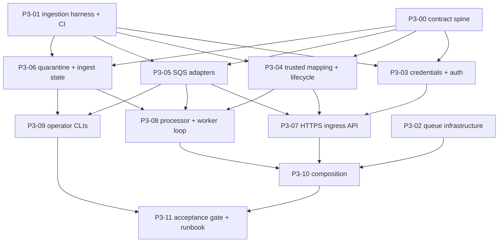

# LimnoPulse V4 Phase 3 — Ingress and Integration Abstraction Implementation Plan

> **For agentic workers:** Execute one task per worktree/session. Every task is test-first: write the failing tests, get them audited and approved, and only then implement. Steps use checkbox (`- [ ]`) syntax for tracking.

**Goal:** Build a production-capable HTTPS → SQS → normalizer path that does not depend on AWS IoT.
- **Admission.** Authenticate connectors with a per-IntegrationAccount ingest credential and resolve the device through the trusted DeviceIntegration mapping. Answer `202 Accepted` only after a durable queue write.
- **Durability.** Make at-least-once delivery, replay and DLQ redrive safe.
- **Data that cannot be normalized.** Persist quarantine and fenced data, and give operators a reconciliation path.
- **State and metrics.** Track per-Component sequence and last-seen state and per-account connector health, and emit the §23.2 telemetry metrics.
- **Authority.** Never let a payload carry tenant, site, asset or deployment authority.

**Architecture:**
- **Wave 0.** A short serial contract spine freezes the shared vocabulary as executable fixtures, fakes and *contract kits*:
  - the route order;
  - the envelope;
  - the keys;
  - the state rules;
  - the failure table;
  - the metrics;
  - the settings.

  An ElasticMQ/DynamoDB Local integration harness and the queue infrastructure run in parallel with it.
- **Wave 1.** Independent vertical slices:
  - credentials and authentication;
  - trusted mapping and lifecycle;
  - SQS adapters;
  - quarantine and state persistence.
- **Wave 2.** Slices that compose wave 1:
  - the ingress API;
  - the normalizer worker;
  - the operator CLIs.
- **Waves 3–4.** One composition owner, then a release gate.

Every dependency boundary is a merge to `main`. P3 ships **dark**: every switch is off by default (D16).

**Tech Stack:**
- Python 3.12+, FastAPI, Pydantic v2, boto3 (already locked; SQS through the same client library), `influxdb-client`, pytest/pytest-asyncio (strict mode), uv.
- Go 1.26 is unchanged, apart from the existing tests.
- Integration tests run against:
  - ElasticMQ 1.6.16 (the compose image version; the server JAR runs locally);
  - DynamoDB Local;
  - InfluxDB 2.7.11.
- CI runs on GitHub Actions.

**Spec:** `docs/superpowers/specs/2026-08-16-limnopulse-platform-redesign-tech-spec-v4.md`, sections:
- §§7.1, 7.2, 8, 8.1, 8.2, 9.2;
- §§10.1–10.4, 13.1–13.3, 15.1, 18.3, 18.12;
- §§20.2, 20.3, 20.7, 21.1, 21.2, 21.5;
- §§22.1, 22.2, 23.1, 23.2, 23.3;
- §24 Phase 3, §§25.7, 25.8, 30.

Also `docs/superpowers/specs/2026-08-25-limnopulse-v4-parallel-execution-design.md`. ADR gates: ADR-001 (fences), ADR-005, ADR-006, ADR-007, ADR-016 and ADR-019.

**Epic:** #15 (roadmap #14). It inherits the entry gates in the #15 comment ("Entry gates inherited from P2"), which derive from P2 D13/D16/D18.

**Planning baseline:** `main@d8c2a99` (P2 complete). `make verify-python` gives 3900 passed / 64 skipped; `go test -race ./...` is green.

**Revision:** r2.1.
- r2.1 applies the ElasticMQ 1.6.16 and DynamoDB Local 3.3.2 experiment session (A30–A33).
- r2 applies the findings of three local auditors and the independent audit sessions. The local auditors covered security and tenant isolation; durability and replay; and contract consistency and collisions. Each change is listed in **Audit amendments (r2)** at the end of this plan and is already applied inline.
- r1 folds in a design stress-test that ran against the code before this plan was written. Among other things it covers:
  - a P2 ADR "last paragraph" test that P3 must relax;
  - a request-processing order that FastAPI body parameters cannot express;
  - legacy-device producer coverage;
  - hidden wave dependencies;
  - a global HTTPS identity namespace;
  - fences that ignored Device status;
  - receipt replay ordering;
  - credential slots that collide with versioned writes;
  - quarantine id stability;
  - hot state rows;
  - the "worker refuses to start" data-loss window;
  - IAM principals;
  - CI pins;
  - the SQS size budget.

## Global Constraints

### Process and compatibility
- **Branching.** A worktree starts from `origin/main` only after all of its blocking task PRs are merged. Branch names follow `agent/v4-p3-<nn>-<short-name>`. One executable issue maps to one session, one branch and one PR.
- **`/v1` stays unchanged.**
  - Every `/v1` path, request, response, status code and role gate is preserved.
  - `tests/contracts/openapi/v1.json` stays byte-identical (`scripts/dev/export_v1_openapi.py --check`). It contains only `/v1` paths and the components they reach.
  - Every new Pydantic schema class name starts with `Ingest`, `Ingress`, `Quarantine`, `Connector` or `V2`, so that it never collides with a `/v1` component name. FastAPI renames colliding components, which would change the golden. P3-10 adds a test asserting that no new component name equals a `/v1` component name.
- **P2 stays unchanged.** P2 contracts in `domain/telemetry_v2.py`, `domain/telemetry_v2_schema.py`, `repositories/telemetry_v2.py` and the Influx schema are not modified. There are two exceptions, and P2 tests stay unedited for both:
  - P3-04's capability gate in `services/telemetry_normalizer.py` (D4);
  - P3-00 additively adds `accepted: tuple[CanonicalObservation, ...]` to `PipelineOutcome` in `services/telemetry_pipeline.py`, so that the P3 marks and sequence events can be derived from the observations actually accepted.

  `QuarantineReason` is not extended.
- **The one non-switched change.** For accounts whose `provider_key` is in `HTTPS_PROVIDER_KEYS`, M1 DeviceIntegration creation returns the account-scoped hash (D4, P3-04). This is the only P3 behavior change that is not behind a switch.
  - Today any tenant can create an `https_direct` account, so DeviceIntegrations created under such accounts before P3-04 merges keep the M1 global hash.
  - Those DeviceIntegrations never resolve, and admission fails closed with 403. The runbook tells operators to re-create them (D22).
- **Default-off switches.**
  - Every new behavior sits behind a default-off switch (see **Settings**).
  - With every P3 switch off, the running application behaves exactly like `main@d8c2a99`.
  - The route sets and the M1 count of 53 tenant routes stay unchanged when only `API_V2_ENABLED` is on.
- **Tenant authority.** The client and the device never supply tenant, site, asset or deployment ownership. `tenant_id` comes only from the authenticated ingest credential, and the Device only from the DeviceIntegration mapping.

### Storage
- **No Scan, GSI or table.** P3 adds no DynamoDB `Scan`, no new GSI and no new table. Every new row lives in `LimnopulseDomain` and is listed in the **Key schema** table. The one exception is the D23 audit items, which go into the existing `LimnopulseAudit` table.
- **Listing prefixes.** No new SK may start with an existing listing prefix in the same partition. Those prefixes are `SITE#`, `ASSET#`, `DEVICE#`, `COMPONENT#`, `CAPABILITY#`, `INTEGRATION_ACCOUNT#`, `DEVICE_INTEGRATION#`, `DEPLOYMENT#`, `POND#` and `IDEMPOTENCY#`. A P3-00 test enforces this rule.
- **TTL.** TTL uses the existing `expires_at` attribute: epoch seconds, rounded up. Expiry is always also checked logically: receipts against `created_at_us` (D5), every other row against `created_at`.
- **Expiry tests.** No test depends on DynamoDB Local deleting **or retaining** expired items. With TTL enabled, DynamoDB Local 3.3.2 deletes expired items within seconds, which experiments confirmed. The harness `ingestion_table()` therefore creates the key schema and GSIs but does **not** enable TTL. Expiry paths are tested by advancing the injected clock.

### Guards inherited from M1/P2
- **M1 protocols.** The M1 protocols in `repositories/v2_contracts.py` are frozen (`tests/unit/test_v2_repository_protocols.py`). P3 protocols go in `repositories/ingestion.py`. Adapters may add methods beyond their protocols.
- **Forbidden words.**
  - M1 forbids `redis`, `aws_iot`, `thing_name`, `certificate_arn` and `shadow_name` as case-insensitive substrings in every `domain/*.py` and `api/v2/**` file, comments and docstrings included (`tests/contracts/test_m1_acceptance_gate.py`). Write "the optional cache" rather than naming the product.
  - Every file under `infra/opentofu/` must not contain `telegraf`, `mosquitto`, `mqtt-broker` or `dynamodb-local` (`tests/unit/test_opentofu_infra.py`).
  - `scripts/` and `src/` must not contain the storage-stack words checked by `tests/unit/test_local_ingestion_config.py`.
- **ADR text.**
  - ADR heading tuples are pinned (`tests/unit/test_architecture_inventory.py`), so additions are paragraphs only.
  - ADR-016 text must not match the forbidden regexes at `tests/unit/test_architecture_inventory.py:646-659`. These include phrases such as "without leases", "without fencing" and "DLQ redrive need not be tested".
  - `tests/contracts/test_p2_acceptance_gate.py:1236-1262` requires the **last** paragraph of the Implementation gate in ADR-006 and ADR-007 to start with `**Phase split (P2).**`. P3-11 alone relaxes this check (D19).
- **`/v1` OpenAPI.** The `/v1` OpenAPI is identical in every switch combination (`tests/api/test_v2_telemetry_composition.py`).

### Dependencies and tests
- **No new dependencies.** No new runtime or dev dependency and no lockfile change. boto3's SQS client and `urllib3`/`botocore` exception types are already available.
- **Unique test basenames.** `tests/` has no `__init__.py`. Shared helpers live under `tests/support/` and are imported as `tests.support.<module>`. P3-00 owns `ingestion_fakes.py`, `ingestion_contract_kits.py` and `ingestion_dynamo_fake.py`; P3-01 owns `ingestion_harness.py`. Waves 1–4 create or edit no file under `tests/support/`.
- **Async tests.** pytest-asyncio runs in strict mode: async tests need `@pytest.mark.asyncio`, and async fixtures need `@pytest_asyncio.fixture`.
- **Integration tests.**
  - **ElasticMQ/DynamoDB tests** live in `tests/ingestion/` and skip unless `RUN_INGESTION_INTEGRATION=1`. They need InfluxDB only where they say so.
  - **Influx-only tests** stay in `tests/influx/` (`RUN_INFLUX_INTEGRATION=1`).
  - **Isolation.** Every test creates its own queues, table and bucket and removes them afterwards.
  - **Defaults.** `make verify-python` and `make verify-go` never need a service.
- **Coverage.** Sonar runs only the default suites. New production code under `src/` and `scripts/admin/` must reach ≥80% line coverage from unit tests alone. `tests/**` and `scripts/dev/**` are excluded from coverage.
- **Contract kits.**
  - Every new repository and queue protocol has a contract kit in `tests/support/ingestion_contract_kits.py`.
  - P3-00 runs each kit against its fake.
  - The task that implements a real adapter runs the same kit against that adapter: on the in-memory Dynamo fake in unit tests, and on real services in `tests/ingestion/`.
  - A fake and its adapter can therefore not drift apart.

### Safety
- **Never stored, logged or emitted.** The following are never stored, logged, placed in a metric label, put in a queue body or written to a receipt:
  - a raw ingest token or its secret, and its digest anywhere other than `secret_sha256` on the authoritative credential row;
  - the raw `Authorization` header;
  - a raw `Idempotency-Key`;
  - a raw `external_device_id`.
- **Redaction.**
  - 422 bodies never echo input (`include_input=False`).
  - The `/ingest` route never raises `RequestValidationError`. It builds its 422 body from `ValidationError.errors(include_input=False, include_context=False, include_url=False)[:20]`, because `/ingest` is outside the `/v2` validation handler.
  - It also **replaces every `msg` with a fixed string chosen by error `type`**, for example `"invalid value"`, `"field required"` or `"extra fields not permitted"`, because validator messages can embed input. `_require_metadata`, for instance, lists the unknown keys.
  - P3-00 adds a vector in which an unknown `source_metadata` key, a bad id and a bad unit each contain a sentinel string. The 422 body must not contain the sentinel.
  - Settings errors never echo values (`hide_input_in_errors=True`).
- **`external_identity_hash` is not a secret.** It is an unkeyed SHA-256 of a possibly low-entropy identifier, so it is pseudonymous. Never treat it as redaction.
- **Constant-time comparison.** Token digests are compared with `hmac.compare_digest`. The unknown-credential path performs one dummy comparison.

### Evidence
Every PR records the exact commands and their observed results:
- the approved failing-test run and the passing run;
- `make verify-python`, `make verify-go` and `git diff --check`;
- `uv run --locked --extra dev python scripts/dev/export_v1_openapi.py --check`;
- `make verify-ingestion` (once P3-01 is merged) and/or `make verify-influx`, when the task adds or touches integration tests. Locally these use the no-Docker runners `scripts/dev/run_local_elasticmq.sh`, `scripts/dev/run_local_dynamodb.sh` and `scripts/dev/run_local_influxd.sh`;
- `make verify-tofu` for P3-02. Install tofu 1.12.6 locally if it is missing; CI pins the same version.

## Entry Decisions (frozen by this plan)

Epic #15's entry decision is to freeze generic ingress/HTTPS first; a non-AWS generic MQTT runtime needs a separately approved slice. The decisions below are the approved answers. Changing one requires amending this plan before the dependent task starts.

| # | Decision | Answer |
|---|---|---|
| D1 | Scope | **In scope:** generic HTTPS ingress, the provider authentication port, the telemetry SQS queue and DLQ, the normalizer worker, dynamic trusted mapping, the rate-limit and entitlement hook interface, and the connector-health foundation (§24 Phase 3).<br>**Out of scope, each with its owner:**<br>• a non-AWS MQTT runtime: a separate approved slice (Backlog, see D16);<br>• vendor webhooks, `ConnectorProvider.sync` and the connector SDK: P9 (#26);<br>• AWS IoT: P5 (#18);<br>• health state machines, current-health views, calibration and point-level sequence flags: P6 (#17);<br>• entitlement enforcement: P4 (#20);<br>• AlertRuleV2: #77. |
| D2 | Connector authentication | **Credential.** A bearer **ingest credential** belongs to exactly one IntegrationAccount (ADR-016 is per-IntegrationAccount).<br>**Token grammar.** `lpi_<ic_id>_<secret>`, where `ic_id` is `ic_<32 hex>` and `secret` is 32 random bytes in unpadded base64url (43 characters). It is parsed only with `INGEST_TOKEN_PATTERN = ^lpi_(ic_[0-9a-f]{32})_([A-Za-z0-9_-]{43})$`. Splitting on `_` is wrong, because base64url contains `_`.<br>**What is stored.** Only `secret_sha256 = sha256(b"limnopulse.ingest-credential.v1\0" + secret)` and `fingerprint = secret_sha256[:8]`. The authoritative row is the global `INGEST_CREDENTIAL#<ic_id>/META`. No secret store is needed, because the platform never has to recover the secret (§13.3 "fingerprint").<br>**Issuance.**<br>• At most two **active** credentials per account, enforced by two fixed slot items created with `attribute_not_exists` in the issuing transaction. The IntegrationAccount item is never written.<br>• Credentials can be issued only for accounts whose `provider_key` is in `HTTPS_PROVIDER_KEYS = {"https_direct"}` and whose status is `pending` or `active`. The issuing transaction also includes a `ConditionCheck` on the IntegrationAccount row: `#status IN (:pending, :active) AND provider_key = :https`.<br>• Issuance takes **no** Idempotency-Key. The token is returned exactly once, with `Cache-Control: no-store` and `Pragma: no-cache`, and is never written to a receipt or snapshot. A lost issuance response therefore uses up a slot, and the operator revokes it (runbook).<br>**Revocation.**<br>• Immediate and terminal, with no cache, and it frees the slot.<br>• The revoke transaction conditions the authoritative row on `tenant_id = :t AND integration_account_id = :ia AND #status = :active AND version = :v`, and the slot `Delete` on `ingest_credential_id = :ic`.<br>• Any condition failure maps to 404, or 409 for a stale version, without revealing another tenant's row. This is the repository port's mapping; the service maps an already-revoked credential of the path's tenant and account to 409 (A45).<br>• Revoking a credential stops new admissions only. To fence data already queued, revoke the IntegrationAccount or decommission the DeviceIntegration.<br>**Who may manage credentials.** Owner and admin (`WRITE_ROLES`) issue, list and revoke.<br>**Ingest admission.** Requires an active credential **and** an active account with an HTTPS provider key.<br>**Deferred.** HMAC request signatures and mTLS (P9 webhooks use `verify_webhook`). |
| D3 | Ingest endpoint | **Endpoint.** `POST /ingest/v2/observations`. The body is `IngestObservationBatch{external_device_id, observations[1..1000]}` with `extra="forbid"`, so a `tenant_id`, `site_id`, `asset_id`, `deployment_id` or `pond_id` field gets a 422.<br>**Headers.** `Authorization: Bearer <token>` and `Idempotency-Key` (8–128 characters) are required. `X-Connector-Version` is optional and must be printable ASCII, 1–64 characters.<br>**Request handling.**<br>• The route declares **no** FastAPI body parameter and no `Header` parameter.<br>• It reads the body with a bounded stream of at most `MAX_INGEST_BODY_BYTES = 163840` (160 KiB), following the `api/telegram_webhook.py` pattern.<br>• It parses with `IngestObservationBatch.model_validate_json`.<br>• It follows the frozen **route order table** exactly.<br>**Responses.**<br>• `202` returns `{ingress_id, accepted_observations, replayed}` only after the queue write is durable (ADR-016).<br>• Every error body is fixed (see **Route order**). |
| D4 | Trusted mapping | **Identity namespace.**<br>• Generic HTTPS identities are **scoped to the IntegrationAccount**: `account_scoped_identity_hash(provider_key, ia_id, external_device_id) = external_identity_hash(provider_key, f"{ia_id}\x1f{external_device_id}")`.<br>• P3-04 applies it both when a DeviceIntegration is created under an HTTPS account and when one is resolved. This prevents cross-tenant namespace squatting on a global `EXTERNAL_ID` key.<br>• Non-HTTPS providers keep the M1 global hash.<br>**Resolution.**<br>• Read the `EXTERNAL_ID#<provider>#<hash>/META` row, then the DeviceIntegration row, then the Device, all **strongly consistent**.<br>• M1 `get_device` is eventually consistent, so P3-04 adds `get_device(..., consistent=True)` as an adapter-only method. The M1 protocol is unchanged.<br>**Admission rule — all must hold:**<br>• `di.integration_account_id == authenticated account`;<br>• `di.tenant_id == credential tenant`;<br>• DI `active`;<br>• IA `active`;<br>• **Device** `active` (provisioning, suspended, decommissioned and missing are all denied).<br>**Component selector.**<br>• `component_id` is a selector that the mapping constrains, never an ownership claim.<br>• Admission reads the **distinct** referenced Components with bounded `ComponentReader.get_component` reads. There are at most `MAX_INGEST_DISTINCT_COMPONENTS = 32` per request, and more is a 422. The legacy default id is one more read. No listing is used, because storage has no device-scoped component index.<br>• An explicit `component_id` that is not an **active** Component of that Device gets 422 `component_id is not valid for this device`, with no echo. This keeps quarantine writes from being amplified (ADR-016 "ignored *or rejected*").<br>• It may be omitted only when `default_component_id_for_legacy_device(tenant, device)` is an active Component of that Device. Otherwise omitting it gives 422 `component_id is required for this device`.<br>• Admission fills in the default, so the envelope always carries `component_id`.<br>• The normalizer's `component_not_owned` check stays as defense in depth, for replays and forged envelopes.<br>**Capability gate (P2 D14).** For a probe or hybrid Component whose `probe_profile.measurement_metric_keys` is non-empty, a metric outside that set is quarantined as `component_not_measuring`. Empty sets, which legacy defaults use, are not gated. |
| D5 | Idempotency and first receipt | **Receipt.** A per-request `IngressReceipt` (§9.2 `ExternalProviderEventReceipt`), keyed by `(integration_account_id, idempotency_key_hash)`, with a TTL of 24 h. It records:<br>• `ingress_id`;<br>• the **first** `received_at`;<br>• `request_sha256`, the canonical hash of `{external_device_id, observations as model_dump(mode="json", exclude_none=True), connector_version}`, computed **before** the default `component_id` fill, with `connector_version: null` when it is absent, using `canonical_request_hash` (`sort_keys`, compact separators);<br>• `mapping_versions`, the normalizer versions pinned into the first envelope. A pending retry reuses them, so a deploy between attempts cannot renormalize the same observations differently;<br>• `created_at_us`, an integer count of microseconds, used by the **single** expiry predicate: a receipt is live iff `created_at_us > now_us − 86_400_000_000`, and `expires_at` is used only by the TTL;<br>• `state ∈ {pending, enqueued}`.<br>**Replay.**<br>• It follows the frozen **receipt replay table**.<br>• A pending receipt is re-enqueued with the stored `ingress_id` and `received_at`, so redelivery, lost-response retries and redrive all keep the first-receipt `received_at` (P2 D5).<br>• Duplicate queue messages are possible and safe.<br>**Not a per-observation receipt** (§10.4).<br>**Known limitation.** A device that re-sends the same observation under a **new** key creates a new receipt, and its delivery fields win last-writer-wins. |
| D6 | Queue contract | **Queues.**<br>• Standard queues `limnopulse-telemetry-ingress` and `limnopulse-telemetry-ingress-dlq` (§21.2).<br>• Visibility 60 s, long polling 20 s, retention 4 days for the source and 14 days for the DLQ. The DLQ must outlive the source, because expiry counts from the original enqueue.<br>• `maxReceiveCount` 8, SSE.<br>**Body.** A compact `telemetry-ingress@1` envelope (see **Envelope**) of opaque IDs, with no secret or raw identity.<br>**Size guard.** An envelope whose UTF-8 body bytes plus `INGRESS_SCHEMA_ATTRIBUTE_BYTES` exceed `MAX_INGRESS_MESSAGE_BYTES = 262144` gets a 413 without being sent. A property test proves that the largest valid body stays within the guard, so a valid body never gets a 413. |
| D7 | Worker runtime | **Runtime.**<br>• Python (§7.2): a long-running asyncio loop, with boto3 calls in `asyncio.to_thread`.<br>• It uses its own composition function, not `create_app`, so the API's cache client is not built.<br>• It runs from the API image with an entrypoint override: `python -m limnopulse_api.workers.telemetry_ingest`. There is no new image and no build-matrix change.<br>**Credentials.** It runs as the dedicated **`telemetry_ingest`** IAM principal, never the api principal or the shared `workers` user (see **IAM**).<br>**Start guard.** It refuses to start (exit 2) unless `TELEMETRY_V2_WRITE_ENABLED=true`, so it can never delete a message it did not write. Settings also reject `INGEST_V2_ENABLED=true` without `TELEMETRY_V2_WRITE_ENABLED=true`, because the API and worker share one environment file.<br>**Compose.** `restart: "no"` locally and a bounded `on-failure` restart in production. A queue-age alarm and a runbook step cover a stopped worker. |
| D8 | Processing, ack and failure table | **Order of operations:**<br>1. Parse and validate the envelope.<br>2. Re-resolve and **fence** (ADR-001). All of the following must hold:<br>   – the re-resolved DeviceIntegration's `tenant_id`, `integration_account_id`, `provider_key`, `device_integration_id` and `device_id` equal the envelope's;<br>   – the IntegrationAccount re-read by `(envelope.tenant_id, envelope.integration_account_id)` is `active` (this read also decides `account_verified`, A45) and has an HTTPS provider key;<br>   – the Device is `active` (all three reads are consistent).<br>3. `TelemetryPipeline.ingest`.<br>4. Persist quarantine rows.<br>5. Apply monotone state updates.<br>6. Emit metrics.<br>7. Delete the message.<br>**Failures.** Each class follows the frozen **worker failure table**.<br>**Fenced messages.** These have already been answered 202, so they are never silently dropped. Each fence reason belongs to one class:<br>• **Terminal fences:** `INTEGRATION_DECOMMISSIONED`, `ACCOUNT_REVOKED`, `DEVICE_DECOMMISSIONED`, `INTEGRATION_MISMATCH` and `IDENTITY_UNRESOLVED`. Persist one **replayable** `kind=fenced_observation` row per envelope observation, with reason `fenced_<reason>`, plus one `fenced_message` summary row. Only then delete the message.<br>• **Temporary fences:** a DeviceIntegration or IntegrationAccount in `error` or `pending`, and a Device that is `provisioning` or `suspended`. These are **retryable**: `change_visibility(backoff(n))`. If the condition outlasts `maxReceiveCount`, the message lands in the DLQ, where it can be redriven.<br>• **Forged envelopes:** fenced rows and fence marks are written only when an authoritative IntegrationAccount row exists for `(envelope.tenant_id, envelope.integration_account_id)`. Otherwise the worker writes nothing, emits `ingress_fenced_total{reason}`, and uses permanent visibility, so the message ends up in the DLQ. |
| D9 | Quarantine persistence | **Rows.** One row per quarantined or fenced observation, plus one `fenced_message` summary row per fenced message, under the dedicated partition `QUARANTINE#<tenant_id>`. The SK is `<received_at_key>#<qtn_id>`, so listings are time-ordered.<br>**Id.** `quarantine_id = qtn_ + uuid5(NAMESPACE_URL, f"limnopulse:quarantine:{ingress_id}:{ordinal}:{sha256(excerpt)}").hex`.<br>• `ordinal` counts the earlier rows with an identical excerpt in the same message, in outcome order, so two identical (or identically truncated) excerpts never collide.<br>• The `fenced_message` summary row uses `ordinal = -1`.<br>• The id is content-derived and stable across redelivery, because the message body is byte-identical.<br>**Writes.** Each row is created with `attribute_not_exists(PK)`. A conditional failure counts as success, so a redelivery never resets `replayed` or `dismissed` back to `open`.<br>**TTL** 14 days.<br>**Status transitions.** `open → replayed` or `open → dismissed`; both are terminal.<br>**Contents.** The row stores the mapping versions the worker actually used (`envelope.mapping_versions`, which admission always pins).<br>**Replayable rule.** A row is replayable iff its kind is `observation` or `fenced_observation`, its `source_observation_json` is not truncated, and that JSON parses as a `SourceObservation`.<br>**Replay inputs.** Each row also stores what a replay envelope needs: `provider_key`, `external_identity_hash`, `source_type` and `connector_version`.<br>**Deadline.** The quarantine TTL and the DLQ retention are both 14 days. Together they set the hard reconciliation deadline for data that got a 202, and the runbook states both. |
| D10 | Operator reconciliation | **Admin CLIs** in `scripts/admin/`. They run from an operator checkout and are dry-run by default; `--apply` executes.<br>**`telemetry_quarantine.py`** has `list`, `replay` and `dismiss`.<br>• `replay` builds a **new** envelope: a deterministic `ingress_id = ing_ + uuid5(NAMESPACE_URL, "limnopulse:replay:" + ",".join(sorted(group_entry_keys))).hex`, computed **per group** from that group's own entry keys, where `entry_key` is the quarantine SK `<received_at_key>#<qtn_id>` (so a rerun after a crash reuses it), `replay_of=<original ingress_id>`, `replay=true`, the first `received_at`, the stored mapping versions and the stored source observations. It groups entries by `(ingress_id, device_integration_id)`, one envelope per group.<br>• It enqueues that envelope through the normal producer, and only after the send succeeds does it mark the rows `replayed`.<br>**`telemetry_dlq.py`** has `sample` and `redrive`. `redrive` sends the raw body unchanged to the source queue and then deletes it from the DLQ. A duplicate is safe.<br>**Never** an automatic DLQ consumer (`docs/notifications-phase-3c-a.md` precedent). |
| D11 | Ingest state and connector health | **Rows.**<br>• Per Component: `COMPONENT#<c>/INGEST_STATE#CURRENT`.<br>• Per Device: `DEVICE#<d>/INGEST_STATE#CURRENT`.<br>• Per IntegrationAccount: `INTEGRATION_ACCOUNT#<ia>/CONNECTOR_HEALTH#CURRENT`, a partition of its own, not the tenant partition.<br>• `HEALTH#CURRENT` is reserved for P6.<br>**Update rule.** Every attribute is a **monotone high-water mark**, written with a conditional `UpdateItem` (`attribute_not_exists(x) OR x < :t`), with no read-modify-write and no version. Updates are therefore idempotent and order-independent under concurrent workers and redelivery.<br>**Replay.** Replay messages (`replay=true`) never update state.<br>**Last-seen.** For P6, last-seen means `last_received_at`. `last_ingested_at` is diagnostic and may advance on a DLQ redrive.<br>**Device-controlled marks.** `(last_observed_at, last_observed_sequence)` advances only for accepted observations that meet all three conditions:<br>• they have a non-null `sequence`;<br>• they carry neither `clock_skew_future` nor `clock_skew_past_extreme`;<br>• they passed normalizer ownership.<br>Every other mark uses server time: the first-receipt `received_at`, or the worker clock for `last_ingested_at`. A device clock therefore cannot pin a mark.<br>**Ties.** On equal timestamps the lexicographically greater tie-breaker wins: `sequence` for observed marks, `reason` for quarantine and fence marks. This makes the final row independent of order.<br>**Sequence events.** `classify_component_sequence` (the frozen truth table) classifies sequence events against the state read once per message, and the result goes **only to metrics**. These metrics are **best-effort** and are classified only when the message is not a replay and `ApproximateReceiveCount == 1`:<br>• a first attempt that fails loses its events;<br>• a redriven message (CLI or `StartMessageMoveTask`) comes back with `ApproximateReceiveCount = 1`, is classified again (usually LATE), and may double-count;<br>• reordering between messages can produce a false GAP.<br>Gates assert state rows and pure truth-table vectors, never exact event counts under redelivery. |
| D12 | Point quality flags | `DUPLICATE`, `SEQUENCE_GAP` and `SEQUENCE_REGRESSION` stay reserved for P6. A state-dependent flag would flip on redelivery and break P2 D4 determinism. `quality-policy@1` is unchanged. |
| D13 | Rate limits and entitlements | **Rate limits.**<br>• An in-process token bucket per IntegrationAccount (default 120 requests/minute, burst 20). It runs after authentication and before the body is read.<br>• Two pre-auth buckets run before any DynamoDB read, in this order: a **process-global** bucket (default 600/minute), then a bucket keyed by the parsed `ic_` id (default 60/minute). Random `ic_` ids therefore cannot amplify store reads.<br>• No distributed cache is involved (ADR-019). With N API replicas the bound is N × limit, which is bounded and documented.<br>**Entitlements.**<br>• `IngressEntitlementCheck` is a hook. Its default `AllowDirectIngressEntitlements` allows, because direct HTTPS is on every tier (§18.3).<br>• Enforcement against EntitlementSnapshot is **DEFERRED → #20 (P4)**.<br>**Store outage.** If the authoritative stores are unavailable, the request fails closed with 503. |
| D14 | Metrics | **Port.** `TelemetryMetrics`, a port with `increment(name, value=1, **labels)` and `observe(name, value, **labels)`.<br>**Names.** Closed `*_total` and `*_seconds` names drawn from §23.2 (see **Metrics**).<br>**Labels.** Only closed-enum values, never a tenant, account, device, component or identity.<br>**Adapter.** A structured-JSON log line on logger `limnopulse.telemetry.metrics`, shaped so that an OTLP adapter can follow without renaming. No new dependency.<br>**Queue age.** Taken from `SentTimestamp`.<br>**Alarms.** CloudWatch age, depth and DLQ alarms (P3-02).<br>**Not in P3.** Stale/offline device views, connector sync lag and calibration metrics belong to P6/P9. |
| D15 | Switches and routes | **`INGEST_V2_ENABLED`** (default `false`).<br>• Requires `API_V2_ENABLED=true`, `TELEMETRY_V2_WRITE_ENABLED=true` and a non-empty `SQS_TELEMETRY_INGRESS_QUEUE_URL`.<br>• Mounts exactly `POST /ingest/v2/observations` plus the **5 tenant routes** of the credential and lifecycle routers (see **Routes**).<br>**`API_V2_ENABLED` alone** still mounts exactly the 53 M1 tenant routes.<br>**Router placement.** The lifecycle routes go in a new router file, `api/v2/routers/integration_lifecycle.py`. The existing integrations router is not extended. |
| D16 | Ships dark; legacy-device coverage | **Dark by default.** With every switch off, nothing produces canonical telemetry in production. All production switch flips are owner actions in the runbook.<br>**The D16 read-switch precondition stays open after P3.** That precondition is "a producer writes every legacy device to `observation_numeric`" (P2 D16). Legacy devices publish MQTT, which the HTTPS path cannot carry. The gate moves to a Backlog issue, `[Backlog][P3 follow-up] Producer path for legacy MQTT devices (D16 read-switch gate)`. That is issue #104, created together with the task issues, and it is the single owner. It is decomposed only after its open producer-path decision is approved: HTTPS firmware, an approved MQTT bridge, or P5 AWS IoT. The P3-11 runbook links it.<br>**P3's contribution: G15.** With `TELEMETRY_LEGACY_DUAL_WRITE_ENABLED=false`, the keyed divergence check between `observation_numeric` (written by the P3 worker) and `water_quality` (written independently by the legacy writer, for the same readings) reports zero differences. |
| D17 | Storage | No Scan, no GSI, no new table. A test checks the new keys against existing listing prefixes. |
| D18 | Dependencies | No new dependency and no lockfile change. |
| D19 | ADR recording | **What P3-11 appends.** A `**Phase split (P3).**` paragraph at the end of `## Implementation gate`, with no new heading, in ADR-006, ADR-007 and ADR-016.<br>**Changes to the P2 test.** P3-11 relaxes `tests/contracts/test_p2_acceptance_gate.py`:<br>• the P2 paragraph must be immediately followed by **at most** the P3 paragraph;<br>• every pre-existing hash stays pinned;<br>• a new P3 test checks for the P3 paragraph.<br>**Constraints on the ADR-016 text.** It must avoid the forbidden regexes in `test_architecture_inventory.py:646-659`.<br>**Required content, pinned by the new P3 test:**<br>• **ADR-006** mentions `P3`, `P6`, `#17`, `quarantine`, `connector health` and `INGEST_STATE`.<br>• **ADR-007** mentions `P3`, `redrive`, `D16`, `Backlog` and `G15`.<br>• **ADR-016** mentions `P3`, `Idempotency-Key`, `entitlement`, `#20` and `DLQ redrive`. It states that entitlement enforcement is P4 (#20) and that P3 ships the pre-enqueue hook.<br>• **Every one** links `../p3-ingestion-rollout-runbook.md`. |
| D20 | Spec deltas | See the table below. |
| D21 | Production compose | P3-10 adds a `telemetry-ingest-worker` service in profile `ingestion` to both `compose.yaml` and `compose.production.yaml`. The default deploy does not start it. |
| D23 | Security audit events (§22.3) | Credential issue and revoke, and IntegrationAccount and DeviceIntegration status transitions, each write **one** audit item into `LimnopulseAudit`.<br>• The audit item is part of the same `TransactWriteItems` as the change, following the `adapters/alert_rules.py` pattern (`AuditContext`, actions `ingest_credential.issued`, `ingest_credential.revoked`, `integration_account.status_changed` and `device_integration.status_changed`).<br>• Each item carries the actor, tenant, resource ids, before and after status, and the credential `fingerprint` only: never a token, secret or digest.<br>• The adapters take `audit_table_name`. P3-02 grants the API principal `PutItem` on the audit table (absent today). |
| D22 | Device re-claim and decommission | **Releasing an identity.** Decommissioning a DeviceIntegration does not release its external identity in P3. The `EXTERNAL_ID` row keeps the identity claimed, with `status=decommissioned`.<br>**Effect on new and queued data.** New admissions get 403, and queued messages are fenced.<br>**Re-claimed identities.** Because the identity is never released, the `INTEGRATION_MISMATCH` fence can only be triggered by a forged or corrupted envelope. Tests use a forged envelope whose DeviceIntegration id differs from the resolved one.<br>**DeviceIntegrations created under `https_direct` before P3-04.** They carry the global hash. They never resolve, so admission fails closed with 403, and they must be re-created.<br>**Deployment edits.** If a Deployment interval is edited between a first write and a redelivery or replay, a second series is written for the same `event_id`, because `site_id`, `asset_id` and `deployment_id` are tags. This is documented and not prevented. |

### Spec deltas (V4 → this plan)

| V4 text | P3 contract | Reason |
|---|---|---|
| §30 `cmd/telemetry-normalizer/` | Python `src/limnopulse_api/workers/telemetry_ingest.py` | §7.2 "Initially Python"; reuses the P2 Pydantic pipeline. |
| §24 `infra/opentofu/queues.tf` | `infra/opentofu/ingestion_queues.tf` | §30 lists `ingestion_queues.tf`; it also keeps `queues.tf` counts pinned. |
| §15.1 "per-integration rate … limits" | per-IntegrationAccount bucket plus pre-auth bucket | ADR-016 says per-IntegrationAccount. |
| §10.4 "`Idempotency-Key` or a stable `source_event_id`" | `Idempotency-Key` required | Satisfies the ADR-016 "either" requirement. A per-request receipt preserves first-receipt time. |
| §9.2 `ExternalProviderEventReceipt` (append-only) | `IngressReceipt` with `pending → enqueued` state | DynamoDB and SQS are not transactional. The state makes a lost send recoverable. |
| §20.3 `HEALTH#CURRENT` for Device/Component | `INGEST_STATE#CURRENT`; connector health under `INTEGRATION_ACCOUNT#<ia>` | Health semantics belong to P6. P3 writes raw high-water marks only. |
| §10.2 "preserve the source event in bounded quarantine/DLQ metadata" | DynamoDB quarantine rows plus SQS DLQ for undecodable messages | The ack contract requires persistence before delete. Undecodable bodies stay in the DLQ. |
| §24 "Mosquitto/Telegraf remains local and can dual-write" | Unchanged local path; canonical writes dual-write `water_quality` through P2 D7/D8 | There is no MQTT runtime in P3 (entry decision). |
| §13.3 webhook secrets in the secret store | Ingest credential digests in DynamoDB | Inbound bearer secrets never need recovery; only a fingerprint is kept. |
| P2 D16 "Production enablement is a P3 exit step" | P3 exits with enablement **permitted**: G1–G15 green, runbook drills executed. The production flips are owner runbook actions recorded on #15. The legacy-device read-switch precondition moves to the Backlog issue (D16). | Agents do not change production. HTTPS cannot carry legacy MQTT devices. |
| ADR-016 "enforce … entitlement limits before durable enqueue" | Hook before enqueue; enforcement **DEFERRED → #20** and recorded in the ADR-016 P3 paragraph | P4 owns EntitlementSnapshot (D13). |

## Execution Graph and Merge Gates



| Wave | Tasks allowed in parallel | Start condition |
|---:|---|---|
| 0 | P3-00, P3-01, P3-02 | This plan merged |
| 1 | P3-03, P3-04, P3-05, P3-06 | P3-00 and P3-01 merged and green |
| 2 | P3-07 (P3-03, P3-04, P3-05); P3-08 (P3-04, P3-05, P3-06); P3-09 (P3-05, P3-06) | Their blockers merged and green |
| 3 | P3-10 only | P3-02, P3-07, P3-08 merged and green |
| 4 | P3-11 only | P3-09 and P3-10 merged and green |

| Task | Issue | Blocked by | Blocks |
|---|---|---|---|
| P3-00 | #92 | plan | P3-03, P3-04, P3-05, P3-06 |
| P3-01 | #93 | plan | P3-03, P3-04, P3-05, P3-06 |
| P3-02 | #94 | plan | P3-10 |
| P3-03 | #95 | P3-00, P3-01 | P3-07 |
| P3-04 | #96 | P3-00, P3-01 | P3-07, P3-08 |
| P3-05 | #97 | P3-00, P3-01 | P3-07, P3-08, P3-09 |
| P3-06 | #98 | P3-00, P3-01 | P3-08, P3-09 |
| P3-07 | #99 | P3-03, P3-04, P3-05 | P3-10 |
| P3-08 | #100 | P3-04, P3-05, P3-06 | P3-10 |
| P3-09 | #101 | P3-05, P3-06 | P3-11 |
| P3-10 | #102 | P3-02, P3-07, P3-08 | P3-11 |
| P3-11 | #103 | P3-09, P3-10 (others transitively) | Epic #15 |

## Locked Cross-Task Contracts

P3-00 encodes every item in this section as executable tests, fixtures or vectors. Later tasks consume these contracts and do not redefine them.

### Versions and limits (`domain/ingestion.py`)
```python
INGRESS_ENVELOPE_SCHEMA = "telemetry-ingress@1"
HTTPS_PROVIDER_KEYS = frozenset({"https_direct"})
MAX_INGEST_BODY_BYTES = 163_840            # 160 KiB, bounded streaming read
MAX_INGEST_OBSERVATIONS = 1_000            # == MAX_OBSERVATIONS_PER_BATCH (P2)
MAX_INGEST_DISTINCT_COMPONENTS = 32        # bounded GetItem reads at admission
MAX_INGRESS_MESSAGE_BYTES = 262_144        # our guard (stricter than SQS's 1 MiB); UTF-8 body + attribute bytes -> 413
INGRESS_SCHEMA_ATTRIBUTE_BYTES = 31       # len("schema") + len("String") + len("telemetry-ingress@1")
MAX_VALIDATION_ERRORS = 20                 # 422 detail entries
MAX_ENVELOPE_EXCERPT_BYTES = 2_048         # fenced-message quarantine excerpt
INGRESS_RECEIPT_TTL = timedelta(hours=24)
QUARANTINE_TTL = timedelta(days=14)
MAX_ACTIVE_INGEST_CREDENTIALS = 2          # slot numbers 1 and 2
INGEST_TOKEN_PATTERN = r"^lpi_(ic_[0-9a-f]{32})_([A-Za-z0-9_-]{43})$"
INGEST_SECRET_DIGEST_PREFIX = b"limnopulse.ingest-credential.v1\0"
CONNECTOR_VERSION_PATTERN = r"^[\x21-\x7e]{1,64}$"
```
- **IDs.**
  - `new_ingest_credential_id()` returns `ic_<32 hex>`.
  - `new_ingress_id()` returns `ing_<32 hex>`.
  - `quarantine_entry_id(ingress_id, ordinal, excerpt_json)` returns `qtn_<32 hex>`. It is deterministic (D9) and lives in `domain/ids.py`.
- **Hashing.** `account_scoped_identity_hash(provider_key, integration_account_id, external_device_id)` lives in `adapters/dynamodb_v2.py`, next to `external_identity_hash` (D4). The `\x1f` separator is unambiguous because `EXTERNAL_IDENTITY_PATTERN` excludes control characters.
- **Shared pattern.** P3-00 moves `EXTERNAL_IDENTITY_PATTERN` and `EXTERNAL_IDENTITY_MAX_LENGTH` from `api/v2/schemas/integrations.py` to `domain/v2_common.py` and re-imports them there, so behavior does not change. The domain layer must not import from the API layer.

### Models (`domain/ingestion.py`)
```python
class IngestCredentialStatus(StrEnum): ACTIVE = "active"; REVOKED = "revoked"
class IngestCredential(V2VersionedEntity):
    tenant_id; ingest_credential_id; integration_account_id
    slot: Literal[1, 2]; secret_sha256: Sha256Hex; fingerprint  # 8 lowercase hex
    status: IngestCredentialStatus; revoked_at: datetime | None

class AuthenticatedSource(BaseModel, frozen, extra=forbid):
    tenant_id; integration_account_id; provider_key; ingest_credential_id

class IngestSourceObservation(BaseModel, extra=forbid):   # public; SourceObservation minus required component
    component_id: ComponentId | None = None
    metric_key; value; source_unit; observed_at; sequence = None
    source_event_id = None; source_metadata = {}           # same validators as SourceObservation
class IngestObservationBatch(BaseModel, extra=forbid):
    external_device_id: str                                 # EXTERNAL_IDENTITY_PATTERN, <= 512
    observations: list[IngestSourceObservation]            # 1..MAX_INGEST_OBSERVATIONS

class IngressEnvelope(BaseModel, frozen, extra=forbid):   # see Envelope
class IngressReceiptState(StrEnum): PENDING; ENQUEUED
class IngressReceipt(BaseModel, frozen, extra=forbid):
    integration_account_id; tenant_id; key_sha256; request_sha256; ingress_id
    received_at; mapping_versions: NormalizationVersions   # pinned at first claim; reused on every pending retry
    state; created_at; created_at_us: int; expires_at   # expires_at == ceil(created_at + 24h)

class IngressFenceReason(StrEnum):          # terminal: rows persisted, message deleted
    IDENTITY_UNRESOLVED; INTEGRATION_MISMATCH; INTEGRATION_DECOMMISSIONED
    ACCOUNT_REVOKED; DEVICE_DECOMMISSIONED
class IngressDeferReason(StrEnum):          # temporary: retryable visibility, then DLQ
    INTEGRATION_NOT_ACTIVE; ACCOUNT_NOT_ACTIVE; DEVICE_NOT_ACTIVE
class IngressAdmissionDenied(StrEnum):   # admission-time 403/422 causes (metric labels only)
    IDENTITY_UNRESOLVED; INTEGRATION_MISMATCH; INTEGRATION_INACTIVE
    ACCOUNT_INACTIVE; DEVICE_INACTIVE; COMPONENT_REQUIRED; COMPONENT_INVALID; ENTITLEMENT_DENIED

class QuarantineEntryKind(StrEnum): OBSERVATION; FENCED_OBSERVATION; FENCED_MESSAGE
class QuarantineEntryStatus(StrEnum): OPEN; REPLAYED; DISMISSED
class QuarantineEntry(V2VersionedEntity):
    tenant_id; quarantine_id; kind; reason: str   # QuarantineReason value, or "fenced_<IngressFenceReason>"
    ingress_id; replay_of: str | None; integration_account_id
    provider_key; external_identity_hash; source_type: SourceType; connector_version: str | None
    device_integration_id: str; device_id: str      # always the envelope's values (never optional)
    received_at; mapping_versions: NormalizationVersions
    observation: QuarantinedObservation | None    # kind == observation (normalizer quarantine)
    source_observation_json: str | None            # kind in {observation, fenced_observation}: the SourceObservation JSON used for replay
    envelope_excerpt_json: str | None              # kind == fenced_message: compact envelope truncated to <= 2048 bytes on a UTF-8 boundary
    truncated: bool; replayable: bool
    status: QuarantineEntryStatus; replayed_ingress_id: str | None; expires_at: datetime

class QuarantinePage(BaseModel, frozen): entries: tuple[QuarantineEntry, ...]; next_after_sk: str | None
# entry_key == the quarantine SK "<received_at_key>#<qtn_id>"; received_at_key = canonical_timestamp_key(received_at)
class IngestMarks(BaseModel, frozen):
    tenant_id; device_id: str | None; integration_account_id
    component_marks: tuple[ComponentMark, ...]   # (component_id, received_at?, ingested_at?, observed_at?, sequence?)
    device_mark: DeviceMark | None               # (received_at, ingested_at)
    connector_mark: ConnectorMark                # (received_at?, accepted_at?, quarantined_at?+reason?, fenced_at?+reason?)

def build_quarantine_entries(envelope: IngressEnvelope, *, outcome: PipelineOutcome | None = None,
                             fence: IngressFence | None = None, now: datetime) -> tuple[QuarantineEntry, ...]: ...
# outcome: one OBSERVATION row per outcome.quarantined record (reason = its QuarantineReason value;
#          source_observation_json = its source_excerpt_json); fence: one FENCED_OBSERVATION row per envelope
#          observation (reason = "fenced_<reason>") + one FENCED_MESSAGE summary row (ordinal -1).
# ordinal = count of earlier rows with an identical excerpt in this call; replayable per D9.
def ingest_audit_item(*, action: str, tenant_id: str, resource_id: str, before_status: str | None,
                      after_status: str, context: AuditContext, now: datetime, fingerprint: str | None = None) -> dict: ...
# The single D23 audit-item layout (mirrors adapters/alert_rules.py `_audit_item`); P3-03/P3-04 both use it.

class SequenceEvent(StrEnum): FIRST; CONTIGUOUS; GAP; REGRESSION; DUPLICATE; LATE
class ComponentIngestState(BaseModel, frozen, extra=forbid):
    tenant_id; component_id; device_id
    last_received_at | None; last_ingested_at | None
    last_observed_at | None; last_observed_sequence: int | None
class DeviceIngestState(...): tenant_id; device_id; last_received_at | None; last_ingested_at | None
class ConnectorHealth(...): tenant_id; integration_account_id
    last_received_at; last_accepted_at; last_quarantined_at; last_quarantine_reason
    last_fenced_at; last_fence_reason                # all optional
```
Each enum is frozen with a value-set test. Any model that P3 persists has a `to_item`/`from_item` round-trip vector.

### Route order (`POST /ingest/v2/observations`)

| Step | Check | Failure → status | Body (exact) | Headers |
|---:|---|---|---|---|
| 1 | `Authorization` present and the token matches `INGEST_TOKEN_PATTERN` | 401 | `{"detail":"unauthorized"}` | `WWW-Authenticate: Bearer` |
| 2 | Pre-auth buckets: process-global, then the parsed `ic_` id. No store read before this step. | 429 | `{"detail":"rate limited"}` | `Retry-After: <int ≥1>` |
| 3 | Credential row exists, digest matches, `active`; account exists, `active`, provider key in `HTTPS_PROVIDER_KEYS` | 401 | `{"detail":"unauthorized"}` | `WWW-Authenticate: Bearer` |
| 4 | Per-account bucket | 429 | `{"detail":"rate limited"}` | `Retry-After` |
| 5 | `Content-Type` is `application/json`, with an optional `charset=utf-8`; `Content-Encoding` is absent or `identity` | 415 | `{"detail":"unsupported media type"}` | — |
| 6 | Declared `Content-Length` ≤ max; streamed bytes ≤ max. A malformed or negative `Content-Length` also gets 413. | 413 | `{"detail":"request body too large"}` | — |
| 7 | JSON + `IngestObservationBatch`; `Idempotency-Key` 8–128 chars (`loc:["header","idempotency-key"]`); `X-Connector-Version` pattern (`loc:["header","x-connector-version"]`) | 422 | `{"detail":[{"loc":[…],"msg":"…","type":"…"}]}`, at most 20 entries, no `input`/`ctx`/`url`, never 500 on NaN/Infinity | — |
| 8 | Receipt lookup (replay table) | 409 / replay 202 | `{"detail":"idempotency key reused with a different request"}` | — |
| 9 | Resolve the identity with `account_scoped_identity_hash`, then the D4 admission rule | 403 | `{"detail":"forbidden"}`: one body for unknown, foreign-account and inactive | — |
| 10 | Component rule (D4) | 422 | `{"detail":[{"loc":["body","observations",i,"component_id"],"msg":"component_id is required for this device","type":"missing"}]}`, or with `"msg":"component_id is not valid for this device","type":"value_error"` | — |
| 11 | Entitlement hook | 403 | `{"detail":"forbidden"}` | — |
| 12 | Build the envelope; size guard (body bytes + message-attribute bytes). This runs before the claim, so a 413 never leaves a receipt behind. | 413 | `{"detail":"request body too large"}` | — |
| 13 | Claim the receipt (conditional put). This step is skipped for a live `pending` receipt that has the same hash. | 503 | `{"detail":"service unavailable"}` | — |
| 14 | SQS send (the receipt stays `pending` on failure) | 503 | `{"detail":"service unavailable"}` | — |
| 15 | Mark the receipt `enqueued` (a failure is logged and counted, and still returns 202) | — | — | — |
| 16 | Success | 202 | `{"ingress_id":"ing_…","accepted_observations":n,"replayed":false}` | — |

- **Store failures.** A DynamoDB/botocore failure at steps 3, 8, 9 or 10 returns 503 `{"detail":"service unavailable"}`. Admission fails closed.
- **Limits.** The three rate limiters (the global pre-auth, the per-`ic_` pre-auth and the per-account limiter) and the entitlement hook are ports. P3-07 provides the in-process implementations.

### Receipt replay table (step 8, then 13)

| Receipt (logically live: `created_at_us > now_us − 86_400_000_000`) | `request_sha256` | Action |
|---|---|---|
| none, or expired | — | Continue to step 9. At step 13, claim with `attribute_not_exists(PK) OR created_at_us <= :cutoff_us`, the **same predicate** as step 8. If the claim loses a race, re-read **once** and apply this table to the winner. A second loss returns 503. |
| `enqueued` | same | 202, `replayed=true`, stored `ingress_id`. Nothing is sent. |
| `pending` | same | Steps 9–12, 14 and 15 run with the stored `ingress_id`, `received_at` and **`mapping_versions`**, and **no claim**. A claim-race loser uses the winner's stored values in the same way. The result is 202 with `replayed=true`. A fresh admission denial returns 403 (the worker would fence anyway). |
| `pending` or `enqueued` | different | 409 |

`mark_ingress_receipt_enqueued` is conditioned on `ingress_id = :id AND #state = :pending`. A condition failure there is a no-op.

Receipt keys use `idempotency_key_hash` on the raw key, scoped to the authenticated account. The `request_sha256` hash input includes the raw `external_device_id`; only the hash is stored.

### Envelope (`telemetry-ingress@1`)
```json
{
  "schema": "telemetry-ingress@1",
  "ingress_id": "ing_<32 hex>",
  "replay_of": "ing_<32 hex>",                 // omitted unless replay
  "tenant_id": "...", "integration_account_id": "ia_...", "provider_key": "https_direct",
  "external_identity_hash": "<64 hex>",
  "device_integration_id": "di_...", "device_id": "...",
  "source_type": "https",
  "connector_version": "...",                   // omitted when absent
  "received_at": "YYYY-MM-DDTHH:MM:SS.ffffffZ",
  "replay": true,                               // omitted when false
  "mapping_versions": {"catalog_version": "...", "unit_mapping_version": "...", "quality_policy_version": "..."},  // ALWAYS present: admission pins the normalizer defaults (ADR-005 across deploys)
  "observations": [ /* SourceObservation.model_dump(mode="json", exclude_none=True, exclude_defaults=True); component_id always present */ ]
}
```
- **Serialization.** Compact: `separators=(",", ":")`, **`ensure_ascii=False`** (UTF-8-preserving), `exclude_none` and `exclude_defaults`. A P3-00 Unicode-expansion vector, using 1000 observations whose `firmware_version` contains emoji, must stay within the size bound.
  - **Exception:** `mapping_versions` is always serialized with all three version strings, even when they equal the current defaults, so a later default change cannot re-fill them on parse.
  - P3-00 adds a wire-format vector that requires `catalog_version`, `unit_mapping_version` and `quality_policy_version` to appear literally in the JSON.
- **Parsing.** The worker parses with `IngressEnvelope.model_validate_json` and rebuilds `SourceObservation`s.
- **Context.** The `TrustedSourceContext` is:
  - `tenant_id`, `device_id` from the **re-resolved** DI;
  - `integration_id=device_integration_id`;
  - `integration_type=provider_key`;
  - `source_type=https`;
  - `connector_version`, `received_at`, `replay` and `mapping_versions` from the envelope.
- **Size vectors.** A P3-00 test serializes the largest valid `IngestObservationBatch`: a 160 KiB body, every optional field at its maximum, and component ids filled in. It asserts that `envelope bytes + message-attribute bytes ≤ MAX_INGRESS_MESSAGE_BYTES`, so a valid body **never** gets a 413. The guard is defense in depth.

### Key schema (`DynamoV2KeyBuilder` additions)

| Row | PK | SK | entity_type | TTL | Operations |
|---|---|---|---|---|---|
| Ingest credential (authoritative) | `INGEST_CREDENTIAL#<ic>` | `META` | `ingest_credential` | — | Put (txn, new), GetItem (consistent), Update (txn, revoke) |
| Credential listing | `TENANT#<t>` | `INGEST_CREDENTIAL#<ia>#<ic>` | `ingest_credential_listing` | — | Put/Update (txn), Query prefix `INGEST_CREDENTIAL#<ia>#` |
| Credential slot | `TENANT#<t>` | `INGEST_CREDENTIAL_SLOT#<ia>#<1\|2>` | `ingest_credential_slot` | — | Put `attribute_not_exists` (txn), Delete (txn, on revoke) |
| Ingress receipt | `INGRESS_RECEIPT#<ia>` | `<key_sha256>` | `ingress_receipt` | `expires_at` (TTL only; liveness via `created_at_us`) | conditional Put, GetItem (consistent), conditional Update (`enqueued`) |
| Quarantine | `QUARANTINE#<t>` | `<received_at_key>#<qtn>` | `telemetry_quarantine` | `expires_at` | Put `attribute_not_exists`, Query (range, `ExclusiveStartKey`-free paging by SK lower bound), Update (status, version) |
| Component ingest state | `COMPONENT#<c>` | `INGEST_STATE#CURRENT` | `component_ingest_state` | — | conditional UpdateItem per mark, GetItem |
| Device ingest state | `DEVICE#<d>` | `INGEST_STATE#CURRENT` | `device_ingest_state` | — | conditional UpdateItem, GetItem |
| Connector health | `INTEGRATION_ACCOUNT#<ia>` | `CONNECTOR_HEALTH#CURRENT` | `connector_health` | — | conditional UpdateItem, GetItem |

- **Tenant partition.** The new `TENANT#<t>` SKs start with `INGEST_CREDENTIAL#` or `INGEST_CREDENTIAL_SLOT#`. Neither extends an existing listing prefix, and a test proves it.
- **Revocation.** The `Delete` action builder lives in `adapters/dynamodb_ingest_credentials.py`, owned by P3-03, and never on `DynamoV2RepositoryBase`, whose public surface is pinned by `tests/unit/test_v2_key_builder.py`. Revoke is one transaction: update the authoritative row and the listing row, and delete the slot, with the D2 conditions.
- **Connector health reads.** `get_connector_health(tenant_id, ia)` returns `None` unless `item.tenant_id == tenant_id`.

### Monotone update expressions (P3-06)
- **Simple marks** (`last_received_at`, `last_ingested_at`, `last_accepted_at`):
  - `SET #m = :t, tenant_id = :tenant, … ` (identity attributes set with `if_not_exists`);
  - condition `attribute_not_exists(#m) OR #m < :t`;
  - a `ConditionalCheckFailed` means *already newer* and counts as success.
- **Paired marks:**
  - `(last_observed_at, last_observed_sequence)` is written together on `last_observed_at`;
  - `(last_quarantined_at, last_quarantine_reason)` is written together on `last_quarantined_at`;
  - `(last_fenced_at, last_fence_reason)` is written together on `last_fenced_at`.

  The condition is `attribute_not_exists(#m) OR #m < :t OR (#m = :t AND #tb < :tb)`, where the tie-breaker `#tb` is the sequence or the reason. The final row is therefore independent of write order. Within one message, the mark is the maximum `(observed_at, sequence)` pair and, for quarantine and fence marks, the lexicographically greatest reason at the maximum timestamp.
- **Timestamps.** They use the canonical `YYYY-MM-DDTHH:MM:SS.ffffffZ` string (`%Y-%m-%dT%H:%M:%S.%fZ`), so lexicographic order is chronological. `isoformat()` is forbidden, because without microseconds `…00Z` sorts after `…00.000001Z`. P3-00 adds a vector for this. `last_ingested_at` uses the worker clock. Every other mark uses the envelope `received_at` or the observation's `observed_at`.

### Sequence truth table (`classify_component_sequence(state, pairs) -> tuple[SequenceEvent, ...]`, pure)
`pairs` are the **distinct** `(observed_at, sequence)` pairs of a Component's accepted observations whose `sequence` is not `None`. A multi-metric reading collapses to one pair. They are sorted by `(observed_at, sequence)`. Let `prev = (state.last_observed_at, state.last_observed_sequence)`, updated after each pair that is not LATE.

| Condition (per pair `(o, s)`) | Event |
|---|---|
| `prev` absent (no state, or `last_observed_sequence is None`) | `FIRST` |
| `o > prev.o` and `s == prev.s + 1` | `CONTIGUOUS` |
| `o > prev.o` and `s > prev.s + 1` | `GAP` (counted through the sequence-event counter only; P3 emits no gap-size metric, A44) |
| `o > prev.o` and `s <= prev.s` | `REGRESSION` |
| `o == prev.o` and `s == prev.s` | `DUPLICATE` |
| `o == prev.o` and `s != prev.s` | `LATE` |
| `o < prev.o` | `LATE` (never a regression; reordering is normal, §8.1) |

Observations without a sequence produce no event. Sequences are interpreted per Component. A connector that shares one device-level counter across several Components can produce false gaps, which is documented for P6.

### Worker failure table (P3-08)

| Condition | Category (metric label) | SQS action |
|---|---|---|
| Body not UTF-8 JSON, envelope invalid, or `schema` unknown | `envelope_invalid` (permanent) | `change_visibility(permanent_visibility)`, until `maxReceiveCount` moves it to the DLQ |
| Terminal fence (D8), authoritative account row exists | `fenced` | persist the per-observation `fenced_<reason>` rows and the summary row → `delete` |
| Terminal fence, no authoritative account row (forged envelope) | `fenced_unverified` (permanent) | nothing written → `change_visibility(permanent_visibility)` |
| Temporary fence (`IngressDeferReason`) | `deferred` (retryable) | `change_visibility(backoff(n))` |
| Processing exceeded `processing_deadline_seconds` | `unexpected` (retryable) | `change_visibility(backoff(n))` |
| DynamoDB/botocore error (resolve, components, deployments, quarantine, state) | `store_unavailable` (retryable) | `change_visibility(backoff(n))` |
| `TelemetryWriteError(retryable=True)` | `write_retryable` | `change_visibility(backoff(n))` |
| `TelemetryWriteError(retryable=False)` | `write_permanent` | `change_visibility(permanent_visibility)` |
| `ValueError` from the pipeline (unknown mapping version, over-limit batch) | `contract_violation` (permanent) | `change_visibility(permanent_visibility)` |
| Any other `Exception` | `unexpected` (retryable) | `change_visibility(backoff(n))` |
| Success | `processed` | `delete`. A failure to delete is logged and counted; the redelivery is idempotent. |

- **Backoff.** `backoff(n) = clamp(ceil(random() * min(cap, base * 2**(n-1))), 1, 43200)`, where `n = ApproximateReceiveCount`. Full jitter is applied, and `base`, `cap` and the random source are injectable (defaults 30 s and 900 s). `permanent_visibility` is 60 s.
- **Heartbeat.**
  - It starts **when the message is received**, not when processing starts, and extends visibility to `visibility_seconds` every `visibility_seconds / 2`.
  - It is cancelled and awaited **before** the final `delete` or `change_visibility`, so a late heartbeat never overwrites the backoff.
- **Deadline.** Each message is processed under `asyncio.wait_for(processing_deadline_seconds)`, so a hung dependency cannot keep a message invisible forever.
- **Shutdown.** On SIGTERM the worker stops receiving and waits up to `drain_seconds` for in-flight messages. Unfinished messages simply reappear on the queue.
- **Concurrency.** A semaphore bounds it at `TELEMETRY_INGEST_WORKER_CONCURRENCY`. Each receive asks for `min(max_messages, free permits)` messages, so no message waits unprocessed while its visibility runs out.
- **Outage timing.** With the defaults (8 receives, a 30 s base and a 900 s cap), an InfluxDB outage longer than roughly 20–45 minutes moves the backlog to the DLQ. That is expected; recovery is the runbook redrive drill, alerted by the DLQ alarm. The DLQ window is 14 days minus the time spent in the source queue.

### Metrics (closed names; labels from closed enums only)

| Name | Labels | Emitted by |
|---|---|---|
| `ingest_requests_total` | `outcome ∈ {accepted, replayed, unauthorized, rate_limited, unsupported_media, too_large, invalid, conflict, forbidden, unavailable}` | API |
| `ingest_admission_denied_total` | `reason ∈ IngressAdmissionDenied` | API |
| `ingest_observations_admitted_total` | — | API |
| `ingress_messages_total` | `outcome ∈ {processed, fenced, retry, permanent}` and `category` (failure table) | worker |
| `ingress_observations_total` | `result ∈ {accepted, quarantined}` | worker |
| `ingress_quarantined_total` | `reason ∈ QuarantineReason` (covers unit-mapping failures and deployment-resolution misses) | worker |
| `ingress_fenced_total` | `reason ∈ IngressFenceReason` | worker |
| `ingress_deferred_total` | `reason ∈ IngressDeferReason` | worker |
| `ingress_quality_flags_total` | `flag ∈ QualityFlag` (delayed, replay, clock skew) | worker |
| `ingress_sequence_events_total` | `event ∈ SequenceEvent` | worker |
| `ingress_write_failures_total` | `retryable ∈ {true, false}` | worker |
| `ingress_normalization_duration_seconds` | — | worker |
| `ingress_queue_age_seconds` | — | worker (`SentTimestamp`) |
| `ingress_dlq_redriven_total` | `result ∈ {redriven, failed}` | CLI |
| `ingress_quarantine_replayed_total` | `result ∈ {replayed, skipped, failed}` | CLI |

The structured-log adapter emits one JSON object per `increment`/`observe` call: `{"metric": name, "value": n, "labels": {...}}`.

**Never logged:** `Authorization`, any token or secret or digest, a raw `Idempotency-Key`, a raw `external_device_id`, or request bodies.

### IAM (P3-02)

| Principal | SQS | DynamoDB (domain table) |
|---|---|---|
| `api` user (existing) | `SendMessage` on ingress | adds explicit `dynamodb:DeleteItem` and `dynamodb:ConditionCheckItem` to the existing set, and adds `dynamodb:PutItem` on `LimnopulseAudit` for the D23 audit items. Today `iam_runtime.tf` grants only `TransactWriteItems` there, and transactions need the per-item actions. A transaction's sub-operations are authorized per item action. |
| `telemetry_ingest` user (**new, dedicated**) | `ReceiveMessage`, `DeleteMessage`, `ChangeMessageVisibility`, `GetQueueAttributes` on ingress | `GetItem`, `Query`, `PutItem`, `UpdateItem` |
| operator policy (managed, **not attached**) | `ReceiveMessage`, `DeleteMessage`, `ChangeMessageVisibility`, `GetQueueAttributes` on the DLQ; `SendMessage` on ingress | `Query`, `GetItem`, `UpdateItem` |

- **Gating.** Every resource and policy is gated by `count = var.telemetry_ingress ? 1 : 0` and lives in `ingestion_queues.tf`. `iam_runtime.tf` is not edited; its users are referenced by resource name.
- **Why a dedicated worker principal.** The shared `workers` user, which also serves the Go notification workers, is **not** widened.
- **Transport.** Both queues get a queue policy that denies `aws:SecureTransport = false`.

### Settings (`core/config.py`; P3-00 adds, P3-10 wires)
`SQS_ENDPOINT_URL` already exists in `.env.example` (Go workers). The Python `sqs_endpoint_url` field reuses that variable, and P3-10 must not duplicate the line: `test_p2_configuration.py` forbids duplicate entries.
```python
ingest_v2_enabled: bool = False
sqs_endpoint_url: str | None = None
sqs_telemetry_ingress_queue_url: str = ""
sqs_telemetry_ingress_dlq_url: str = ""
ingest_rate_limit_per_minute: int = Field(default=120, ge=1, le=6_000)
ingest_rate_limit_burst: int = Field(default=20, ge=1, le=1_000)
ingest_rate_limiter_max_keys: int = Field(default=10_000, ge=100, le=1_000_000)
# pre-auth bucket capacity = max(1, per_minute // 10); refill = per_minute / 60 per second
ingest_preauth_rate_limit_per_minute: int = Field(default=60, ge=1, le=6_000)
ingest_preauth_global_per_minute: int = Field(default=600, ge=1, le=60_000)
telemetry_ingest_processing_deadline_seconds: int = Field(default=45, ge=5, le=900)
telemetry_ingest_worker_concurrency: int = Field(default=4, ge=1, le=10)
telemetry_ingest_worker_max_messages: int = Field(default=10, ge=1, le=10)
telemetry_ingest_worker_wait_seconds: int = Field(default=20, ge=0, le=20)
telemetry_ingest_worker_visibility_seconds: int = Field(default=60, ge=10, le=43_200)
telemetry_ingest_retry_base_seconds: int = Field(default=30, ge=1, le=900)
telemetry_ingest_retry_cap_seconds: int = Field(default=900, ge=1, le=43_200)
telemetry_ingest_drain_seconds: int = Field(default=30, ge=1, le=300)
```
- **Validator.** `INGEST_V2_ENABLED=true` requires `API_V2_ENABLED=true`, `TELEMETRY_V2_WRITE_ENABLED=true` and a non-empty `SQS_TELEMETRY_INGRESS_QUEUE_URL`. It also requires `retry_base ≤ retry_cap`.
- **Errors never echo values.**

### Routes (mounted by P3-10 only when `INGEST_V2_ENABLED`)
- `POST /ingest/v2/observations`. It is not tenant-scoped and has no Cognito/dev auth: the ingest credential is its only authority.
- `POST   /v2/tenants/{tenant_id}/integration-accounts/{integration_account_id}/ingest-credentials`: 201 with the metadata and the `token` once, plus `Cache-Control: no-store` and `Pragma: no-cache`.
- `GET    /v2/tenants/{tenant_id}/integration-accounts/{integration_account_id}/ingest-credentials`: 200 with metadata only, never the digest.
- `POST   /v2/tenants/{tenant_id}/integration-accounts/{integration_account_id}/ingest-credentials/{ingest_credential_id}/revoke`: body `{expected_version}`.
- `POST   /v2/tenants/{tenant_id}/integration-accounts/{integration_account_id}/status`: body `{status, expected_version}`.
- `POST   /v2/tenants/{tenant_id}/devices/{device_id}/integrations/{device_integration_id}/status`: body `{status, expected_version}`.

These are 5 tenant routes, all owner/admin (`require_tenant_role(*WRITE_ROLES)`; the function is variadic). A read API over connector health is a P6 view (#17), so P3 exposes the D11 row only through `IngestStateRepository.get_connector_health` and the P3-09 `health` CLI subcommand. The DeviceIntegration status route returns 404 unless `di.device_id == path device_id`. With `API_V2_ENABLED` and `INGEST_V2_ENABLED` both on, the tenant route count is 53 + 5, plus 3 more when `API_V2_TELEMETRY_ENABLED` is also on. Every route that mutates state needs `expected_version`, except credential issuance.

### Ports (`repositories/ingestion.py`)
```python
class IngestCredentialRepository(Protocol):
    async def get_ingest_credential(self, ingest_credential_id: str) -> IngestCredential | None: ...
    async def list_ingest_credentials(self, tenant_id: str, integration_account_id: str) -> list[IngestCredential]: ...
    async def create_ingest_credential(self, credential: IngestCredential, audit: AuditContext) -> IngestCredential: ...   # ConflictError when slot taken
    async def revoke_ingest_credential(self, tenant_id: str, integration_account_id: str, ingest_credential_id: str,
                                       *, expected_version: int, revoked_at: datetime, audit: AuditContext) -> IngestCredential: ...
class ConnectorAuthenticator(Protocol):
    async def authenticate(self, token: str) -> AuthenticatedSource | None: ...   # None -> 401
class ExternalIdentityResolver(Protocol):
    async def resolve_external_identity(self, provider_key: str, external_identity_hash: str) -> DeviceIntegration | None: ...
class IntegrationLifecycleRepository(Protocol):
    async def transition_integration_account(self, tenant_id, integration_account_id, target, *, expected_version, updated_at, audit: AuditContext) -> IntegrationAccount: ...
    async def transition_device_integration(self, tenant_id, device_integration_id, target, *, expected_version, updated_at, audit: AuditContext) -> DeviceIntegration: ...
class ConsistentDeviceReader(Protocol):     # P3 port; the M1 DeviceReader stays frozen
    async def get_device(self, tenant_id: str, device_id: str, *, consistent: bool) -> DeviceV2 | None: ...
class TrustedMapping(Protocol):
    async def admit(self, source: AuthenticatedSource, batch: IngestObservationBatch) -> IngressAdmission | IngressDenial: ...
    async def fence(self, envelope: IngressEnvelope) -> TrustedIngress | IngressFence | IngressDefer: ...
class IngressReceiptRepository(Protocol):
    async def get_ingress_receipt(self, integration_account_id: str, key_sha256: str) -> IngressReceipt | None: ...
    async def claim_ingress_receipt(self, receipt: IngressReceipt, *, now: datetime) -> IngressReceipt: ...  # returns the winner
    async def mark_ingress_receipt_enqueued(self, integration_account_id: str, key_sha256: str, ingress_id: str, *, at: datetime) -> None: ...
class IngressQueueProducer(Protocol):
    async def send(self, envelope: IngressEnvelope) -> str: ...     # message id; IngressMessageTooLarge / IngressQueueError
    async def send_raw(self, body: str) -> str: ...                  # redrive only
class IngressQueueConsumer(Protocol):
    async def receive(self, *, max_messages: int, wait_seconds: int, visibility_seconds: int) -> list[IngressQueueMessage]: ...
    async def delete(self, message: IngressQueueMessage) -> None: ...
    async def change_visibility(self, message: IngressQueueMessage, seconds: int) -> None: ...
class QuarantineRepository(Protocol):
    async def put_quarantine_entries(self, entries: Sequence[QuarantineEntry]) -> None: ...   # idempotent create
    async def list_quarantine_entries(self, tenant_id: str, *, status=None, reason=None, after_sk: str | None, limit: int) -> QuarantinePage: ...
    async def get_quarantine_entry(self, tenant_id: str, entry_key: str) -> QuarantineEntry | None: ...
    async def transition_quarantine_entry(self, tenant_id: str, entry_key: str, target, *, expected_version: int,
                                          at: datetime, replayed_ingress_id: str | None = None) -> QuarantineEntry: ...
class IngestStateRepository(Protocol):
    async def get_component_states(self, tenant_id: str, component_ids: Sequence[str]) -> dict[str, ComponentIngestState]: ...  # rows of other tenants are ignored
    async def apply_ingest_marks(self, marks: IngestMarks) -> None: ...   # monotone, idempotent
    async def get_connector_health(self, tenant_id: str, integration_account_id: str) -> ConnectorHealth | None: ...
class IngressRateLimiter(Protocol):
    def try_acquire(self, key: str, *, now: float) -> float | None: ...   # None = allowed, else retry-after seconds
class IngressEntitlementCheck(Protocol):
    async def allows(self, tenant_id: str, integration_account_id: str, observation_count: int) -> bool: ...
class TelemetryMetrics(Protocol):
    def increment(self, name: str, value: int = 1, **labels: str) -> None: ...
    def observe(self, name: str, value: float, **labels: str) -> None: ...
```
- **`IngressQueueMessage`** is frozen: `message_id`, `receipt_handle`, `body`, `receive_count`, `sent_at`.
- **`IngressAdmission`**: `source`, `device_integration`, `device`, and resolved `observations: tuple[SourceObservation, ...]`.
- **`IngressDenial`**: `reason: IngressAdmissionDenied`, `observation_index: int | None`. The index is set for `COMPONENT_REQUIRED`/`COMPONENT_INVALID`, so that route step 10 can build `loc`.
- **`AuditContext`** is the existing `domain/alerts.py` model (`actor_id`, `ip`, `user_agent`). The adapters write the D23 audit item from it inside the same transaction.
- **`TrustedIngress`**: `context: TrustedSourceContext` and `observations`.
- **Condition → enum table.** P3-00 freezes this table as vectors. The checks run in this order, and the first failure wins.

  | Condition | `admit` → `IngressAdmissionDenied` | `fence` → result |
  |---|---|---|
  | No `EXTERNAL_ID` row, or the DI row is missing or inconsistent. Under the account-scoped hash this includes another account's identity. | `IDENTITY_UNRESOLVED` | `IngressFence(IDENTITY_UNRESOLVED)` |
  | DI tenant, account, provider, DI id or device ≠ the authenticated source (admit) or the envelope (fence) | `INTEGRATION_MISMATCH` | `IngressFence(INTEGRATION_MISMATCH)` |
  | DI `decommissioned` | `INTEGRATION_INACTIVE` | `IngressFence(INTEGRATION_DECOMMISSIONED)` |
  | DI `provisioning` or `error` | `INTEGRATION_INACTIVE` | `IngressDefer(INTEGRATION_NOT_ACTIVE)` |
  | IA missing | (unreachable: auth is 401) | `IngressFence(IDENTITY_UNRESOLVED, account_verified=False)` |
  | IA `revoked`, or its provider key is not HTTPS | `ACCOUNT_INACTIVE` | `IngressFence(ACCOUNT_REVOKED)` |
  | IA `pending` or `error` | `ACCOUNT_INACTIVE` | `IngressDefer(ACCOUNT_NOT_ACTIVE)` |
  | Device missing or `decommissioned` | `DEVICE_INACTIVE` | `IngressFence(DEVICE_DECOMMISSIONED)` |
  | Device `provisioning` or `suspended` | `DEVICE_INACTIVE` | `IngressDefer(DEVICE_NOT_ACTIVE)` |
  | Component rule fails (admit only) | `COMPONENT_REQUIRED` / `COMPONENT_INVALID` | — |
- **`IngressFence`**: `reason: IngressFenceReason`, `account_verified: bool` (whether an authoritative IntegrationAccount row exists for the envelope's tenant and account).
- **`IngressDefer`**: `reason: IngressDeferReason`.
- **Rate limiter and metrics signatures.** `IngressRateLimiter.try_acquire(key, *, now)` takes `now` from the caller, which reads an injected monotonic clock. `TelemetryMetrics.increment(name, value=1, **labels)` is the only metrics signature. These are the signatures; any other wording in this plan defers to them.
- **`IngestMarks`**: the per-message component, device and connector marks (D11).
- **Errors.** `IngressQueueError(retryable: bool)` and `IngressMessageTooLarge` live in `core/errors.py`.

### FastAPI dependencies (`api/ingestion_dependencies.py`, P3-00)
- **Frozen `app.state` names:**
  - `ingest_credential_repository`, `connector_authenticator`, `integration_lifecycle_repository`;
  - `trusted_mapping`, `ingress_receipt_repository`, `ingress_queue_producer`;
  - `ingress_preauth_global_rate_limiter`, `ingress_preauth_rate_limiter`, `ingress_rate_limiter`, `ingress_entitlement_check`;
  - `telemetry_metrics`.
- **Getters.** Each is a getter that returns 503 `{"detail":"service unavailable"}` when the attribute is missing (the `_state_dependency` pattern).
- **Shared validation route.** P3-00 extracts `_RedactedValidationRoute` from `api/v2/routers/integrations.py` into `api/redacted_validation.py`, unchanged in behavior. The integrations router imports it from there.

## File Ownership Map

| Task | Exclusive responsibility | Restriction |
|---|---|---|
| P3-00 | `PipelineOutcome.accepted` in `services/telemetry_pipeline.py`, `domain/ingestion.py` (incl. `classify_component_sequence`, `build_ingest_marks`), `repositories/ingestion.py`, `EXTERNAL_IDENTITY_*` move to `domain/v2_common.py`, key builders and `account_scoped_identity_hash` in `adapters/dynamodb_v2.py`, id functions in `domain/ids.py`, the new errors in `core/errors.py`, the Settings fields and validator in `core/config.py`, `api/ingestion_dependencies.py`, `api/redacted_validation.py` (plus the one-line import change in `api/v2/routers/integrations.py`), `tests/support/ingestion_{fakes,contract_kits,dynamo_fake}.py` | No adapter, service, router or mounting. No `.env.example` edit (P3-10). |
| P3-01 | `scripts/dev/run_local_{elasticmq,dynamodb}.sh`, `tests/support/ingestion_harness.py`, `tests/ingestion/conftest.py` and the harness smoke tests, the Makefile `verify-ingestion` target, the `verify.yml` `ingestion` job, `tests/unit/test_ci_contract.py`, `docs/verification.md` | No production code. CI and the Makefile belong to P3-01 only. |
| P3-02 | `infra/elasticmq/elasticmq.conf`, `infra/opentofu/ingestion_queues.tf` (all P3 IAM incl. the dedicated `telemetry_ingest` user; `iam_runtime.tf` untouched), ingestion entries in `variables.tf`, `outputs.tf`, `env/cloud.tfvars.example` and `infra/opentofu/README.md`, the IAM attachments for P3 actions, `tests/unit/test_opentofu_infra.py`, `tests/unit/test_phase3c_local_runtime.py` | No Python production code. Existing `queues.tf` resources are unchanged. |
| P3-03 | `services/ingest_credentials.py`, `services/connector_auth.py`, `adapters/dynamodb_ingest_credentials.py`, `api/v2/routers/ingest_credentials.py`, `api/v2/schemas/ingest_credentials.py` | Router unmounted; no edit to `api/v2/router.py` or `main.py`. |
| P3-04 | Resolver and transitions in `adapters/dynamodb_integrations.py`; the account-scoped hash in `services/integrations.py`; `services/integration_lifecycle.py`; `services/trusted_mapping.py`; `api/v2/routers/integration_lifecycle.py` and its schemas; the capability gate in `services/telemetry_normalizer.py`; the adapter-only consistent `get_device` in `adapters/dynamodb_devices_v2.py` | Router unmounted. P2 normalizer tests stay green and unedited. |
| P3-05 | `adapters/sqs_ingestion.py` (producer, consumer, heartbeat helper), `services/ingress_redrive.py` | No settings or composition. |
| P3-06 | `adapters/dynamodb_quarantine.py`, `adapters/dynamodb_ingest_state.py`, `services/ingest_state.py` (wraps the P3-00 `build_ingest_marks` and `classify_component_sequence`) | — |
| P3-07 | `services/ingestion.py`, `services/ingress_rate_limit.py`, `services/ingress_entitlements.py`, `adapters/dynamodb_ingress_receipts.py`, `api/ingest_v2.py` | Router unmounted. |
| P3-08 | `services/ingest_processor.py`, `workers/__init__.py`, `workers/telemetry_ingest_loop.py`, `adapters/telemetry_metrics_log.py` | No entrypoint `main` or settings composition (P3-10). |
| P3-09 | `scripts/admin/telemetry_quarantine.py`, `scripts/admin/telemetry_dlq.py` | Reads only existing and P3-00 Settings fields. No hotspot edit. |
| P3-10 | `main.py`, `api/router.py`, `api/v2/router.py` (mount points only), `.env.example`, `.env.production.example`, `compose.yaml`, `compose.production.yaml`, `workers/telemetry_ingest.py`, `scripts/dev/seed_ingest_local.py`, the README and `docs/architecture.md` wiring sections, the composition, switch-matrix and configuration tests | The integration-hotspot owner. No feature logic. |
| P3-11 | the README runbook link line, `tests/contracts/test_p3_acceptance_gate.py`, `tests/ingestion/test_p3_acceptance_ingestion.py`, `docs/p3-ingestion-rollout-runbook.md`, ADR-006/007/016 paragraphs, the D19 relaxation in `tests/contracts/test_p2_acceptance_gate.py`, cross-links in `docs/p2-telemetry-rollout-runbook.md` | No production code, apart from fixes that a gate failure proves necessary. Those need re-approval. |

---

### Task 1: P3-00 — Contract spine

**Branch:** `agent/v4-p3-00-ingestion-contract-spine` · **Blocked by:** plan · **Blocks:** P3-03, P3-04, P3-05, P3-06

**Files:**
- Create: `src/limnopulse_api/domain/ingestion.py`, `src/limnopulse_api/repositories/ingestion.py`, `src/limnopulse_api/api/ingestion_dependencies.py`, `src/limnopulse_api/api/redacted_validation.py`, `tests/support/ingestion_fakes.py`, `tests/support/ingestion_contract_kits.py`, `tests/support/ingestion_dynamo_fake.py`, `tests/contracts/test_p3_00_review_regressions.py` (GREEN review regressions, A44)
- Modify:
  - `src/limnopulse_api/domain/ids.py` (new id functions);
  - `src/limnopulse_api/adapters/dynamodb_v2.py` (key builders and `account_scoped_identity_hash`; update the "only receipts may carry `expires_at`" comment);
  - `src/limnopulse_api/core/errors.py`;
  - `src/limnopulse_api/services/telemetry_pipeline.py` (additive `PipelineOutcome.accepted: tuple[CanonicalObservation, ...] = ()`, appended as the last field so existing P2 constructions stay valid; P2 tests unedited);
  - `src/limnopulse_api/core/config.py` (fields and validator);
  - `src/limnopulse_api/api/v2/routers/integrations.py` (import the moved route class only);
  - `src/limnopulse_api/domain/v2_common.py` and `src/limnopulse_api/api/v2/schemas/integrations.py` (move `EXTERNAL_IDENTITY_PATTERN` and `EXTERNAL_IDENTITY_MAX_LENGTH` to the domain layer and re-import them; behavior is unchanged).
- Test: `tests/unit/test_ingestion_contracts.py`, `tests/unit/test_ingestion_protocols.py`, `tests/unit/test_ingestion_keys.py`, `tests/unit/test_ingestion_sequence_vectors.py`, `tests/unit/test_ingestion_settings.py`, `tests/unit/test_ingestion_fakes_contract_kits.py`

**Interfaces:** It produces everything in **Locked Cross-Task Contracts**. It also produces:
- the pure function `classify_component_sequence(state: ComponentIngestState | None, pairs: Sequence[tuple[datetime, int]]) -> tuple[SequenceEvent, ...]`;
- the pure function `build_ingest_marks(envelope, outcome: PipelineOutcome | None, *, fence: IngressFence | None = None, ingested_at) -> IngestMarks`;
- the additive `PipelineOutcome.accepted`.

- [ ] **Step 1: Write failing contract tests.**
  - **Constants and identifiers.**
    - Every constant has its exact value.
    - Token parsing accepts exactly `INGEST_TOKEN_PATTERN`. Cases: a secret containing `_` or `-`; secret lengths 42 and 44; a wrong prefix; uppercase hex.
    - The digest and fingerprint vectors are exact.
    - The ID functions use the right prefix and are deterministic. `quarantine_entry_id(ingress_id, ordinal, excerpt)` is stable for the same input, and differs when the ordinal or the excerpt changes.
  - **Models.**
    - Field sets are frozen with `set(model_fields)`, and `extra="forbid"` holds throughout.
    - `IngestObservationBatch`:
      - accepts 1 and 1000 observations and rejects 0 and 1001;
      - rejects a `tenant_id`, `site_id`, `asset_id`, `deployment_id` or `pond_id` key at both batch and observation level;
      - rejects a non-printable or over-long `external_device_id`;
      - applies the `SourceObservation` validators to each observation, with `component_id` optional.
    - `IngressEnvelope`:
      - compact serialization omits `None` and default values;
      - the round trip is lossless;
      - an unknown `schema` is rejected;
      - the `received_at` canonical form is exact.
    - **Size property.** The largest valid batch (160 KiB body, every optional field at its maximum, component ids filled in) becomes an envelope with `UTF-8 body bytes + INGRESS_SCHEMA_ATTRIBUTE_BYTES ≤ MAX_INGRESS_MESSAGE_BYTES`. A valid body therefore never gets 413.
    - `IngressReceipt`: the TTL invariant holds; `expires_at` is the epoch rounded up; and liveness uses only `created_at_us > now_us − 86_400_000_000`, at both the read check and the claim condition.
    - **Timestamp formatting.** A vector asserts the canonical `%Y-%m-%dT%H:%M:%S.%fZ` form, and shows that `isoformat()` output without microseconds sorts wrongly.
    - `QuarantineEntry`: the replayable rule (D9) holds, and the excerpt bound holds.
  - **Key schema.**
    - Every builder produces the exact PK and SK in the table.
    - `_part` guards apply.
    - **Prefix-collision test:** no new `TENANT#` SK starts with an existing listing prefix, and no new `COMPONENT#`/`DEVICE#` SK sorts inside `deployment_history_bounds()` or matches `CAPABILITY#`.
  - **Marks builder vectors.** A pure `build_ingest_marks(...)` is frozen here for P3-06 to use. Its vectors cover:
    - the observed pair advances only on accepted observations with a non-null sequence and no clock-skew flag;
    - tie-breakers;
    - per-message maxima;
    - a replay produces no marks;
    - a fenced message (`outcome=None`, `fence` set) produces **only** the connector `last_fenced_at`/`last_fence_reason` marks, and only when `fence.account_verified`. It produces no device or component mark, because the envelope's device identity is unverified;
    - cross-tenant regression vector: a forged envelope with tenant A's account and tenant B's device produces no mark on B.
  - **Other frozen builders and tables.** Add vectors for each of these:
    - **`build_quarantine_entries`**: observation rows, fenced-observation rows, the summary row (ordinal −1, envelope truncated on a UTF-8 boundary), ordinals for identical excerpts, and the replayable flag.
    - **`ingest_audit_item`**: the exact layout, holding the actor and fingerprint but no token, secret or digest.
    - **The condition → enum table**, every row.
    - **The envelope wire format:**
      - all three `mapping_versions` strings appear literally, even when they equal the defaults;
      - Unicode-expansion size: 1000 observations with emoji `firmware_version` stay within the bound under `ensure_ascii=False`.
    - **The fixed 422 messages**: sentinel text in an unknown metadata key, a bad id or a bad unit never appears in the body.
    - **The limiter shape**: capacity is `max(1, per_minute // 10)`, and `max_keys` evicts with LRU.
  - **Sequence truth table.** Use vectors for every row of the table. Also cover:
    - collapsing multi-metric pairs;
    - `None` sequences;
    - a shuffled input order giving the same multiset of events;
    - LATE never being a REGRESSION.
  - **Settings.** Defaults are off. Each validator rule gets a pass case and a fail case. Errors never echo a secret value (the `test_p2_configuration.py` technique).
  - **Ports and fakes.**
    - Every protocol has an exact member set.
    - Every fake in `tests/support/ingestion_fakes.py` passes its contract kit.
    - The Dynamo fake **reuses the condition and update evaluator** of `tests/contracts/m1_fakes.py` (`ConditionalDynamoClient`), which handles AND/OR, parentheses, `=`, `<>`, `<`, `<=`, `IN`, `attribute_(not_)exists` and `if_not_exists`. It adds the operations below. Any operation that is not listed, such as Scan or BatchWriteItem, raises. Every expression listed below and every expression the existing M1 adapters emit (for example `attribute_exists(PK) AND #version = :v` and `attribute_exists(PK) AND #status <> :decommissioned`) gets a vector. P3-06 runs the same vectors on DynamoDB Local (`tests/ingestion/test_dynamo_fake_vectors_dynamodb.py`).
      - **Operations:** `GetItem` (consistent); conditional `PutItem`, `UpdateItem` and `DeleteItem`; `TransactWriteItems` with `Put`, `Update`, `Delete` and `ConditionCheck`, reporting `CancellationReasons` by index.
      - **Queries:** `Query` with `begins_with(SK, :p)`, `SK BETWEEN :a AND :b`, or `SK > :lower`, plus `Limit` and `ScanIndexForward`.
      - **Conditions:**
        - `attribute_not_exists(PK)`;
        - `attribute_not_exists(PK) OR #a <= :n`;
        - `attribute_exists(PK) AND #status IN (...)`, optionally `AND #a = :v …`. This covers the issuance check `#status IN (:pending,:active) AND provider_key = :https`;
        - `#version = :v`;
        - `#a = :v AND #b = :w …` (conjunctions of equalities);
        - `attribute_not_exists(#m) OR #m < :t`, the simple mark;
        - `attribute_not_exists(#m) OR #m < :t OR (#m = :t AND #tb < :tb)`, the paired mark.
      - **Failure detail:** `ReturnValuesOnConditionCheckFailure=ALL_OLD` on Put, Update and Delete, and in transaction items. Adapters use it, together with `CancellationReasons`, to tell 404 from 409.
      - **Update actions:** `SET` with `if_not_exists`, and `REMOVE`.
      - The kits never assert the error returned for the same item appearing twice in one transaction, because DynamoDB Local and AWS differ there.
  - **Dependencies and the moved route class.**
    - Each `api/ingestion_dependencies.py` getter returns 503 when its `app.state` attribute is missing.
    - `_RedactedValidationRoute` behaves byte-identically in its new location: the existing `tests/api/test_v2_integrations*` tests stay green unedited.
- [ ] **Step 2: Run red, commit, test gate,** then implement after approval.
- [ ] **Step 3: Run the shared gates.** That includes the `/v1` golden and the M1 forbidden-word gate.

**Acceptance criteria:**
- [ ] Every Locked Cross-Task Contract is executable, and every later task can import it.
- [ ] The contract kits exist for every port and pass against the fakes.
- [ ] No behavior changes on `main`. With all switches off, all existing tests pass unedited.

**Rollback:** Revert. Nothing consumes the spine yet.

---

### Task 2: P3-01 — Ingestion integration harness and CI gate

**Branch:** `agent/v4-p3-01-ingestion-harness` · **Blocked by:** plan · **Blocks:** P3-03, P3-04, P3-05, P3-06

**Files:**
- Create: `scripts/dev/run_local_elasticmq.sh`, `scripts/dev/run_local_dynamodb.sh`, `tests/support/ingestion_harness.py`, `tests/ingestion/conftest.py`, `tests/ingestion/test_ingestion_harness.py`
- Modify: `Makefile`, `.github/workflows/verify.yml`, `tests/unit/test_ci_contract.py`, `docs/verification.md`, `scripts/dev/init_dynamodb.py` (the `table_request`/`enable_ttl` refactor only; the existing `tests/unit` init tests stay green unedited)

**Interfaces:**
- **Local runners.**
  - **ElasticMQ runner.** Downloads `elasticmq-server-1.6.16.jar` with a pinned SHA-256 into the user cache. It starts the server with a generated config that binds `127.0.0.1:${ELASTICMQ_PORT:-9324}` and sets `node-address.host = "127.0.0.1"`. It has no pre-declared queues, waits for `ListQueues`, and is idempotent.
  - **DynamoDB Local runner.**
    - It downloads `v2.x/dynamodb_local_latest.tar.gz` and verifies SHA-256 `7a94eb65f81aee270738751a4e5e3e6a7ad02a5d25194f55b83e08ec2ba6342b` (DynamoDB Local 3.3.2). The URL is mutable, so on a mismatch the runner fails with a re-pin message.
    - It runs `-inMemory -port ${DYNAMODB_LOCAL_PORT:-8001}`.
    - CI uses `amazon/dynamodb-local:3.3.2@sha256:<digest>`.
  - **ElasticMQ JAR.** Its SHA-256 is `30a81f56a40b670fafc3f32b0f09f3baf59ad2645edaf17bc2e79170c75479f2`. The runner config sets `sqs-limits = strict`.
  - Both are linux/amd64 and Java 17+ only (the sessions have Java 21). Follow `run_local_influxd.sh`.
- **Harness** (`tests/support/ingestion_harness.py`):
  - **Fixtures.**
    - `ingestion_queue_pair(max_receive_count=2, visibility_seconds=2)` creates a unique source queue and DLQ with a `RedrivePolicy`, and deletes them afterwards.
    - `ingestion_tables()` creates a unique **domain and audit** table pair with the exact `scripts/dev/init_dynamodb.py` key schemas and GSIs. They are imported rather than copied, through a refactor of `init_dynamodb.py` that adds a pure `table_request(...)` and `ensure_table(..., enable_ttl=True)`, with unchanged CLI behavior.
    - The pair has **TTL disabled**, because DynamoDB Local deletes expired items within seconds once TTL is enabled.
    - It deletes both tables afterwards.
    - `ingestion_queue_pair` is a **factory fixture**: `make(max_receive_count=2, visibility_seconds=2)`.
    - The runners must be started before `make verify-ingestion`. The target's help text says so.
  - **Clients and credentials.** `sqs_client()` and `dynamodb_client()` are pointed at `INGESTION_SQS_URL` / `INGESTION_DYNAMODB_URL` (defaults `http://127.0.0.1:9324` / `http://127.0.0.1:8001`). They use dummy credentials injected in code, because `verify.yml` must not contain AWS key names.
  - **`ToggleableTcpProxy`.** A thread-based TCP forwarder with `up()`/`down()`, which G7 places in front of InfluxDB.
    - `down()` closes the listener **and** resets every established forwarded socket, so pooled keep-alive connections cannot bypass it.
    - It works in refuse mode, not blackhole mode, so no test waits out client timeouts.
  - **Loop construction for G7.** G7 builds the worker loop directly with `max_receive_count=2`, `base=cap=1` and a short visibility, bypassing Settings, whose visibility minimum is 10 s.
  - **Influx reuse.** The harness reuses `tests/support/influx_harness.py` for buckets.
- **Make target.** `verify-ingestion` runs:
  1. `uv sync --locked --extra dev`;
  2. `RUN_INGESTION_INTEGRATION=1 RUN_INFLUX_INTEGRATION=1 uv run --locked --no-sync python -m pytest -q tests/ingestion`.

  Both flags are needed, because the reused `tests/support/influx_harness.py` bucket fixture skips unless `RUN_INFLUX_INTEGRATION=1`. A harness test asserts that the Influx-backed ingestion tests run, rather than skip, under `make verify-ingestion`.

  It is not added to the aggregate `verify` target, consistent with `verify-influx`.
- **CI job `ingestion`.** One `make verify-ingestion` step. Its services are:
  - ElasticMQ `softwaremill/elasticmq-native:1.6.16@sha256:<digest>`;
  - DynamoDB Local `amazon/dynamodb-local:3.3.2@sha256:<digest>`, mapped `8001:8000` to match the harness default;
  - InfluxDB `influxdb:2.7.11@sha256:d92a10e9…525b`, the same digest as the `influx` job.

  Every digest is resolved and pinned by this task.

- [ ] **Step 1: Write failing harness tests.** Each of these must fail before the harness exists:
  - **SQS redrive.** A message received `max_receive_count` times without deletion moves to the DLQ on the next receive. `ApproximateReceiveCount` increments, and the DLQ copy keeps the body and the original `SentTimestamp`.
  - **Visibility.** `ChangeMessageVisibility(0)` makes a message visible again.
  - **Timestamps and size.**
    - `SentTimestamp` is returned.
    - The smoke test records the emulator limit: 1,048,577 characters → `MessageTooLong`.
    - ElasticMQ 1.6.16 enforces only a character-counted 1 MiB limit and ignores `MaximumMessageSize`. The 262,144-byte guard is therefore proven in the P3-05 adapter, not in the emulator.
  - **DynamoDB conditions.**
    - A conditional Put with `attribute_not_exists` fails on the second write.
    - `attribute_not_exists(x) OR x < :t` behaves as a monotone mark.
    - A `TransactWriteItems` with a failing `ConditionCheck` reports the index.
    - The P3-00 Dynamo-fake expression vectors run unchanged against DynamoDB Local once P3-00 is merged. If P3-00 merges after this task, P3-06 owns running them against DynamoDB Local (its Step 1).
  - **Proxy.** `ToggleableTcpProxy.down()` makes an Influx write raise a retryable `TelemetryWriteError` through `InfluxObservationWriter`, and `up()` restores it.
  - **Skip rule.** `tests/ingestion` skips cleanly without `RUN_INGESTION_INTEGRATION=1`.
- [ ] **Step 2: Update the CI contract test deliberately.** Keep every existing invariant:
  - one `make` step per job;
  - no `secrets.`, `aws_access_key_id`, `tofu plan/apply` or `docker compose up` in `verify.yml`;
  - the Makefile `.PHONY` pin is updated exactly.

  Make these changes:
  - change the job set to `{python, go, opentofu, compose, frontend, influx, ingestion}`;
  - allow services only for `influx` and `ingestion`;
  - replace the "`local-dev-token` exactly once" pin with an equivalent pin that allows exactly one occurrence per Influx-backed job, and keep it forbidden anywhere else.
- [ ] **Step 3: Run red, commit, test gate,** then implement after approval. Run `make verify-ingestion` locally with the new runners and `run_local_influxd.sh`.
- [ ] **Step 4: Run the shared gates.** Confirm that the CI `ingestion` job is green on the PR.

**Acceptance criteria:**
- [ ] Real ElasticMQ and DynamoDB Local semantics are proven by harness tests, both locally without Docker and in CI.
- [ ] An Influx outage can be simulated and reversed without stopping a service container.
- [ ] `docs/verification.md` documents `make verify-ingestion`, the runners and the environment variables.

**Rollback:** Revert. No production code changes.

---

### Task 3: P3-02 — Queue infrastructure (local and cloud)

**Branch:** `agent/v4-p3-02-ingestion-queues-infra` · **Blocked by:** plan · **Blocks:** P3-10

**Files:**
- Create: `infra/opentofu/ingestion_queues.tf`
- Modify: `infra/elasticmq/elasticmq.conf`, `infra/opentofu/variables.tf`, `infra/opentofu/outputs.tf`, `infra/opentofu/env/cloud.tfvars.example`, `infra/opentofu/README.md`, `tests/unit/test_opentofu_infra.py`, `tests/unit/test_phase3c_local_runtime.py`

**Interfaces:**
- **ElasticMQ.** Add `limnopulse-telemetry-ingress-dlq` (receive wait 0 s) and `limnopulse-telemetry-ingress`. The ingress queue has visibility 60 s, receive wait 20 s and `deadLettersQueue` with `maxReceiveCount = 8`.
- **OpenTofu feature flag.** `variable "telemetry_ingress"` (bool, default `false`). Every new resource uses `count` on it.
- **Queues.**
  - `aws_sqs_queue.telemetry_ingress_dlq`: retention 1209600, `sqs_managed_sse_enabled = true`, `max_message_size = 262144`.
  - `aws_sqs_queue.telemetry_ingress`: visibility 60, retention 345600, wait 20, `sqs_managed_sse_enabled = true`, `max_message_size = 262144`, redrive `maxReceiveCount = 8`.
  - `RedriveAllowPolicy` exists only in OpenTofu, because ElasticMQ rejects the attribute.
  - `aws_sqs_queue_redrive_allow_policy` (`byQueue`).
- **IAM.** Everything in the **IAM** table goes in `ingestion_queues.tf`:
  - the new dedicated `telemetry_ingest` user;
  - the API grants;
  - an unattached operator managed policy;
  - SecureTransport-deny queue policies.

  `iam_runtime.tf` is not edited.
- **Alarms.** CloudWatch alarms on:
  - `ApproximateAgeOfOldestMessage`, threshold variable defaulting to 300 s;
  - DLQ `ApproximateNumberOfMessagesVisible > 0`;
  - ingress depth, threshold variable.

  `alarm_actions` is a list variable defaulting to `[]`.
- **Outputs.** `telemetry_ingress_queue_url` (description `SQS_TELEMETRY_INGRESS_QUEUE_URL`) and `telemetry_ingress_dlq_url` (description `SQS_TELEMETRY_INGRESS_DLQ_URL`). Both are null when the flag is off.

- [ ] **Step 1: Write failing infrastructure tests.**
  - **ElasticMQ.** Assert the exact ElasticMQ blocks. Convert `tests/unit/test_phase3c_local_runtime.py:44` (`maxReceiveCount = 8` count == 3 in `elasticmq.conf`) to per-queue redrive asserts. `test_opentofu_infra.py:179` (`queues.tf`) stays at 3.
  - **New `test_ingestion_queues_tf_*` functions:**
    - the count gate;
    - SSE on both queues;
    - retention, visibility, wait and redrive values;
    - the redrive allow policy;
    - the IAM actions per principal;
    - the operator policy is unattached;
    - the alarms;
    - outputs and descriptions;
    - variables are declared and present in `env/cloud.tfvars.example`;
    - no forbidden infrastructure words;
    - no secrets.
  - `max_message_size` on both queues, the SecureTransport-deny policies, and the IAM actions per principal as exact sets.
  - `queues.tf` counts stay unchanged: 7 SSE and 3 `maxReceiveCount = 8`.
  - The SHA-256 of `iam_runtime.tf` is pinned unchanged, and the operator policy has no attachment.
- [ ] **Step 2: Run red, commit, test gate,** then implement after approval.
- [ ] **Step 3: Run the shared gates and the infrastructure checks.** That means `make verify-tofu` (install tofu 1.12.6 locally if needed) and `make verify-compose`.

**Acceptance criteria:**
- [ ] With the flag off, nothing new is planned and every existing resource is unchanged.
- [ ] With the flag on, the queues, IAM and alarms validate.
- [ ] Least privilege holds: the API principal can only send, the worker can only consume, and the operator policy is separate.

**Rollback:** Revert. The flag stays default-off.

---

### Task 4: P3-03 — Ingest credentials and connector authentication

**Branch:** `agent/v4-p3-03-ingest-credentials` · **Blocked by:** P3-00, P3-01 · **Blocks:** P3-07

**Files:**
- Create: `src/limnopulse_api/services/ingest_credentials.py`, `src/limnopulse_api/services/connector_auth.py`, `src/limnopulse_api/adapters/dynamodb_ingest_credentials.py`, `src/limnopulse_api/api/v2/routers/ingest_credentials.py`, `src/limnopulse_api/api/v2/schemas/ingest_credentials.py`
- Test: `tests/unit/test_ingest_credential_service.py`, `tests/unit/test_connector_auth.py`, `tests/unit/test_dynamodb_ingest_credentials.py`, `tests/api/test_v2_ingest_credentials.py`, `tests/ingestion/test_ingest_credentials_dynamodb.py`

**Interfaces:**
- `IngestCredentialService(*, credentials, integrations: IntegrationRepository, clock, secret_factory, id_factory)`:
  - `issue(tenant_id, integration_account_id) -> IssuedIngestCredential(credential, token)`;
  - `list(...)`;
  - `revoke(..., expected_version)`.

  The account must exist in the tenant, its provider key must be in `HTTPS_PROVIDER_KEYS`, and its status must be `pending|active`. Otherwise the service raises `IntegrationInputError` (422) or `NotFound` (404) in the existing style. When both slots are taken it returns 409.
- `IngestCredentialAuthenticator(*, credentials, integrations)` implements `ConnectorAuthenticator`.
- `DynamoIngestCredentialRepository(table_name, client, *, clock, audit_table_name)` implements `IngestCredentialRepository`. Issue and revoke use the D2 transactions (slot, listing, authoritative row, IntegrationAccount `ConditionCheck`, D23 audit Put), plus the slot delete builder. The service methods take `audit: AuditContext`.
- The router follows **Routes** and stays unmounted. It uses `api/redacted_validation.py` and `require_tenant_role(*WRITE_ROLES)`.
- Revoke and issuance carry the D2 transaction conditions.

- [ ] **Step 1: Write failing tests.**
  - **Issuance and storage.**
    - The issued token matches the grammar.
    - The stored rows hold only the digest and fingerprint. A test serializes every written item, the audit item included, and asserts that the secret, the token and the digest are absent everywhere except `secret_sha256` on the authoritative row.
    - A third active credential gets 409.
    - A revoke frees its slot, and the next issue reuses that slot.
    - Two concurrent issues against one free slot: exactly one wins (fake, then DynamoDB Local).
  - **Authentication** returns `None` when:
    - the token is malformed;
    - the credential is unknown, with one dummy comparison performed;
    - the digest does not match;
    - the credential is revoked;
    - the account is `pending`, `error` or `revoked`;
    - the account's provider key is not HTTPS.

    It returns the exact `AuthenticatedSource` for a valid token.
  - **No caching.** A revoke takes effect on the very next `authenticate`.
  - **API.**
    - Only owner/admin may call these routes.
    - Issuance returns 201 with `Cache-Control: no-store` and `Pragma: no-cache`, and the token appears only in that response.
    - `GET` never shows the digest.
    - Revoke needs `expected_version`; a stale version gets 409.
    - A cross-tenant revoke, using tenant A's path with tenant B's `ic_` id, gets 404, and B's row is unchanged.
    - Issuing for an account whose status or provider changed concurrently fails the `ConditionCheck` with 409.
    - Revoking an already-revoked credential gets 409.
    - The adapter tells 404 from 409 using `CancellationReasons` indexes plus `ReturnValuesOnConditionCheckFailure=ALL_OLD`.
    - No store read happens before the grammar check. Member and viewer get 403.
    - Issue and revoke each write exactly one D23 audit item in the same transaction. The item holds the fingerprint but no token, secret or digest. An audit write failure aborts the change.
    - A 422 never echoes input.
  - **Contract kits.** The kit passes against the in-memory Dynamo fake and against DynamoDB Local.
- [ ] **Step 2: Run red, commit, test gate,** then implement after approval.
- [ ] **Step 3: Run the shared gates.** That includes `make verify-ingestion`.

**Acceptance criteria:**
- [ ] ADR-016: missing, invalid or mismatched credentials are rejected.
- [ ] No plaintext secret is persisted.
- [ ] Rotation works with two slots, and revocation is immediate and bound to the tenant and account.
- [ ] §22.3 audit events cover credential issuance and revocation (D23).

**Rollback:** Revert. The router stays unmounted.

---

### Task 5: P3-04 — Trusted mapping, lifecycle, identity namespace and capability gate

**Branch:** `agent/v4-p3-04-trusted-mapping` · **Blocked by:** P3-00, P3-01 · **Blocks:** P3-07, P3-08

**Files:**
- Create: `src/limnopulse_api/services/trusted_mapping.py`, `src/limnopulse_api/services/integration_lifecycle.py`, `src/limnopulse_api/api/v2/routers/integration_lifecycle.py`, `src/limnopulse_api/api/v2/schemas/integration_lifecycle.py`
- Modify: `src/limnopulse_api/adapters/dynamodb_integrations.py`, `src/limnopulse_api/adapters/dynamodb_devices_v2.py` (adapter-only consistent `get_device`), `src/limnopulse_api/services/integrations.py`, `src/limnopulse_api/services/telemetry_normalizer.py`
- Test: `tests/unit/test_trusted_mapping.py`, `tests/unit/test_integration_lifecycle.py`, `tests/unit/test_dynamodb_integration_resolver.py`, `tests/unit/test_https_identity_namespace.py`, `tests/unit/test_normalizer_capability_gate.py`, `tests/api/test_v2_integration_lifecycle.py`, `tests/ingestion/test_integration_lifecycle_dynamodb.py`

**Interfaces:**
- **`DynamoIntegrationRepository` additions:**
  - `resolve_external_identity`: two consistent `GetItem`s. It returns `None` if either row is missing or if the rows disagree on tenant, device or DI id.
  - `transition_integration_account`: a `TransactWriteItems` of one version-conditioned `Update` (only the changed fields, never a full `Put`) plus the D23 audit `Put`, guarded by `ensure_integration_account_transition`.
  - `transition_device_integration`: a transaction that updates the DI row and the `EXTERNAL_ID` row's `status`/`version`, conditioned on version, plus the D23 audit Put.
  - The constructor takes an optional `audit_table_name`.
- **`IntegrationService`.** For accounts whose provider key is in `HTTPS_PROVIDER_KEYS`, it hashes with `account_scoped_identity_hash`. Other providers keep `external_identity_hash`, with no behavior change (M1 tests stay green).
- **`TrustedMappingService(*, resolver, integrations, devices: ConsistentDeviceReader, components: ComponentReader)`** implements `TrustedMapping`. It follows the frozen **condition → enum table**.
- **Component checks.** A Component is valid iff `get_component` returns it, it is active, and its `device_id` equals the mapped device. Distinct ids are capped at 32.
- **Consistent Device read.** `DynamoDeviceComponentRepository` gains an adapter-only `get_device(..., consistent=True)`.
  - `admit`: D4, plus the component rule and default fill;
  - `fence`: re-resolve and apply the D8 step-2 equalities and statuses. It returns:
    - `IngressFence` for terminal reasons, with `account_verified`;
    - `IngressDefer` for temporary reasons;
    - `TrustedIngress` otherwise.
  - `admit` reads the Device's active Components once, for the D4 selector rules.
- **`IntegrationLifecycleService`** and the lifecycle router.
- **Normalizer capability gate (D4).** It applies only to non-empty `measurement_metric_keys`.

- [ ] **Step 1: Write failing tests.**
  - **Namespace.**
    - Two tenants' HTTPS accounts can each claim `external_device_id="pond-1"`.
    - Under one account the same identity is still unique (409).
    - Non-HTTPS providers keep the global hash: the existing M1 vectors are unchanged.
  - **`admit`.** One test per D4 condition: unknown identity, foreign account, foreign tenant, DI not active, IA not active, Device `provisioning`, `suspended`, `decommissioned` or missing. Each returns the right `IngressAdmissionDenied`.
  - **Component rule.**
    - When the legacy default Component exists, it is filled in.
    - On a v2-native device, an omitted `component_id` gives `COMPONENT_REQUIRED`.
    - An explicit `component_id` that is an active Component of the mapped Device passes through unchanged. A foreign or unknown id gets `COMPONENT_INVALID`. `component_not_owned` is tested only through forged or replay envelopes, in P3-08 and G4.
  - **`fence`.**
    - Every `IngressFenceReason` and `IngressDeferReason` is covered.
    - `INTEGRATION_MISMATCH` is covered by a forged envelope whose DI id, tenant, account or device differs from the resolved row.
    - `account_verified=False` is covered for an envelope naming a nonexistent account.
    - The Device read is strongly consistent: an adapter test asserts `ConsistentRead=True`.
  - **Explicit component.** An explicit foreign or unknown `component_id` gets `COMPONENT_INVALID`.
  - **Lifecycle transitions.**
    - Legal and illegal moves.
    - A stale `expected_version` gives 409.
    - The DI transition updates the `EXTERNAL_ID` status atomically.
    - The account transition does not erase any other attribute: an unknown attribute seeded on the item survives.
    - Each transition writes one D23 audit item in the same transaction.
  - **API.**
    - Roles: owner/admin for every route; member and viewer get 403.
    - The DeviceIntegration status route returns 404 when the path device differs.
    - A 422 is redacted.
  - **Capability gate.**
    - A metric outside a non-empty key set is quarantined as `component_not_measuring`.
    - Empty key sets are unaffected.
    - Every existing P2 normalizer test stays green unedited.
  - **Contract kits.** The resolver and lifecycle kits pass against the Dynamo fake and against DynamoDB Local.
- [ ] **Step 2: Run red, commit, test gate,** then implement after approval.
- [ ] **Step 3: Run the shared gates.** That includes `make verify-ingestion`.

**Acceptance criteria:**
- [ ] ADR-016: an IntegrationAccount cannot claim another tenant or account. Payload ownership never overrides the mapping.
- [ ] ADR-001: inactive targets are denied at admission. At consumption, decommissioned or revoked targets are fenced, and suspended, pending or error targets are deferred.
- [ ] P2 D14 capability gating is delivered for declared probes.
- [ ] §22.3 audit events cover IA and DI status changes (D23).

**Rollback:** Revert. The router stays unmounted, and the M1 hash is unchanged for non-HTTPS providers. DeviceIntegrations created under `https_direct` accounts before P3-04 never resolve and fail closed (D22).

---

### Task 6: P3-05 — SQS ingress adapters and redrive core

**Branch:** `agent/v4-p3-05-sqs-ingestion` · **Blocked by:** P3-00, P3-01 · **Blocks:** P3-07, P3-08, P3-09

**Files:**
- Create: `src/limnopulse_api/adapters/sqs_ingestion.py`, `src/limnopulse_api/services/ingress_redrive.py`
- Test: `tests/unit/test_sqs_ingestion.py`, `tests/unit/test_ingress_redrive.py`, `tests/ingestion/test_sqs_ingestion_elasticmq.py`

**Interfaces:**
- **`SqsIngressQueue(*, client, queue_url)`** implements `IngressQueueProducer` and `IngressQueueConsumer`.
  - **Send.** `send` serializes compactly and enforces the size guard: `len(body.encode("utf-8")) + INGRESS_SCHEMA_ATTRIBUTE_BYTES > MAX_INGRESS_MESSAGE_BYTES` raises `IngressMessageTooLarge`. It sets the message attribute `schema=telemetry-ingress@1`, and requires a `MessageId` in the response, raising `IngressQueueError(retryable=True)` otherwise. Every client call goes through `asyncio.to_thread`.
  - **Receive.** `receive` requests `MessageSystemAttributeNames=["ApproximateReceiveCount", "SentTimestamp"]`. `AttributeNames` is deprecated.
  - **Errors.** A `ReceiptHandleIsInvalid` or other failure in `delete` or `change_visibility` raises `IngressQueueError(retryable=False)`. The P3-08 loop logs and counts it, and never raises it further.
  - **`send_raw(body)`** (redrive) sets `schema=telemetry-ingress@1` and applies the same size guard.
  - **Visibility.** `change_visibility` clamps to `[0, 43200]`. `heartbeat(message, seconds)` is a thin helper over it.
- **Redrive.** `redrive_dlq(*, dlq: IngressQueueConsumer, source: IngressQueueProducer, max_messages, apply: bool = False) -> RedriveReport(seen, redriven, failed)` lives in `services/ingress_redrive.py`.
  - With `apply`, it sends the raw body unchanged, then deletes the message from the DLQ.
  - In dry-run it only counts, and calls `change_visibility(0)` to release each message.
  - A failed send never deletes the message.

- [ ] **Step 1: Write failing tests.**
  - **Unit tests, with a stubbed client:**
    - the exact request parameters;
    - the size guard at the boundary, in UTF-8 bytes plus attribute bytes. Over the limit, the stub records no `send_message` call; the ElasticMQ test also asserts that `ApproximateNumberOfMessages` stays 0;
    - a missing `MessageId`, and botocore errors mapped to `IngressQueueError(retryable=True)`;
    - visibility clamping, and the `heartbeat` helper;
    - the `receive` mapping, including `sent_at` from `SentTimestamp` milliseconds as a UTC datetime;
    - the delete and visibility failure type;
    - the redrive ordering (send before delete; no delete after a failed send);
    - dry-run releases each message.
  - **ElasticMQ tests:**
    - send, then receive, then `body` is byte-identical;
    - `receive_count` increments;
    - DLQ redrive after `max_receive_count`, with the body preserved byte-identically;
    - `redrive_dlq` moves exactly N messages and leaves the rest;
    - the queue contract kit passes against the real queue.
- [ ] **Step 2: Run red, commit, test gate,** then implement after approval.
- [ ] **Step 3: Run the shared gates.** That includes `make verify-ingestion`.

**Acceptance criteria:**
- [ ] SQS semantics match the fakes, proven by the kit on real ElasticMQ.
- [ ] Redrive is non-destructive on failure, and dry-run is the default.

**Rollback:** Revert. Nothing is composed yet.

---

### Task 7: P3-06 — Quarantine persistence, ingest state and connector health

**Branch:** `agent/v4-p3-06-quarantine-ingest-state` · **Blocked by:** P3-00, P3-01 · **Blocks:** P3-08, P3-09

**Files:**
- Create: `src/limnopulse_api/adapters/dynamodb_quarantine.py`, `src/limnopulse_api/adapters/dynamodb_ingest_state.py`, `src/limnopulse_api/services/ingest_state.py`
- Test: `tests/unit/test_dynamodb_quarantine.py`, `tests/unit/test_dynamodb_ingest_state.py`, `tests/unit/test_ingest_state_service.py`, `tests/ingestion/test_quarantine_state_dynamodb.py`, `tests/ingestion/test_dynamo_fake_vectors_dynamodb.py`

**Interfaces:**
- **`DynamoQuarantineRepository`** implements `QuarantineRepository`. Every write is a **single-item** conditional `PutItem`, because the worker principal has no `TransactWriteItems` or `BatchWriteItem`.
  - writes are idempotent creates, with a conditional failure counted as success;
  - `list` is a time-ordered `Query` on `QUARANTINE#<t>`, filtered on status and reason in code, and resumed from `after_sk`;
  - transitions are versioned.
- **`DynamoIngestStateRepository`** implements `IngestStateRepository` with the **monotone update expressions**.
- **`IngestStateService`** builds `IngestMarks` and the sequence events from a `PipelineOutcome` plus the envelope (D11), using the P3-00 `build_ingest_marks` and `classify_component_sequence`.
  - Replays produce no marks.
  - Events are best-effort and are classified only when the message is not a replay and `receive_count == 1`.

- [ ] **Step 1: Write failing tests.**
  - **Quarantine.**
    - Persisting the same entries twice leaves them unchanged.
    - A redelivery after `dismissed`/`replayed` never resets the status.
    - The list is time-ordered and pages correctly from `after_sk`.
    - The reason and status filters work.
    - The TTL attribute is the ceiling of the epoch.
    - Two entries with identical excerpts but distinct ids both persist.
    - With the clock advanced past 14 days from `created_at`, an entry is excluded from `list`, and get and transition treat it as absent (logical expiry).
    - Illegal transitions are rejected, and a stale version gets 409.
    - If P3-00 merged after P3-01, the P3-00 Dynamo-fake expression vectors run against DynamoDB Local here.
  - **State.**
    - Applying N shuffled message marks in any order, with duplicates, gives the same final row, **including ties** (resolved by the tie-breaker). Equality excludes `last_ingested_at`. This is tested against the fake and against DynamoDB Local with concurrent tasks.
    - A future-skewed observation never advances the observed pair.
    - A replay never advances any mark.
    - Paired marks stay consistent.
    - On an equal timestamp, the lexicographically greater tie-breaker wins, whatever the write order.
  - **Service.**
    - The sequence events per the truth table.
    - No events for replays or when `receive_count > 1`. A redriven message comes back with `receive_count == 1` and is classified again (best-effort, D11).
    - Connector health marks: accepted, quarantined (with reason, which covers `deployment_unresolved`, §10.2 "mark connector health"), and fenced (with reason).
  - **Contract kits.** The quarantine and state kits pass against the Dynamo fake and against DynamoDB Local.
- [ ] **Step 2: Run red, commit, test gate,** then implement after approval.
- [ ] **Step 3: Run the shared gates.** That includes `make verify-ingestion`.

**Acceptance criteria:**
- [ ] ADR-006: quarantine persists; connector health is marked for unresolved Deployments; device and component last-seen are recorded; sequence gap and regression state is kept.
- [ ] State is idempotent and order-independent under concurrency and redelivery. A replay never makes a device look current.

**Rollback:** Revert. Nothing is composed yet.

---

### Task 8: P3-07 — HTTPS ingress service, router and receipts

**Branch:** `agent/v4-p3-07-https-ingress` · **Blocked by:** P3-03, P3-04, P3-05 · **Blocks:** P3-10

**Files:**
- Create: `src/limnopulse_api/services/ingestion.py`, `src/limnopulse_api/services/ingress_rate_limit.py`, `src/limnopulse_api/services/ingress_entitlements.py`, `src/limnopulse_api/adapters/dynamodb_ingress_receipts.py`, `src/limnopulse_api/api/ingest_v2.py`
- Test: `tests/unit/test_ingress_service.py`, `tests/unit/test_ingress_rate_limit.py`, `tests/unit/test_dynamodb_ingress_receipts.py`, `tests/api/test_ingest_v2_route.py`, `tests/ingestion/test_ingress_admission_elasticmq.py`

**Interfaces:**
- **`IngressService`** follows the **Route order** and the **Receipt replay table** exactly. Its inputs are the authenticator, the three limiters, receipts, trusted mapping, entitlements, queue producer, metrics, clock and id factory.
- **The router** `api/ingest_v2.py` (unmounted):
  - it has no FastAPI body or Header parameters;
  - it reads the body as a bounded stream;
  - it emits the fixed error bodies and headers.
- **`TokenBucketRateLimiter`** implements `try_acquire(key, *, now)` and keeps a bounded number of keys, with LRU eviction. The service passes `now` from an injected monotonic clock.
- **Pre-auth limiting.** The process-global pre-auth bucket is a `TokenBucketRateLimiter` with the single key `"*"`.
- **`AllowDirectIngressEntitlements`** allows everything (D13).
- **`DynamoIngressReceiptRepository`** implements `IngressReceiptRepository`.

- [ ] **Step 1: Write failing tests.**
  - **Route order.** Each row of the table gets its exact status, body and headers. Each step must also short-circuit, with nothing called after it:
    - no store read happens before the token passes the grammar and the pre-auth limiter;
    - no body read happens on 401 or 429;
    - nothing is read past the limit on 413 (verified with a streaming request that counts bytes read);
    - with 10,000 distinct random `ic_` ids, the number of store reads per minute is at most the global pre-auth limit;
    - a 413 from the size guard leaves no receipt.

    A 422 never echoes input and never returns 500 on `NaN`.
  - **Receipt replay table.** Every row, including these races:
    - two concurrent same-key requests;
    - a send that succeeds while the mark fails → 202, and the retry re-enqueues the same `ingress_id` and `received_at`;
    - a send that fails → 503 with the receipt still `pending`, then a retry → 202 with the first `received_at`, and no claim;
    - the logical-expiry boundary: the same predicate at steps 8 and 13, with no loop;
    - a claim race lost twice → 503;
    - `mark_enqueued` conditioned on `ingress_id` and `pending`.
  - **Accepted only after the queue write (G1).** A failing producer never yields 202. A succeeding producer yields 202 exactly once per request.
  - **Envelope.** Exact fields, including the admission-time DI and device, the default Component filled in, and compact serialization. The 413 size guard is checked.
  - **Redaction.** Logs and metrics never contain the token, the raw key or the raw `external_device_id` (captured with `caplog`).
  - **Contract kits.** The receipts kit passes against the Dynamo fake and DynamoDB Local. One ElasticMQ test runs the full admission: request → message on a real queue → body equals the expected envelope.
- [ ] **Step 2: Run red, commit, test gate,** then implement after approval.
- [ ] **Step 3: Run the shared gates.** That includes `make verify-ingestion`.

**Acceptance criteria:**
- [ ] ADR-016:
  - a request is accepted only after a durable SQS write;
  - the `Idempotency-Key` retry after a lost response creates no second observation and keeps the first `received_at`;
  - bounded size, rate limiting and the entitlement hook all run before enqueue;
  - credentials are authenticated before ownership is resolved.
- [ ] The full route-order table is executable.

**Rollback:** Revert. The router stays unmounted.

---

### Task 9: P3-08 — Ingest message processor, worker loop and metrics adapter

**Branch:** `agent/v4-p3-08-ingest-worker` · **Blocked by:** P3-04, P3-05, P3-06 · **Blocks:** P3-10

**Files:**
- Create: `src/limnopulse_api/services/ingest_processor.py`, `src/limnopulse_api/workers/__init__.py`, `src/limnopulse_api/workers/telemetry_ingest_loop.py`, `src/limnopulse_api/adapters/telemetry_metrics_log.py`
- Test: `tests/unit/test_ingest_processor.py`, `tests/unit/test_telemetry_ingest_loop.py`, `tests/unit/test_telemetry_metrics_log.py`, `tests/ingestion/test_ingest_worker_end_to_end.py`

**Interfaces:**
- **`IngestMessageProcessor`**
  - Inputs: `mapping`, `pipeline: TelemetryPipeline`, `quarantine`, `state: IngestStateService`, `metrics`, `clock`, and `retry: RetryPolicy`. The mapping versions always come from `envelope.mapping_versions`.
  - `async process(message) -> ProcessDecision(action: delete|visibility, seconds, category)`, following the D8 order and the **worker failure table**.
  - It builds the `QuarantineEntry` rows **only** through the P3-00 `build_quarantine_entries`, which owns the ids, ordinals, summary row, `replayable` flag and linkage fields.
- **`RetryPolicy(base, cap, permanent_visibility, random)`** implements the backoff formula.
- **`IngestWorkerLoop`**
  - Inputs: `consumer`, `processor`, `config`, `metrics` and `clock`.
  - `async run(stop: asyncio.Event)`: long polling, a semaphore, the heartbeat, a drain on stop, and the queue-age metric.
- **`StructuredLogTelemetryMetrics`** implements `TelemetryMetrics`.

- [ ] **Step 1: Write failing tests.**
  - **Failure table.** Every row maps to its exact action and category.
  - **Write order.** Quarantine rows are persisted **before** the delete. A quarantine or state failure means no delete, and so does a `TelemetryWriteError`.
  - **Fences.**
    - A terminal fence with a verified account persists one replayable `fenced_<reason>` row per observation plus the summary row, then deletes the message.
    - A temporary fence changes visibility with backoff and writes nothing.
    - An unverified fence (forged envelope) writes nothing and uses permanent visibility.
    - Data that already got a 202 never vanishes silently.
  - **Context.** The `TrustedSourceContext` is rebuilt from the re-resolved DI with the envelope's `received_at`, `replay` and `mapping_versions`.
    - A replay envelope reproduces the pinned versions and the same `event_id`.
    - A forged envelope with a foreign `component_id` is quarantined as `component_not_owned`.
  - **Quarantine rows.** Identical excerpts get distinct ordinals, and the summary row uses ordinal −1.
  - **Backoff.** Matches the formula at n = 1..10, with an injected random source.
  - **Loop.**
    - The concurrency bound is respected.
    - The heartbeat extends visibility on a slow message.
    - SIGTERM drain: in-flight messages finish and no new receive happens.
    - Each receive asks for `min(max_messages, free permits)` messages.
    - The heartbeat starts at receive time and is cancelled before the final action.
    - The processing deadline maps to `unexpected`.
    - A delete failure is counted and not raised.
  - **Metrics.**
    - The names and labels form exactly the closed sets.
    - No identifier appears in any label or log line.
    - `ingress_queue_age_seconds` comes from `SentTimestamp`.
  - **End-to-end (ElasticMQ, DynamoDB Local, InfluxDB):**
    - an envelope on a real queue → the points in `observation_numeric` equal the P2 pipeline baseline;
    - a quarantine row is persisted;
    - the state rows are updated;
    - the message is deleted.
  - **At-least-once and order.** Duplicate and shuffled delivery of N messages leave the point set and the state rows identical. Points are keyed by (measurement, tag set, timestamp) and compared on every field except `ingested_at_ns`. State is compared without `last_ingested_at`.
- [ ] **Step 2: Run red, commit, test gate,** then implement after approval.
- [ ] **Step 3: Run the shared gates.** That includes `make verify-ingestion`, with `scripts/dev/run_local_influxd.sh` running.

**Acceptance criteria:**
- [ ] The P2 ack contract is honored: a message is deleted only after the durable writes and the quarantine persistence.
- [ ] The §8.2 sequence is implemented: resolve, normalize, write, health, delete.
- [ ] ADR-001: queued ingest is fenced after decommission, and temporary conditions defer rather than drop.
- [ ] §23.2 metrics are emitted with closed labels.

**Rollback:** Revert. There is no entrypoint until P3-10.

---

### Task 10: P3-09 — Operator reconciliation and DLQ CLIs

**Branch:** `agent/v4-p3-09-operator-clis` · **Blocked by:** P3-05, P3-06 · **Blocks:** P3-11

**Files:**
- Create: `scripts/admin/telemetry_quarantine.py`, `scripts/admin/telemetry_dlq.py`
- Test: `tests/unit/test_telemetry_quarantine_cli.py`, `tests/unit/test_telemetry_dlq_cli.py`, `tests/ingestion/test_operator_clis_elasticmq.py`

**Interfaces:**
- **`telemetry_quarantine.py`**
  - `list --tenant T [--status open] [--reason R] [--limit 50] [--after SK] [--show-excerpt]`
  - `replay --tenant T --entry KEY... [--apply]`
  - `dismiss --tenant T --entry KEY... [--apply]`
  - `health --tenant T --account IA`: prints the D11 connector-health row, read-only.
- **`telemetry_dlq.py`**
  - `sample [--limit 10]`, which prints metadata only and releases each message;
  - `redrive [--max 100] [--apply]`.
- **Behavior.**
  - The CLIs emit `ingress_dlq_redriven_total` and `ingress_quarantine_replayed_total` through an injected `TelemetryMetrics`. Tests use the P3-00 fake; at runtime the CLI uses a JSON-lines stderr sink defined in the CLI. P3-09 is therefore not blocked by P3-08.
  - Output is JSON lines.
  - Exit codes: 0 ok (including a dry run), 1 error, 3 partial.
  - `argparse` never echoes argv.
  - Composition reads Settings: the existing DynamoDB fields plus P3-00's `sqs_*`. The CLI builds its own boto3 SQS and DynamoDB clients; P3-10's `sqs_client_kwargs` is not a dependency. Clients are injectable for tests.

- [ ] **Step 1: Write failing tests.**
  - **Replay.**
    - It builds a **new** envelope: the deterministic replay `ingress_id` (D10; a rerun reuses it), one envelope per `(ingress_id, device_integration_id)` group, `replay_of`, `replay=true`, the first `received_at`, the stored versions and the stored observations.
    - It marks the entries `replayed` only after a successful send.
    - It skips non-replayable or non-open entries and reports them.
    - Dry-run sends and writes nothing.
  - **Dismiss** is versioned.
  - **Redrive** delegates to `redrive_dlq`, and dry-run is the default.
  - **Output** contains no raw identifiers, tokens or secrets.
  - **ElasticMQ and DynamoDB Local:**
    - quarantine → replay → the message on the ingress queue equals the expected replay envelope;
    - DLQ redrive moves N messages and preserves their bodies.
- [ ] **Step 2: Run red, commit, test gate,** then implement after approval.
- [ ] **Step 3: Run the shared gates.** That includes `make verify-ingestion` and ≥80% coverage for `scripts/admin`.

**Acceptance criteria:**
- [ ] §10.2: an operator reconciliation path exists.
- [ ] §23.3: the DLQ can be sampled, diagnosed and redriven.
- [ ] Nothing consumes the DLQ automatically.

**Rollback:** Revert. These are operator tools only.

---

### Task 11: P3-10 — Composition, switches and worker entrypoint

**Branch:** `agent/v4-p3-10-ingestion-composition` · **Blocked by:** P3-02, P3-07, P3-08 · **Blocks:** P3-11

**Files:**
- Create: `src/limnopulse_api/workers/telemetry_ingest.py`, `scripts/dev/seed_ingest_local.py`
- Modify: `src/limnopulse_api/main.py`, `src/limnopulse_api/api/router.py`, `src/limnopulse_api/api/v2/router.py` (mount points only), `.env.example`, `.env.production.example`, `compose.yaml`, `compose.production.yaml`, `README.md` (including a placeholder link to `docs/p3-ingestion-rollout-runbook.md`, which P3-11 creates), `docs/architecture.md` (wiring sections; keep the pinned `**Version:** 1.4` / `**Updated:**` lines; new headings say "V4 P3")
- Test: `tests/api/test_ingest_v2_composition.py`, `tests/unit/test_telemetry_ingest_entrypoint.py`, `tests/unit/test_ingestion_compose.py`. Update:
  - `tests/api/test_v2_telemetry_composition.py` (`FLAG_ENVIRONMENT`, `SWITCH_COMBINATIONS`, route counts);
  - `tests/api/test_app_runtime.py` (the guard-tuple parametrization and flag isolation);
  - `tests/unit/test_p2_configuration.py`, only where an assertion pins the README, the architecture doc or `.env.example`.

**Interfaces:**
- **Lifespan** (only when `INGEST_V2_ENABLED`). It builds:
  - the SQS client (an `sqs_client_kwargs(settings)` helper mirroring `_dynamodb_client_kwargs`) and `SqsIngressQueue`;
  - the credential repository (with `audit_table_name`, D23) and the authenticator;
  - the three limiters (the global pre-auth limiter is keyed `"*"`);
  - the receipts repository;
  - `TrustedMappingService`;
  - `AllowDirectIngressEntitlements`;
  - `StructuredLogTelemetryMetrics`;
  - the lifecycle repository, with `audit_table_name` (D23).

  The new `app.state` names are added to the early-return guard tuple. No client is created during OpenAPI generation.
- **Routers.** They are mounted per D15. `build_api_router(..., enable_ingest: bool = False)` gets a new keyword argument with a default, so `tests/api/test_v2_composition.py` stays unedited.
- **Worker entrypoint.** `workers/telemetry_ingest.py` provides `build_worker(settings) -> IngestWorkerLoop`, which composes the DynamoDB client, the Influx writer (synchronous `WriteApi`), the normalizer, pipeline and write service, the repositories, the queue and the metrics. It also provides `main() -> int`:
  - it exits 2 when `TELEMETRY_V2_WRITE_ENABLED` is false or the queue URL is empty;
  - it handles SIGTERM/SIGINT through `stop.set()`.
- **Compose.**
  - The `telemetry-ingest-worker` service uses profile `ingestion` and builds `Dockerfile.api`.
  - Its entrypoint override is `python -m limnopulse_api.workers.telemetry_ingest`.
  - It depends on `elasticmq` (healthy), `dynamodb-local` and `influxdb`.
  - It uses local dummy AWS credentials.
  - Its restart policy is `"no"` locally.
  - **In `compose.production.yaml`:**
    - it uses the same profile;
    - it uses `image: ghcr.io/viniclus/limnopulse/api:${IMAGE_TAG}` with an `entrypoint:` override, because production has no `build:`;
    - `restart: on-failure:5`, plus the hardened container options;
    - `depends_on: influxdb`.
  - **Production credentials.** The worker gets its own credentials from `TELEMETRY_INGEST_AWS_ACCESS_KEY_ID` / `TELEMETRY_INGEST_AWS_SECRET_ACCESS_KEY`, interpolated into its container's `AWS_ACCESS_KEY_ID` / `AWS_SECRET_ACCESS_KEY` (the dedicated IAM user), never the API keys. It also gets `SQS_TELEMETRY_INGRESS_QUEUE_URL` and an InfluxDB write token.
  - These variables appear as placeholders in `.env.production.example`, and `test_ingestion_compose.py` pins them.
- **`seed_ingest_local.py`.** It creates an active `https_direct` account plus a DI for `local-device-001`, issues a credential and prints the token to stdout once. Nothing is committed.

- [ ] **Step 1: Write failing tests.**
  - **Switch matrix.** With `INGEST_V2_ENABLED` off, every route set and the OpenAPI equal `main`. With it on, exactly the D15 routes are added. The `/v1` golden is identical in every combination, and no new component name equals a `/v1` component name.
  - **Settings validator** behavior is pinned from the app side.
  - **Lifespan** builds nothing when the switch is off, and the guard tuple works with pre-set state.
  - **Worker entrypoint** exits 2 when guarded, and builds a loop when configured (with injected client factories).
  - **Compose.**
    - `docker compose config` parses with and without the profile.
    - The worker uses the API image with the entrypoint override.
    - Production hardening matches the other services.
    - The worker never receives the API credential variables.
  - **`.env.example`** lists every P3 variable, all default off or empty.
- [ ] **Step 2: Run red, commit, test gate,** then implement after approval.
- [ ] **Step 3: Run the shared gates.** That includes `make verify-compose`, `make verify-compose-production`, `make verify-ingestion` and `make verify-influx`, plus a local rehearsal:
  1. start the local runners, then run `init_dynamodb.py`, `seed_local.py`, the M1 backfill and `seed_ingest_local.py`;
  2. `POST /ingest/v2/observations`;
  3. the worker;
  4. `observation_numeric`.

  Record the commands and output in the PR.

**Acceptance criteria:**
- [ ] Ships dark: with every switch off, behavior equals `main`.
- [ ] Enabling the switch mounts exactly the D15 surface.
- [ ] The worker cannot delete unwritten data (D7).

**Rollback:** Unset `INGEST_V2_ENABLED` and stop the `ingestion` profile. Queued messages are kept (§24 rollback).

---

### Task 12: P3-11 — Acceptance gate, rollout runbook and ADR phase split

**Branch:** `agent/v4-p3-11-acceptance-gate` · **Blocked by:** P3-09, P3-10 · **Blocks:** Epic #15

**Files:**
- Create: `tests/contracts/test_p3_acceptance_gate.py`, `tests/ingestion/test_p3_acceptance_ingestion.py`, `docs/p3-ingestion-rollout-runbook.md`
- Modify:
  - `README.md`: the runbook link line only, replacing P3-10's placeholder;
  - `docs/adr/ADR-006-telemetry-has-three-timestamps.md`, `docs/adr/ADR-007-influx-v2-dual-write-migration.md`, `docs/adr/ADR-016-eventbridge-is-selective-sqs-is-durable.md` (append the `**Phase split (P3).**` paragraphs);
  - `tests/contracts/test_p2_acceptance_gate.py` (the D19 relaxation only);
  - `docs/p2-telemetry-rollout-runbook.md` (cross-links that keep the words "P3" and "redrive").

**Gates.** Each gate has one named test (`test_gate<N>_…`). The real-service variants live in `tests/ingestion/`.

| Gate | Requirement |
|---|---|
| G1 | A request is accepted only after the queue write. With a failing queue, or a receipt store that fails **before** the send (lookup or claim), there is no 202. A mark-enqueued failure **after** a successful send still returns 202 (route step 15). After recovery, the retry enqueues the first `received_at`. |
| G2 | Authentication: missing, malformed, unknown, revoked or wrong-digest credentials, and inactive or non-HTTPS accounts, all get 401. A revocation takes effect on the next request. |
| G3 | No cross-tenant or cross-account claim, and no namespace collision. A forged envelope with a mismatched DI or tenant is fenced. When its account is unverified, nothing is written and the message reaches the DLQ. A cross-tenant credential revoke gets 404. |
| G4 | Payload ownership fields get 422. An explicit foreign or unknown component gets 422 at admission. A forged envelope with a foreign component is quarantined as `component_not_owned`. An omitted component on a v2-native device gets 422. |
| G5 | Idempotency and first-receipt `received_at`. Covers a lost-response retry, send-OK/mark-fail, and a pending re-enqueue. `received_at_ns` in InfluxDB equals the first receipt. |
| G6 | At-least-once delivery, redelivery and shuffling give an identical point set (v2 and legacy) and identical state rows. Points are compared on every field except `ingested_at_ns`, and state without `last_ingested_at`. |
| G7 | Durable DLQ redrive (ADR-007). The Influx proxy goes down after acceptance. Messages are never deleted and reach the DLQ after `maxReceiveCount`. The proxy comes back up, `telemetry_dlq.py redrive --apply` runs, and the worker reproduces the exact v2 and legacy point set of the no-fault baseline. |
| G8 | Quarantine and reconciliation (§10.2, ADR-006). `deployment_unresolved` is persisted before delete and connector health is marked. An operator adds the covering Deployment and replays. The point lands in the event-time Deployment with the `replay` flag, the first `received_at`, the original versions and the same `event_id`, and the entry is `replayed`. |
| G9 | **Terminal fences:** a DI decommissioned or an account revoked after admission, or a forged DI mismatch. The message is fenced with replayable per-observation rows plus a summary row. New requests get **403** after a DI decommission or mismatch, and **401** after an account revocation, because route step 3 authenticates against an active account (as in G2). **Temporary fence:** a device suspended after admission. The message is retried and is processed once the device is reactivated. |
| G10 | The sequence truth-table vectors hold end to end. A replay and a DLQ-redriven old message never advance `last_received_at` or `last_observed_*` beyond the first receipt (`last_ingested_at` is excluded). A future-skewed observation never pins the observed mark. |
| G11 | Limits: 413 (declared and streamed), 415, 422 (more than 1000 observations, invalid key), 429 with `Retry-After` and no queue admission, and the envelope size guard. |
| G12 | Metrics use the closed name and label sets. Logs, queue bodies, receipts and quarantine rows contain no token, secret, digest, raw key or raw external id. |
| G13 | Switch matrix: the `/v1` golden and the exact route sets in every combination. The worker exits 2 when v2 writes are off. |
| G14 | No Scan, no GSI, no new table, no prefix collision, and no correctness dependency on the optional cache. |
| G15 | Zero divergence. The fixture is a legacy device with a v1 pond projection and its default Component, mapped to an `https_direct` DeviceIntegration. The test writes each reading twice:<br>• through the existing legacy line-protocol writer into `water_quality`, the same shape Telegraf writes;<br>• by POSTing the same values over HTTPS, with legacy dual write **off**.<br>The P2 runbook's keyed divergence check over [min `observed_at`, max `observed_at`] reports zero differences. The check runs through `run_divergence_check` imported from `tests/influx/test_p2_acceptance_influx.py`, and the legacy writer is `tests.support.influx_harness.write_lines`. |

- [ ] **Step 1: Write the failing gate tests.** Use the same red → audit → approve protocol.
- [ ] **Step 2: Write `docs/p3-ingestion-rollout-runbook.md`.** It covers:
  - the preconditions;
  - the enablement order: infrastructure flag → worker with `TELEMETRY_V2_WRITE_ENABLED` → `INGEST_V2_ENABLED` → pilot onboarding (account → credential → DI → activation) → divergence checks → legacy dual write (only after G7 passes) → the remaining P2 runbook steps;
  - the queue-age and DLQ alarms;
  - the DLQ sample, diagnose and redrive drill;
  - the quarantine reconciliation drill;
  - credential rotation and revocation;
  - decommissioning;
  - rollback (§24: route pilots back, disable the endpoint, retain the queued messages);
  - the D16 open gate and its owner #104;
  - the production switch flips and the required status checks, both owner actions;
  - outage-to-DLQ timing and the 14-day reconciliation deadline;
  - lost-issuance slots;
  - re-creating DIs made before P3-04 (D22);
  - the ADR gate map.
- [ ] **Step 3: Write the ADR phase-split paragraphs and the P2 relaxation (D19).** Append the ADR-006/007/016 paragraphs and relax the P2 test.
- [ ] **Step 4: Implement any fixes the gates prove necessary.** Each one needs re-approval.
- [ ] **Step 5: Run every shared gate.** That includes `make verify-ingestion`, `make verify-influx` and a local end-to-end rehearsal of the G7 and G8 drills, recorded in the PR.

**Acceptance criteria:**
- [ ] Every row of the **Final Acceptance Matrix** is green or explicitly DEFERRED with an owner.
- [ ] The runbook drills ran locally against real services.
- [ ] Post-merge `main` CI is green.

**Rollback:** Revert the documentation and the tests. Runtime behavior is unchanged.

## Final Acceptance Matrix

| Requirement | Proving task/test |
|---|---|
| §24: accepted response only after the queue write | P3-07; P3-11 G1 |
| §24 / ADR-016: at-least-once replay is safe | P3-06 state; P3-08 end to end; P3-11 G5, G6 |
| §24 / ADR-016: DLQ redrive test | P3-05; P3-09; P3-11 G7 |
| §24 / ADR-016: an IntegrationAccount cannot claim another tenant | P3-04; P3-11 G3 |
| ADR-016: authenticate before resolving; reject missing, invalid or mismatched credentials | P3-03; P3-07 route order; G2 |
| ADR-016: `Idempotency-Key` retry after a lost response creates no second observation | P3-07; G5 |
| ADR-016: bounded payload, per-account rate limit and entitlement limits before enqueue | P3-07 (limits); G11. Entitlement **enforcement DEFERRED → #20** (hook only, D13) |
| ADR-016: ownership only from the mapping; payload identifiers rejected | P3-00 schema; P3-04; G4 |
| ADR-006: quarantine persistence and connector-health marking | P3-06; P3-08; G8 |
| ADR-006: device and component last-seen; duplicate and sequence gap/regression state | P3-06; G10 (state and metrics); point-level flags **DEFERRED → #17** (D12) |
| ADR-006: operator reconciliation | P3-09; G8 |
| ADR-006: current-health views from receive/ingest time | **DEFERRED → #17** (P6), from the P3 `INGEST_STATE` rows |
| ADR-007: durable SQS redrive after an Influx outage, recovery without loss | P3-08; P3-09; G7 |
| ADR-007 / D16: producer for every legacy device, then the read switches | **DEFERRED → #104 (Backlog: legacy MQTT producer)**; P3 delivers G15 |
| #15: external identity → DeviceIntegration as `TrustedSourceContext`; first-receipt `received_at` on replay | P3-04; P3-07; P3-08; G5, G8 |
| #15: §23.2 metrics | P3-08; P3-07; G12 |
| ADR-001: queued ingest fenced after decommission | P3-04; P3-08; G9 |
| ADR-019: no correctness dependency on the optional cache | D13; G14 |
| P2 D14: capability-gated acceptance | P3-04 |
| §21.2: SSE, retention, visibility, long poll, DLQ runbook, schema version, opaque ids, alarms, least privilege | P3-02; P3-00 envelope; P3-11 runbook |
| Ships dark; `/v1` unchanged | P3-10; G13 |

## Execution Protocol (multi-session, tests first)

Each task runs in its own Claude Code cloud session on its branch. The orchestrator session that owns Epic #15 creates and supervises it. Same-wave tasks run concurrently.

1. **Start.** Fetch `origin/main` and branch from it. Read this plan section, the task issue and every consumed contract on `main`.
2. **Red.** Write only the focused tests. Run them and record the red output: command, exit code and failure summary. Commit with `test(p3-nn): …` and push the branch.
3. **Test audit gate.**
   - **Reviewers.** Two fresh reviewer subagents are given only the issue, this plan section and the test diff. Each produces a table: test id → acceptance criterion → mutant it kills → verdict (useful / weak / redundant / wrong).
   - **Mutants (red phase).** No implementation exists yet, so the "mutant it kills" column names the concrete wrong implementation each test rejects. A test that would pass against a trivially wrong or empty implementation is rewritten.
   - **Hand-off.** The session fixes the findings, pushes, and comments `TESTS READY <sha>` on the task issue, with the red-run evidence and both tables.
   - **Approval.**
     - The orchestrator runs its own independent audit: a subagent writes a plan-only reference implementation and a mutant list against the frozen tests.
     - For P3-00, P3-04, P3-06, P3-07, P3-08 and P3-11 an additional independent audit session runs too.
     - The orchestrator then replies `TESTS APPROVED <sha>` or lists the required changes, records the outcome as an issue comment, and messages the task session.
   - **Freeze.** The tests are frozen at the approved sha. Any later change to an approved test needs re-approval. The PR body includes `git diff --stat <sha>..HEAD -- tests '**/*_test.go'` and links the approval.
4. **Green.** Implement the minimum production code needed to pass. Run:
   - the focused tests;
   - `make verify-python` and `make verify-go`;
   - `git diff --check` and the `/v1` OpenAPI `--check`;
   - `make verify-ingestion` and/or `make verify-influx` when integration tests exist, using the local runners.

   **Mutation check.** Apply at least three deliberate mutants to the new production code. Priority goes to:
   - the route order;
   - receipt states;
   - fences;
   - monotone conditions;
   - the truth table;
   - the failure table;
   - redaction.

   Confirm that an approved test fails for each mutant, then revert it. Record the mutant → failing test id table in the PR. A surviving mutant means a test is missing, and adding it needs re-approval.
5. **Review.** Two independent reviewer subagents audit the full diff against this plan, one for correctness and one for behavior and contract. Every finding is fixed with a regression test.
6. **PR.**
   - Open one PR that closes the task issue. Its body records:
     - the fail-then-pass evidence;
     - the approval link;
     - every gate command and its result;
     - the head sha.
   - Subscribe to PR activity.
   - Address the automated reviews (Codex, Sonar) with fixes or reasoned replies.
   - Comment `PR READY #<n> <sha>`.
7. **Merge.**
   - **Audit.** The orchestrator runs an adversarial PR audit.
   - **Preconditions.** Bring the branch up to date with `origin/main` (merge or `update-branch`) and let CI rerun. The orchestrator squash-merges only when all of these hold on a head that contains current `origin/main`:
     - `python`, `go`, `opentofu`, `compose`, `frontend`, `influx`, `sonar`, `build` and the Trivy checks pass, plus `ingestion` once P3-01 has merged;
     - every review thread is resolved;
     - the PR is mergeable.
   - **Record.** The merge sha goes on the issue and on the Epic.
   - **Unblocking.** Dependent tasks start only after the merge.

**Recommended owner action** (not done by agents): add the required status checks above to the default-branch ruleset, with strict up-to-date branches and required thread resolution.

## Self-Review

- **Coverage:**
  - Every §24 Phase 3 work item maps to a task:
    - direct HTTPS ingress: P3-07;
    - the provider authentication port: P3-03;
    - telemetry SQS/DLQ: P3-02 and P3-05;
    - the normalizer worker: P3-08;
    - dynamic trusted mapping: P3-04;
    - the entitlement and rate-limit hook interface: P3-07;
    - the connector-health foundation: P3-06.
  - All four §24 acceptance bullets map to gates G1, G6, G7 and G3.
  - Every inherited #15 gate maps to a task, or is DEFERRED with an owner (D16, the D13 entitlement, D12 point flags, P6 views).
- **Audit trail.** r1 resolves these stress-test findings:
  - the D19 P2-test relaxation and the ADR-016 forbidden phrases;
  - FastAPI request ordering and redaction;
  - the D16 legacy-coverage gate;
  - wave 2 dependencies;
  - the HTTPS identity namespace;
  - Device status and re-claim fences;
  - receipt-before-resolve ordering and send-OK/mark-fail;
  - credential slots and the token grammar;
  - quarantine id stability and conditional create;
  - monotone state;
  - the worker start guard and the shared-environment validator;
  - IAM principals;
  - CI pins and the Influx outage proxy;
  - the SQS size budget;
  - the unowned inherited items (capability gate, alarms, entitlement deferral, point flags).
- **Type consistency:**
  - **Defined once, in P3-00:** `IngressEnvelope`, `IngestObservationBatch`, `IngressReceipt`, `IngestCredential`, `AuthenticatedSource`, `QuarantineEntry`, `ComponentIngestState`, `DeviceIngestState`, `ConnectorHealth`, every enum, every port, `classify_component_sequence`, `build_ingest_marks`, the key builders, the Settings fields and the `app.state` names.
  - **Defined once, in their owning task:** `IngestCredentialAuthenticator` (P3-03), `TrustedMappingService` (P3-04), `SqsIngressQueue` and `redrive_dlq` (P3-05), `IngestStateService` (P3-06), `IngressService` (P3-07), `IngestMessageProcessor` and `IngestWorkerLoop` (P3-08).
- **Collision check:**
  - Same-wave tasks own disjoint files.
  - `tests/support/` belongs to P3-00 and P3-01 only.
  - The hotspots (`main.py`, `api/router.py`, mount points, `.env.example`, compose files) belong to P3-10 only.
  - CI and the Makefile belong to P3-01 only.
  - `core/config.py` belongs to P3-00 only.
  - The P2 ADR test belongs to P3-11 only.

## Audit amendments (r2)

Applied inline. Sources:
- **S:** the security and tenant-isolation auditor;
- **D:** the durability and replay auditor;
- **C:** the contract and collision auditor;
- **X:** the experiment session;
- **E:** the spec-coverage session.

| # | Source | Change |
|---|---|---|
| A1 | D | **Fences.** Terminal fences persist replayable per-observation rows and a summary row. Temporary fences (`IngressDeferReason`) are retried and can reach the DLQ. An unverified (forged) fence writes nothing and goes to the DLQ (D8, failure table, P3-08, G9). |
| A2 | D | **Receipts.**<br>• A live pending receipt with the same hash skips the claim.<br>• A lost claim race re-reads once, then returns 503.<br>• One expiry predicate on `created_at_us`.<br>• `mark_enqueued` is conditioned.<br>• The size guard runs before the claim (route order, replay table). |
| A3 | D | **Worker loop.**<br>• The heartbeat starts at receive time and is cancelled before the final action.<br>• Receive asks for `min(max_messages, free permits)`.<br>• Each message has a processing deadline.<br>• The runbook states the outage-to-DLQ timing. |
| A4 | D | **Equality.** Point equality excludes `ingested_at_ns`, and state equality excludes `last_ingested_at`.<br>**Ties.** Monotone marks use a deterministic tie-breaker. |
| A5 | D | **Mapping versions.** `mapping_versions` is always pinned in the envelope, so ADR-005 determinism holds across deploys. |
| A6 | D, S | **Observed pair.** It advances only on accepted observations that have a sequence and no clock-skew flag.<br>**Sequence events** are best-effort metrics. |
| A7 | D | **Size.** The size requirement is "a valid body never gets 413". The guard counts message-attribute bytes. |
| A8 | D | **Replay id.** The replay `ingress_id` is deterministic, and replay groups entries per `(ingress_id, device_integration_id)`. |
| A9 | S | **Pre-auth limit.** A process-global pre-auth bucket runs before the per-`ic_` bucket. |
| A10 | S | **Credential transactions.** Revoke and issuance are bound to the tenant and account by transaction conditions. Issuance includes an IntegrationAccount `ConditionCheck`. A cross-tenant revoke gets 404. |
| A11 | S | **Fence comparisons.** The fence compares every DI field and re-reads the IA. Connector health is tenant-checked. |
| A12 | S | **HTTPS hash.** The account-scoped HTTPS hash is listed as the one non-switched change. DIs created before P3-04 under `https_direct` fail closed (D22). |
| A13 | S | **Consistent Device read.** A consistent Device read is added as an adapter-only method. |
| A14 | S | **Explicit components.** An explicit foreign or unknown `component_id` gets 422 at admission (`COMPONENT_INVALID`). |
| A15 | S | **Minor fixes.**<br>• `require_tenant_role(*ROLES)`.<br>• `/ingest` never raises `RequestValidationError`.<br>• A malformed `Content-Length` gets 413.<br>• Digest wording.<br>• Forged-envelope mismatch tests.<br>• Credential revocation does not fence queued data.<br>• The DI path check.<br>• `Pragma: no-cache`.<br>• The hash is pseudonymous. |
| A16 | S | **IAM.**<br>• A dedicated `telemetry_ingest` IAM user; the shared `workers` user is not widened.<br>• Explicit API grants for `DeleteItem` and `ConditionCheckItem`.<br>• SecureTransport-deny queue policies.<br>• Everything in `ingestion_queues.tf`. |
| A17 | C | **Dynamo fake.** The frozen fake subset is extended to every operation and condition the wave-1 adapters use. |
| A18 | C | **`QuarantineEntry` fields.** It stores `provider_key`, `external_identity_hash`, `source_type` and `connector_version`, so a replay envelope can be built. |
| A19 | C | **P3-10 production compose.** P3-10 owns `.env.production.example` and the worker's production credential mapping. The image uses the entrypoint override, and the worker depends on `influxdb`. |
| A20 | C | **Schema prefix.** `V2` is an allowed prefix. |
| A21 | C | **Slot delete builder.** It lives in the P3-03 adapter, not on the pinned base class. |
| A22 | C | **Small fixes.**<br>• `test_app_runtime.py` belongs to P3-10.<br>• The `EXTERNAL_IDENTITY_*` move to the domain layer is in P3-00.<br>• P3-09 metrics go through an injected port, so P3-09 has no P3-08 edge.<br>• The README runbook link line.<br>• A single owner for the D16 Backlog issue.<br>• The DynamoDB Local `8001:8000` mapping.<br>• The `SQS_ENDPOINT_URL` reuse.<br>• Signature consistency. |
| A23 | E | `PipelineOutcome.accepted` is added additively in P3-00. It is the second permitted P2 edit. |
| A24 | E | A spec-delta row records P2 D16 "production enablement is a P3 exit step" → enablement *permitted* plus owner flips. Another records the ADR-016 entitlement deferral. |
| A25 | E | The required content of each D19 ADR paragraph is pinned by the P3 test. |
| A26 | E | §22.3 audit events for credential and lifecycle changes (D23). |
| A27 | E | The quarantine id includes an ordinal, so identical or truncated excerpts never collide. |
| A28 | E | The G15 fixture is defined. Last-seen means `last_received_at`. `request_sha256` inputs are exact. |
| A29 | E | The `connector-health` GET route is cut as a P6 view. It becomes a P3-09 `health` CLI subcommand, and the tenant routes total 53 + 5. |
| A30 | X | ElasticMQ 1.6.16 enforces a character-counted 1 MiB limit and ignores `MaximumMessageSize`. The 256 KiB guard is therefore proven in the adapter, measuring UTF-8 body bytes plus the 31 attribute bytes. OpenTofu pins `max_message_size = 262144`. |
| A31 | X | DynamoDB Local deletes expired items within seconds once TTL is on. The harness table has TTL off, and expiry is tested only through the injected clock. |
| A32 | X | Pinned artifacts:<br>• ElasticMQ JAR SHA-256 `30a81f56…479f2`;<br>• DynamoDB Local 3.3.2 SHA-256 `7a94eb65…6342b`, from a mutable URL, so a mismatch fails with a re-pin message.<br>Also: `MessageSystemAttributeNames`, and `ReceiptHandleIsInvalid` is never raised. |
| A33 | X | Facts confirmed:<br>• the redrive moves on the receive after `maxReceiveCount`, and the DLQ copy keeps the body and `SentTimestamp`;<br>• `StartMessageMoveTask` is supported, and moved messages reset to `ApproximateReceiveCount = 1`;<br>• per-item IAM actions are required inside transactions;<br>• monotone marks, slot races and SK-lower-bound paging behave as specified;<br>• canonical timestamp formatting is required. |
| A34 | C | A plan-wide consistency pass (22 stale spots) aligns the body text with A1–A33: the IAM principal, the audit table, the limiter names, mapping versions, fence wording, ties, the replay id and the size wording. |
| A35 | Codex | The receipt stores the first envelope's `mapping_versions`. Pending retries and claim-race losers reuse them (ADR-005 across deploys). |
| A36 | issue audit | The ports take `audit: AuditContext`. New: the `IngressDenial.observation_index` field, the `ConsistentDeviceReader` port, a condition → enum table, a wider fake subset (issuance check, simple mark, `ALL_OLD`), and the `build_ingest_marks` fence input. |
| A37 | issue audit | Ownership changes: P3-08 builds the quarantine rows and ordinals. Test changes: quarantine logical expiry; the fallback vectors are owned by P3-06. |
| A38 | issue audit | Task text aligned with the issues:<br>• P3-02 audit `PutItem` (absent today), plus the exact test names;<br>• the P3-03 statuses and redaction scope;<br>• the P3-04 audit, path check and roles;<br>• the P3-05 error type, `send_raw` and tests;<br>• the P3-08 acceptance and InfluxDB requirement;<br>• the P3-10 rehearsal and the worker's InfluxDB dependency;<br>• the P3-11 runbook items and the post-merge CI check.<br>Also: the metrics emission unit, the replay id namespace, and the D16 decision wording. |
| A39 | Codex | `mapping_versions` is exempt from `exclude_defaults`, and a wire-format vector requires all three version strings. |
| A40 | Codex | G1 exempts the post-send mark failure.<br>The component check uses bounded `get_component` reads (at most 32 distinct per request), since storage has no device-scoped component index.<br>Fenced messages write only verified connector marks, never device marks, with a cross-tenant regression vector. |
| A41 | Codex | G9: a revoked account gets 401 and a DI decommission gets 403. The envelope is serialized with `ensure_ascii=False`, and a Unicode-expansion size vector is added. |
| A42 | Codex | Ingest 422 messages are replaced with fixed strings chosen by error type, with a sentinel no-echo vector. `verify-ingestion` sets both `RUN_INGESTION_INTEGRATION` and `RUN_INFLUX_INTEGRATION`, and a no-skip assertion is added. |
| A43 | readiness session | Changes to P3-00 and P3-01:<br>• the Dynamo fake reuses the `m1_fakes` evaluator, with vectors for the M1 expressions too;<br>• `PipelineOutcome.accepted` defaults to `()` and comes last;<br>• new frozen helpers `build_quarantine_entries` and `ingest_audit_item`, plus `QuarantinePage`, `IngestMarks` and `entry_key`;<br>• a `FENCED_OBSERVATION` kind, `source_observation_json`, and non-optional DI and device ids;<br>• harness domain and audit tables with no TTL, through an `init_dynamodb.py` refactor; a factory queue fixture;<br>• the P3-06 vector file.<br>Smaller fixes:<br>• `get_component_states` takes the tenant;<br>• the limiter capacity and key bound are fixed;<br>• header 422 `loc` values;<br>• the replay id is per group;<br>• `build_api_router` gets a keyword argument with a default;<br>• the G15 divergence runner and writer are named. |
| A44 | wave-0 audits (#92, #107) | Decisions made while gating P3-00:<br>• more than 32 distinct explicit `component_id` values is rejected by an `IngestObservationBatch` model validator with the standard redacted 422; `IngressAdmissionDenied` is unchanged;<br>• P3 emits no gap-size metric (truth table GAP row);<br>• connector `last_fence_reason` stores the bare `IngressFenceReason` value, while quarantine rows use `fenced_<reason>`;<br>• terminal-fence rows use `kind=fenced_observation`, matching the Locked Contracts;<br>• kit subjects expose `fail_next(operation, exc)` over port methods and `STORE_READS`, and adapters must not retry internally or re-wrap the injected error;<br>• `tests/contracts/test_p3_00_review_regressions.py` is P3-00-owned GREEN test code. |
| A45 | wave-1 test audits (#95, #96, #97) | Decisions made while gating wave 1:<br>• **P3-03 revoke:** the repository keeps the P3-00 kit semantics (an already-revoked credential is `NotFoundError`). `IngestCredentialService.revoke` maps that to 409 only when a strongly consistent re-read shows a revoked credential of the path's tenant and account; foreign and unknown credentials stay 404.<br>• **P3-04 fence:** the account re-read and `IngressFence.account_verified` use the envelope coordinates `(envelope.tenant_id, envelope.integration_account_id)`, matching the Locked Contracts, the D8 forged-envelope rule and the frozen `classify_fence`.<br>• **P3-05 errors:** an `IngressQueueError` passes through every queue operation unchanged. Any other failure in `delete`, `change_visibility` or `heartbeat` becomes `IngressQueueError(retryable=False)`. Receive botocore errors are retryable.<br>• **P3-05 redrive:** a dry run counts each message at most once and releases it afterwards. `IngressMessageTooLarge` counts as failed. Each receive asks for at most `min(10, remaining)`. |
| A46 | wave-2 test audits (#99, #100, #101) | Decisions made while gating wave 2:<br>• **P3-07 ingress:** the random-credential bound is pre-auth capacity plus one minute of refill (600 ≤ store reads ≤ 660 for 10k ids). A mark failure after a successful send is a WARNING log plus `ingest_requests_total{outcome=accepted}`, with no dedicated metric. The service reads the wall clock once per request, so steps 8 and 13 share one liveness instant. A claim-race loser that meets a fresh admission denial is left unpinned. The 422 detail is capped at 20 entries including header errors.<br>• **P3-08 worker:** the loop heartbeats through the P3-05 `consumer.heartbeat(message, visibility_seconds)` helper (the consumer type is the port plus `heartbeat`), starting before `process`, every v/2, extending by v. The deadline decision is `processor.retry.backoff(receive_count)` with category `unexpected`. `IngestWorkerLoop.final_action_failures` counts failed deletes and visibility changes. The loop emits `ingress_messages_total{outcome,category}` once per message after the final action. `IngestWorkerConfig(max_messages, wait_seconds, visibility_seconds, concurrency, drain_seconds, processing_deadline_seconds)` accepts floats, and P3-10 maps the int Settings onto it. `ProcessDecision(action ∈ {delete, visibility}, seconds, category)`. Failure log lines carry the category.<br>• **P3-09 CLIs:** `replay_of` is the root (`entry.replay_of or entry.ingress_id`). Observations are sent in entry-key order. A rerun reuses the replay id when no row of the group was marked, and a post-send conflict exits 3. Defaults are list 50, sample 10 and redrive 100, with maxima 1000, 1000 and 10000. Metrics count actions taken only. `sample` prints metadata only, and holds then releases in a `finally`. Exit codes are 0 ok, 1 error and 3 partial. |
| A47 | P3-10 test audit (#102) | Decisions made while gating P3-10:<br>• **Worker stop grace:** in both compose files, the worker's `stop_grace_period` must exceed `telemetry_ingest_drain_seconds + telemetry_ingest_worker_wait_seconds + 5` (the P3-08 poll grace), which is more than 55 s at the defaults. The P3-08 shutdown is sequential: an in-flight long poll first, then the drain. Docker's SIGKILL must not cut it short.<br>• **Production worker environment:** the worker gets no `env_file`. Every variable is interpolated explicitly from the shared `--env-file`, so it never receives API-only secrets, and it carries a literal `TELEGRAM_WEBHOOK_ENABLED: "false"`. It writes to InfluxDB with a dedicated `TELEMETRY_INGEST_INFLUXDB_TOKEN` write token, never the bootstrap admin token.<br>• **Composition seams:** `sqs_client_kwargs` lives in `workers/telemetry_ingest.py` and is re-exported by `main`. The v2 mount point is `build_v2_router(enable_ingest=False)`.<br>• **Test scope:** P3-07's unmounted-router guard is replaced by a switch-based guard owned by P3-10, which asserts the ingest path is absent from OpenAPI while `INGEST_V2_ENABLED` is off. |
